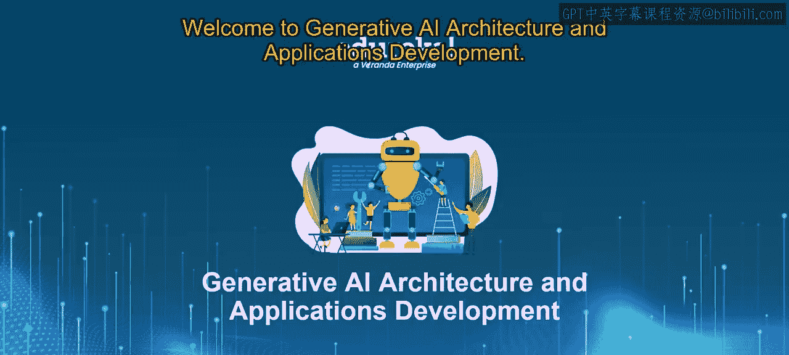
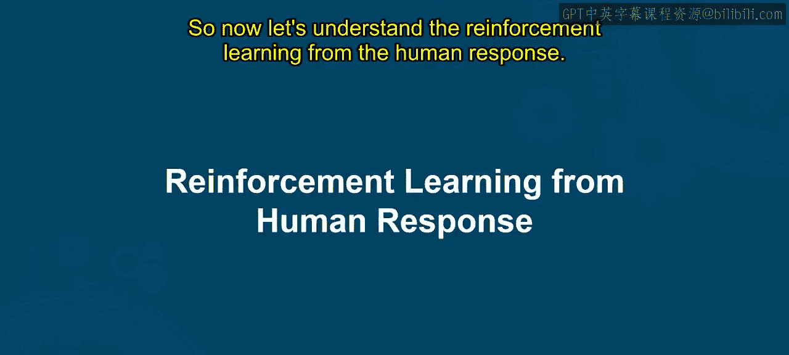
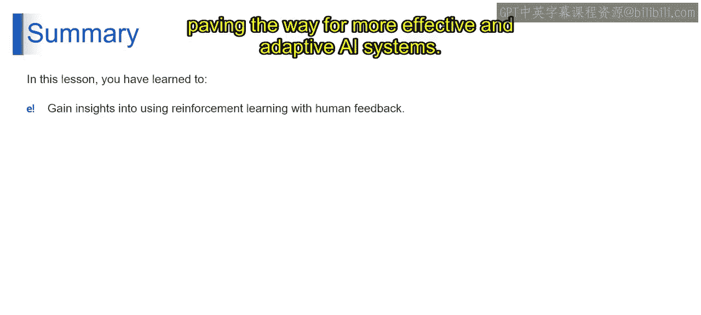

# Edureka《通过LLMs学习生成式AI（基础、应用开发、流行工具，第2、3、4课／共4课）｜Learn Generative AI with LLMs》中英 - P45：8_人类反馈强化学习.zh_en - GPT中英字幕课程资源 - BV1ym421V7gx

Hello everyone welcomelcome to generative AI Arch and applications development So now let's understand the reinforcement learning from the human response in this we are going to understand what exactly the reinforcement learning and what is reinforcement learning from the human response by the end of the session you are able to gain the insights into using the reinforcement learning with human feedback and you are able to learn have to create reward functions and address the challenges in R Hf so let's get started reinforcement learning from the human response before understanding RL Hf first let's understand what exactly the reinforcement learning is all about so imagine you are teaching a dog to perform tricks or a specific task when the dog successfully follows your command or the instruction。

😊。

You reward it with a treat if it doesn't， you don't give it a treat over the time the dog learns which actions lead to rewards and which don't and it adds its behavior accordingly。

😮，In a similar way， reinforcement learning is the type of machine learning where an agent learns to make decisions by interacting with an environment。

 The agent takes actions based on those actions it receives rewards or the penalities the goal is for the agent is to learn the best sequences of actions to maximize its total reward over the time。

 So in our example， the dog is the agent that tricks it performs are the actions。

 the traits or the rewards and the training process is the environment means the dog learns which actions leads to the trait that is nothing but the positive rewards and which tone which are interrupting but negative rewards similar to how a reinforcement learning agent learns from its interaction with the environment。

 So that's about reinforcement learning but what is。😊，RL HF。 so again。

 so imagine you are playing a video game where you control a character navigating through as。 Okay。

 so as you move the character， the game provides feedback based on your actions。

 if you successfully navigate through the image and reach the end， you receive points。

 if you make a wrong move or hit an abstract， you lose the points means now let's relate this to R L H。

 which is nothing but reinforcement learning from the human feedback。

 So RL HF is a type of reinforcement learning where instead of relying solely on predefined rewards from the environment。

 the agent receives feedback from the human。 the human provides feedback on the agent's action indicating whether they are good or the。

😊，Based on this feedback， the agent adjust its strategy to maximize its overall performance In our example。

 the player controlling the character is the agent。

 the maze and the obstacle or the environment and the feedback provided by the human player is the human response means the agent learns from this feedback to improve its decision making process and achieve better outcomes in the game。

😊，But what exactly the difference between the RL and RLHF so the main difference between the reinforcement learning and reinforcement learning from the human feedback lies in the source of the feedback in reinforcement learning the agent learns from the predefined rewards or penalties provided by the environment in the RL HF the agent receives feedback directly from the human allowing for more shades and targeted guidance in the learning process that is the main difference so now let's understand all these。

😊，The first one is of the agent， which is a driving force。

 so how exactly it works in our example let's say we are using RL HF to train a virtual assistant powered by the language model the virtual assistant interact with the users generating responses to their queries。

 the agent here is the language model and which takes inputs that is nothing but the user queries and generates the outputs that is nothing but the responses based on its learning policy means in RL HF。

 the agent here is our language model receives the feedback from the humans on their generated response。

 this feedback helps the agent understand which responses are effective and which one needs improvement by analyzing the feedback。

 the agent adjusts its policy that is nothing but decisionmaking strategy to generate the better responses in the future。

😊，s understandingstand the behavior of this agent is crucial in RLH as it enables us to optimize its learning process and enhance its performance in generating the responses。

 Then the next one is of environment here， humans as catalyst So in our example scenario。

 the environment in RLHF is represented by the interaction between the virtual assistant that is agent and the human users。

 so humans provide feedback through their responses to the assistant generated outputs which serves as a rewards or penalities。

 this human- driven environment shapes the learning process of the virtual assistant means in RLH humans act as the catalyst in shaping the environment for the agent that is nothing but virtual assistant their interactions with the assistant provide a valuable feedback influencing the。

Learning process means understanding the dynamics of this human driven environment is very。

 very important while optimizing the assistance， learning and improving its performance and generating the response。

 then the next one is of action space means crafting possibilities。 So what exactly happens here。

 So considering our same example scenario， the action space refers to the range of response that the LLM。

 it is nothing but virtual assistant can generate in respond to user queries。

 it encompasses all the possible outputs that the LLM can produce based on its learned policy means in RlHF exploring the action space involved analyzing the various responses the various response options available to the LLM for a given prompt by understanding and exploring the space begin enhance the。

😊，adaapability and versatility of the LLM， allowing it to generate more diverse and effective responses to the user queries。

 then the next one is of state space it is information nexus so in considering our example scenario the state space refers to the comprehensive collection of information that includes details from the user prompts the history of previous interactions and the initial state of the LLM it serves as a repository of rich contextual information relating to the technical definition in RLH understanding the state space involves analyzing the prompt details dialogue history and internal state of the LLM deciing this information is important for refining the contextual understanding of the model enabling it to generate more accurate and contextually relevant responses then。

😊，The next two one is of reward function， which is mapping success so the reward function plays an important role in mapping the responses generated by the LLM to reward or penalities based on the human feedback it helps guide the learning process by reinforcing the desirable behaviors and discouraging undesirable ones means in RLHF。

 the reward function is responsible for mapping the actions taken by the LLM to rewards or the penalities based on the human feedback this function guides the learning process by providing the LLM with the feedback on its performance。

 helping it learn and improve over the time navigating the complexities of reward function is very important for ensuring effective learning in the RLHF So these all are the main points involved in the RLHF。

😊，So coming to the challenges faced by RLHHf， it include limited availability of human feedback data。

 designing effective reward functions， ensuring fairness and mitigating the biases in feedback。

 maintaining user privacy and security and scalability of RLHHf systems to handle large scale data and diverse feedback sources。

 additionally optimizing human AI interactions and addressing the interpretability of RLHHf model。

 post significant challenges， but how to overcome all this。

 so addressing challenges in RLHHf involves maximizing limited human feedback through active learning。

 refining reward functions automatically improving human AI interactions， mitigating the bias。

 ensuring privacy and scalability， using distributed computing environments or the resources so these strategies。

😊，Enhance effectiveness， fairness and scalability of RL systems。

 fostering more robust AI learning from the human feedback。 Now， advanced research frontiers。

 The first thing learning reward functions automatically means developing techniques to automatically learn effective reward functions from the limited feedback data reducing the need for manual design efforts。

 This streamlines the reinforcement learning process and makes it more adaptable to various tasks and environment。

 then multi-agent reinforcement learning means expanding the scope of reinforcement learning beyond the human AI interactions to scenarios involving multiple Ral agents。

 This facilitates collaboration or competition among the agents。

 enabling them to tackle complex tasks collectively。 then the distributed reinforcement。😊。

ningFrom the human feedback， implementing the distributed R across the multiple devices or users to leverage diverse feedback data while maintaining privacy and security So this allows for more comprehensive learning experiences while ensuring data protection and confidentiality Now。

 the summary， in this module， you have delved into the realm of the reinforcement learning with human feedback Exp its shades and supplications through various topics you have gained a deeper understanding of how reinforcement learning can be enhanced with human interactions paving the way for more effective and adaptive AI systems。

 Thank you。😊。

