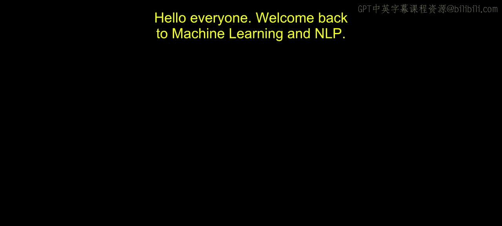
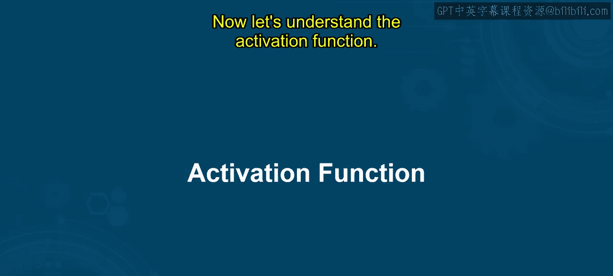
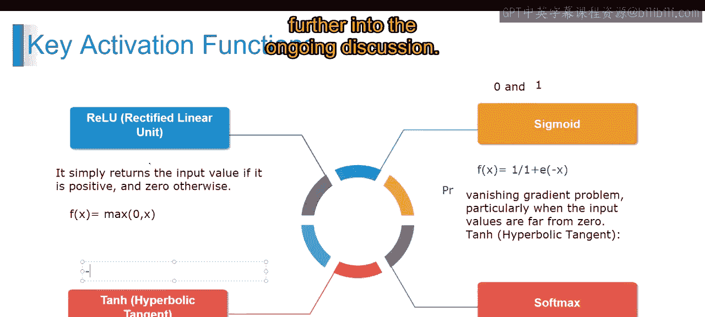

# Edureka《通过LLMs学习生成式人工智能（机器学习和NLP基础，第1课／共4课）｜Learn Generative AI with LLMs》中英字幕 - P46：45_激活函数.zh_en - GPT中英字幕课程资源 - BV1q4421Q7qh

Hello everyone， welcome back to machine learning and NLP。

 So now let's understand the activation function In this we are going to cover the introduction to activation functions and common and advanced activation functions in Tensorflow by the end of the session you will be able to identify role and variety of activation functions in Tensorflow and able to select and implement the appropriate activation functions in Tensorflow models So let's get started。

 first let's understand what exactly an activation function is all about activation function in deep learning are mathematical functions applied to the output of each neuron in a neural network layer the introduced nonlineity into the network allowing it to learn complex patterns and the relationships within the data activation functions are crucial for enabling neural network to appropriate。

😊。

Arbitrary function and make them capable of learning from the data。

So consider a simple neural network with the hidden layer。

 each neuron in the hidden layer receives inputs from the previous layer and performs weighted sum on the inputs and applies to an activation function to produce the output without an activation function the neural network would simply perform the linear operations or transformations and the entire network would collapse into a single linear transformation making it capital of learning complex patterns means technically activation functions are typically nonlinear functions applied element bias to the output of the neuraln in the neural network layer they introducelineity into the network allowing it to model complex relationships in the data popular activation functions include Relu sigmoid tanh soft masks we are going to discuss all this in the upcoming slides each。

😊，Actation function has its own characteristic and it's suitable for different types of problems and architecture。

 So let's understand all this in a brief so understanding the activation function in deep learning so activation functions are fundamental components of neural networks responsible for determining the output of your neural。

😊，Ro that is neuron， given a set of inputs， they introduce non nonlinearity into the network。

 enabling it to learn complex patterns and relationships within the data。

 So Tensorflow and activation function。 So Tensorflow being a comprehensive library for deep learning provides a wide range of built in activation functions that can be used within the neural network architecture。

 So what are the components in it then an activation function denoted as a forex。😊。

Opers on the input data。And produces an output So what exactly is this neuron let's understand all this let's break down its component。

 The first one is of input This refers to the input data that is fit to the activation function it could be the output of the previous layer in the neural network or the initial input data coming to the output the output of the activation function is the result of applying the function to the input data it represents the transformed or activated value of the input coming to the neuron in the context of neural network。

 the activation function is typically applied to the output of each neuron in the layer the neuron performs evaded some of its inputs and applies the activation function to produce its output for example。

 means activation function are essential components of neural network。😊。

Enabling them to learn complex patterns and relationships in the data with Tensorflow extensive library or built in activation functions developers have the flexibility to choose and complete the most suitable activation function for this specific deep learning tasks so now let's understand the common activation functions in Tensorflow so these are the most common activation functions Relu nothing but rectified linear unit sigmoid tanh it is also known as hyperbolic tangent and softs so let's understand all this clearly So Relu it is one of the most widely used activation function in deep learning it simply returns the input value if it is positive and zero otherwise。

😊，Relu activation function returns the input value if it is positive and0 otherwise mathematically relu activation can be represented as so in simply mathematically relu can be represented as a4es equal to match of0 comma x。

 it helps alleviate the vanishing gradient problem and accelerates the training of deep neural networks Relu is efficient computationally and involves sparse activations。

😊，Promoting sparsity in the neural network。 So that is all about the re activation function。

 So coming to the sigmoid activation function it is also one of the commonly used activation function。

 especially in binary classification task， specially designed for binary classification task it crashes the input value between the zero and1 making it suitable for binary classification outputs。

😊，So mathematically sigmoid can be represented as a of x is equal to 1 divided by 1 plus e to the per of minus6 sigmoid activations are smooth and differentiable。

 making them suitable for gradient based optimization algorithms like back propagation。

 however sigmoid activation suffers from vanishing gradient problem。

 particularly when the input values are far from the zero。😊，So。

 this is what the problem with the sigmoid they are suffering with vanishing gradient problem so that's all about the sigmoid coming to the tanh tanh is similar to the sigmoid function but scratches the input values between minus1 to 1 where sigmoid values ranges between0 and 1 where tanh ranges from minus1 to 1 so the upcoming video will delve further into the ongoing discussion。

😊。

