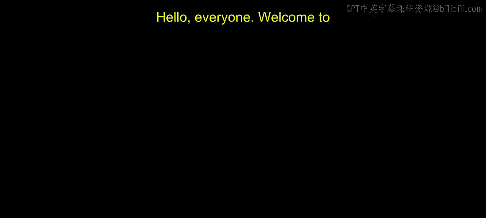
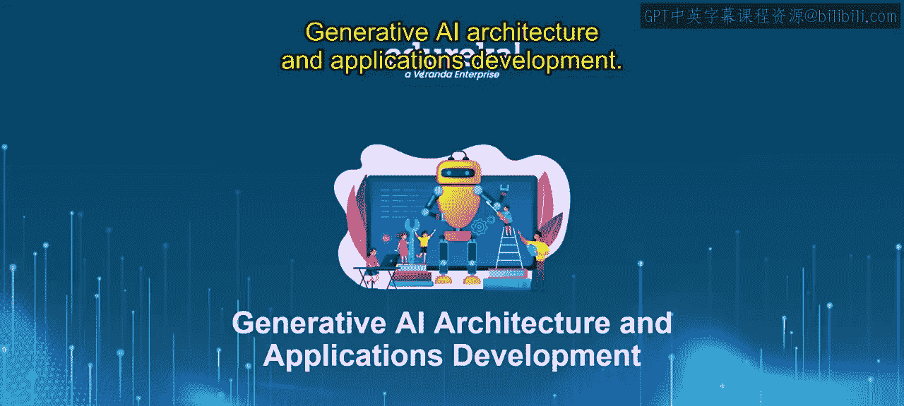
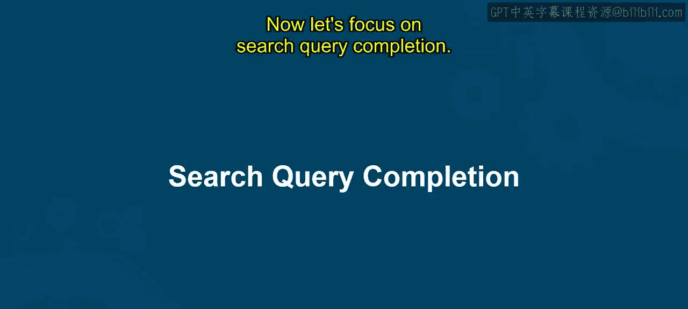
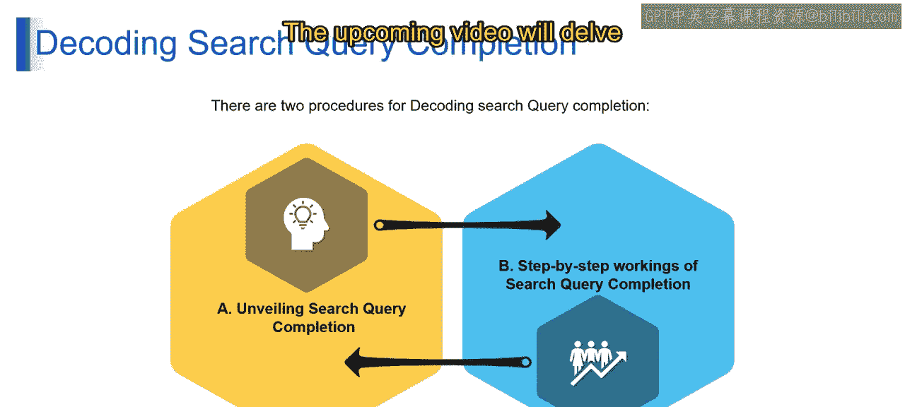

# Edureka《通过LLMs学习生成式AI（基础、应用开发、流行工具，第2、3、4课／共4课）｜Learn Generative AI with LLMs》中英 - P46：9_搜索查询补全.zh_en - GPT中英字幕课程资源 - BV1ym421V7gx

Hello everyone welcomee to Generative AI architecture and applications development so now let's focus on search query completion in this we are going to understand how exactly the search query completion happens by the end of the session you are able to understand the concept behind the search query completion and also about the information retrieval system so let's get started the search query completion so let's start with a simple example we can all relate to so imagine you are typing a search query you start with how to make for example if you are opening Google Chrome。

😊。

And if you are tyling how to make so you can see I'm getting suggestions like how to make a website。

 how to make make Google form and how to make PT and all these things right so means before you even finish typing the search engine magically suggesting something so how does it know that I am searching for something like this So that's a magic of search query completion powered by the AI So now let's break down the technical side of this marvel so we are talking about something called language models so often appreavated as LLMs so these are like super smart algorithms that understand and interact with the human language so they are the secret source behind enhancing are experience with the technology so these LLMs play a crucial role in improving search query completion。

😊，It's like having a personal assistant that can predict what you are about to ask making your search faster and more efficient so as you type your search。

 the LLM start predicting the next word based on its understanding of the language pattern It's like having a friend who knows you so well they can finish your sentence also the real magic lies in the LLM's ability to anticipate and comprehend human language the anticipation is like predicting what comes next and the comprehension is about truly understanding the context of what you are asking so this synergy but anticipation and the comprehension makes your interaction with the technology feel almost telepathic so when you type how to make the LLM not only anticipates you might be looking for a recipe but also you are looking something like you know Wikiia。

😊，Or whatever it is but what exactly it is doing okay so when you are typing how to make the LLM not only anticipate you might looking for a recipe but also comprehend like you know you may looking for website or you may looking for something all some popular choices it's like having an AI mind reader but in the good way so and there you have it the magic behind the search completion search query completion with AI language models it's not just about predicting the word it's about understanding you and making your interaction with the technology as smooth as possible So now let's understand the decoding search query completion so there are two processes for the decoding search query completion the one is that unveiling search query completion and step by step working with the search query completion so let's understand this two so when we say unveiling search query completion。

😊，So ever wondered how your search engine seems to read your mind so well that's a magic of search query completion。

 So let's unveil the process behind it。 So imagine the same thing you are typing a search query and the suggestion start popping up magically So how does it even happens The first step is understanding your input。

 the system carefully analyzes the words you have entered typing trying to predict what you might be looking for。

 It's like having a conversation birth a really attentive in who finishes your sentence because they just get you means the magic lies in the intelligent prediction the system uses sophisticated algorithms and the language models to predict the most likely next words in your search based on what it's learned from the vast amounts of the data It's not just completing your sentence it'。

Pleaing your thoughts。 then the step B is step by step working of search query completion。 Yes。

 so now let's break down the mechanism behind search query completion step by step。

 This is where the real technical ward comes into play。

 So as you type the system begins by analyzinging each word in real time。

 It's like a detective examining clues to figure out what you are searching for。

 So next are trusty language model kick in。 These are the brains behind the operations Preing what words are likely to follow based on the patterns they have learned from the tons of the previous data。

 It's like having a well-train assistant who knows the language inside and out。

 Once the predictions are made the system ranks them by relevance and displays the most likely option。

 It's like having your personal assistant presenting you with the。

caseses for your next move and here is the cool part。 it's happening in real time。

 The system adapts as you type refining its predictions with easy keystr。

 it's like search engine that's always learning and evolving。

 So the upcoming video will delve further into the ongoing discussion。😊。

