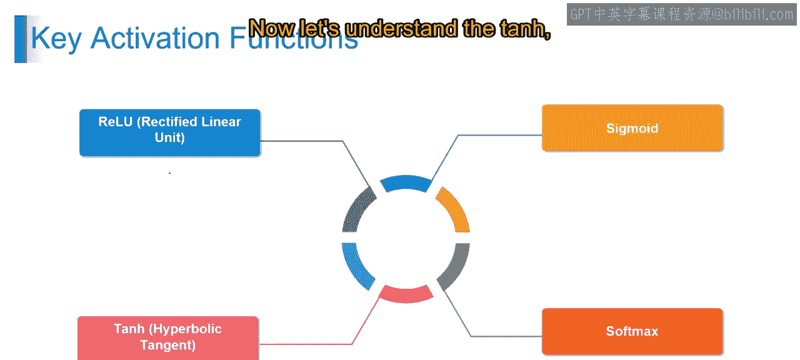
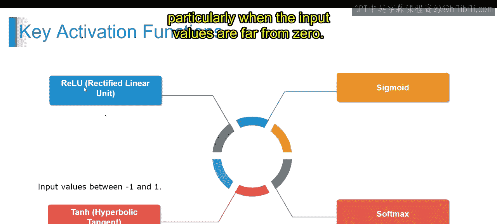
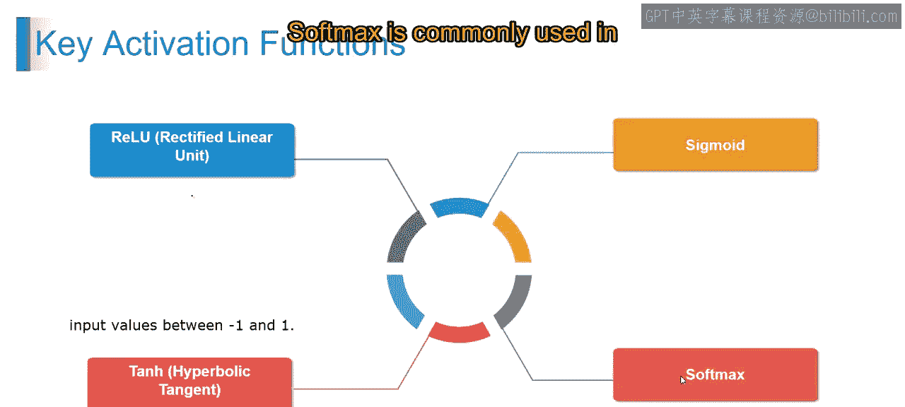
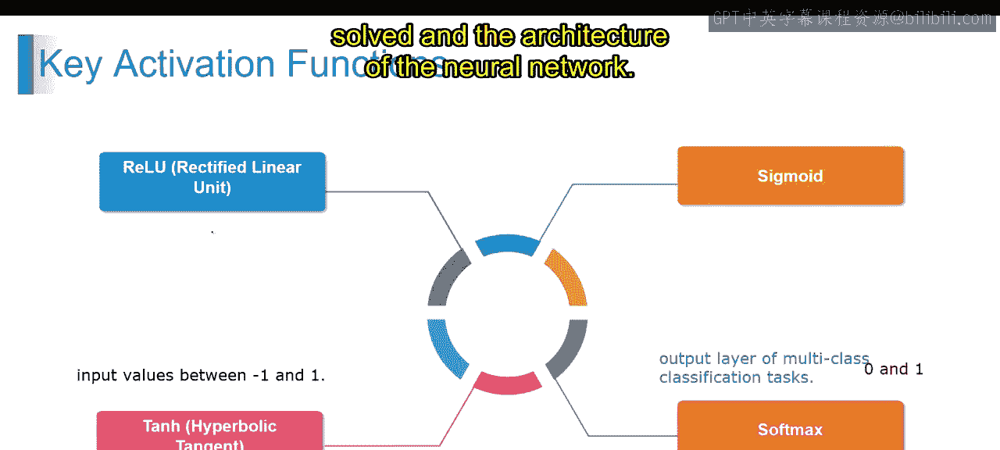
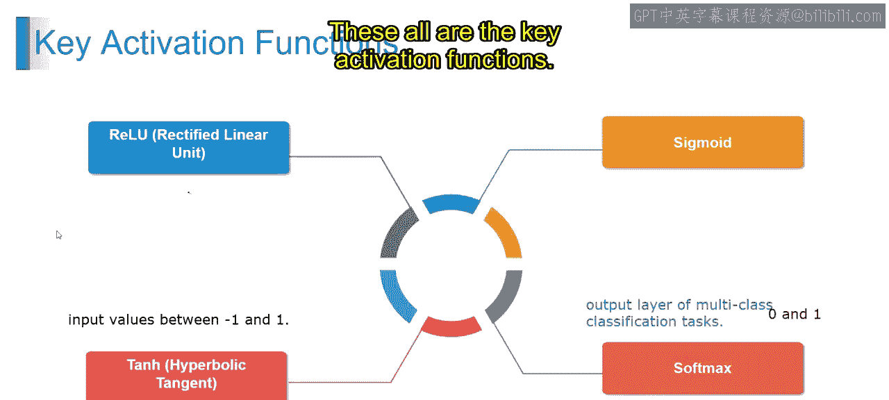
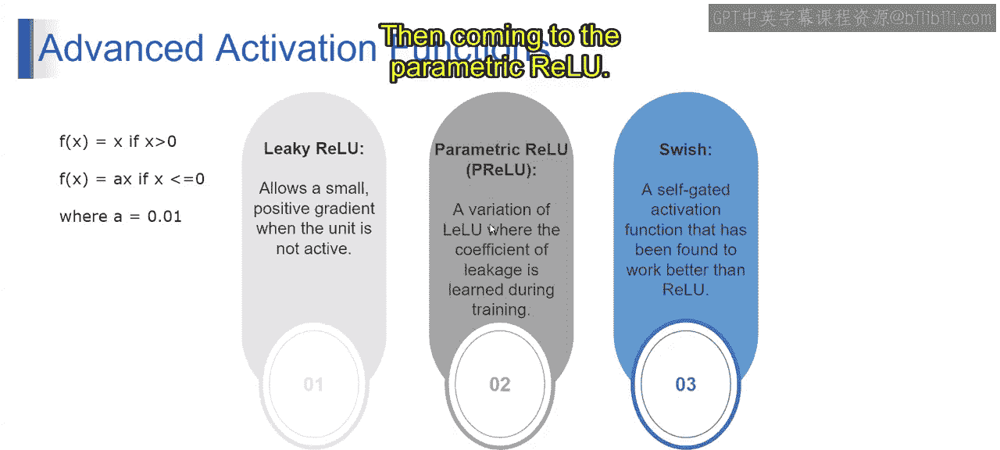
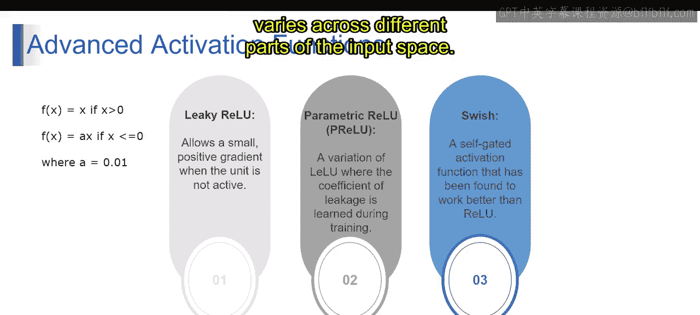
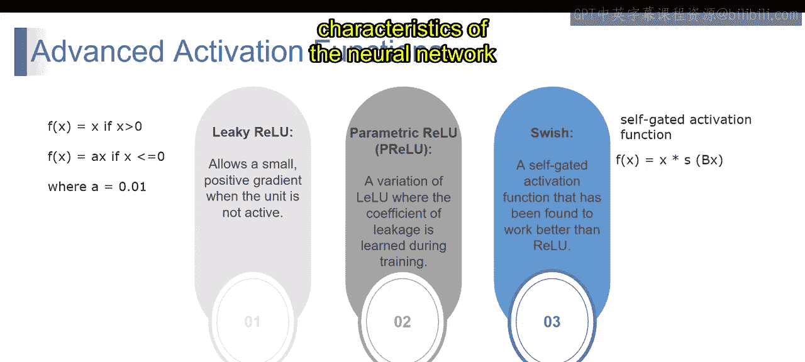
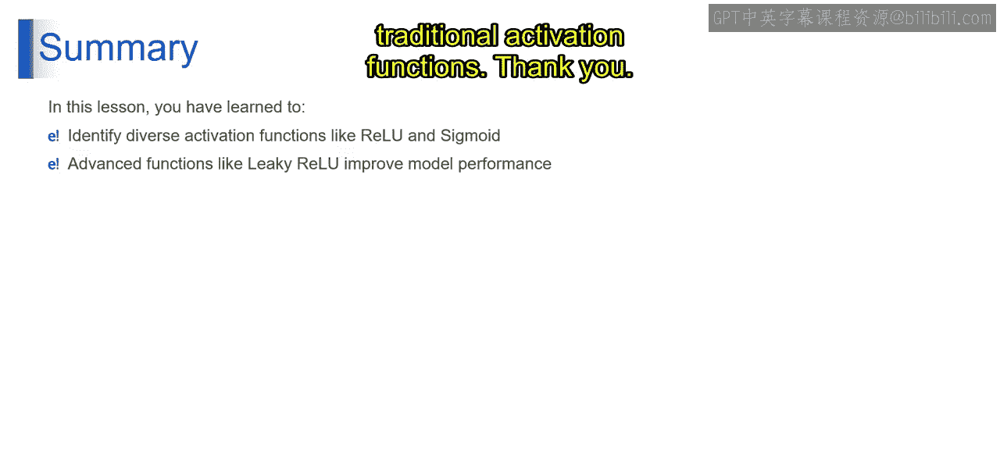

# Edureka《通过LLMs学习生成式人工智能（机器学习和NLP基础，第1课／共4课）｜Learn Generative AI with LLMs》中英字幕 - P47：46_高级激活函数.zh_en - GPT中英字幕课程资源 - BV1q4421Q7qh

So now let's understand the tanh that is nothing but hyperbolic tangent The tanh is similar to the sigmoid function but sques the input values between minus1 and plus1 mathematically tanh can be represented as a4x is equal to e to the over of x minus e to the over of minus x divided by e to the over of x plus e to over of minuss so tanh activations are0cented making it easier for the model to learn comprehend two sigmoid activations like sigmoid tanh activations are also smooth and differentiable suitable for gradient based optimization algorithms however tanh activations are suffer from the vanishing gradient problem particularly when the input values are far from0 Now the next one is of softm function Som is common。

used in the output layer for multi class classification task it converts the rose scores into probabilities by squing them between the0 and1 here also the values arerring between0 and1 ensuring the sum up to one means it converts the row scores into probabilities by squing them between the0 and1 ensuring that the sum up to one Som is mathematically defined us as f of Xi is equal to E to the power of X divided by sumation of J e to the power of Xj for each class in I Somax activation enable the model to output probability distributions over the multiple classes facilitating easy interpretation and decision making softmax activations are differentiable making them suitable for gradient based optimization。

😊，During the training process so these common activation functions play a very important role in neural networks。

 enabling them to learn complex patterns and make predictions choosing the appropriate activation function depends on the specific characteristics of the problem being solved and the architecture of the neural network so these all are the key activation functions。

So now let's understand advanced activation functions。

 That is the first one is of leaky relu and parametric relu Swish。 First。

 let's understand about the leaky relu。 leaky reo is an extension of relu activation function。

 it allows a small positive gradient， when the input is negative preventing the dying relu。

 the problem where the neurons always output 0。 So here two cases persist。

 f of x is equal to x when if x is greater than 0。 And f of x is equal to。😊。

Alpha x if x is less than a is equal to0 or you can take it as alpha you can consider as a。

 so let's understand now clearly leaky re allows a small positive gradient when the input is negative preventing the dying relu problem where neurons always output 0 mathematically leaky relu can be represented as f of x is equal to x if x is greater than 0 and it is going to be the alpha x if x is less than a is equal to 0 where a is a small constant typically a small positive value like 0。

01 by allowing non-zero gradients for negative inputs leaky relu addresses the issue of dead neurons and helps improve the performance of the deep neural network that is about the leaky relu then coming to the parametric realm。

😊。

So parametric re is a variation of leaky re where the coefficient leakage is learned during the training instead of being fixed constant here we provided a fixed constant but in this is also known as PR re okay in this the alpha value is parameterized and optimized along with the other model parameter during the training process。

 this adaptability allows the network to learn the optimal value of alpha for each neuron making it more flexible and effective in different scenarios Parametric relu can be particularly useful in tasks where optimal amount of leakiness varies across different parts of the input space here as you mentioned the alpha is learned during the training instead of having a fixed value Okay so that's about parametric re then coming to the swa。

😊。

Swiwish is a self gated activation function suggested or proposed by Google researchers。

 It has been found to perform better than Relu in many scenarios。 Okay。

 so mathematically Sw can be represented as a x is sQl to x into consider this as a sigma S as a sigma multiplied by beta of。

 Okay， where sigma is the sigmmaoid function and beta is the hyperparameter that controls the smoothness of activation。

 Swish is easy to implement computationally efficient and has been shown to improve both training speed and performance compared to relu。

 However， Sw has more parameters to learn compared to relu。

 which may increase the complexity of the model means this advanced activation functions offer improvements over the traditional re by。

😊，Addressing some of its limitations and enhancing the performance of deep neural networks choosing the appropriate activation function depends on the specific requirements and characteristics of the neural network and problem being solved so these all are the advanced activation function so now the summary in this lesson you have explored a variety of activation functions including relu and sigmoid and understanding and many more their roles in network Additionally。

 you have delvet into advanced functions like leaky relu Tech their capabilities to enhance model performance by addressing limitations of traditional activation functions。

😊。

Thank you。