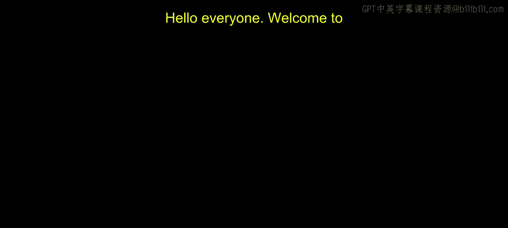
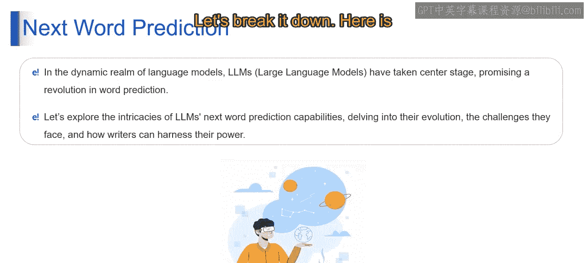
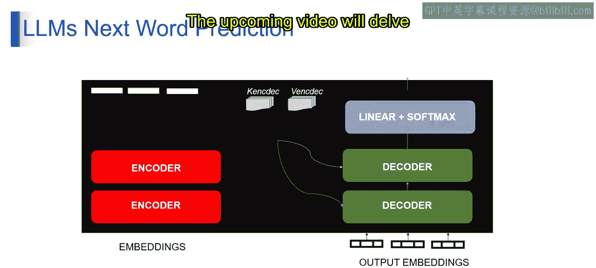

# Edureka《通过LLMs学习生成式AI（基础、应用开发、流行工具，第2、3、4课／共4课）｜Learn Generative AI with LLMs》中英 - P48：11_下一个词预测.zh_en - GPT中英字幕课程资源 - BV1ym421V7gx

Hello everyone welcomee to generative AI architecture and applications development So now let's understand the next word prediction in this we are going to cover the next word prediction using the LMs by the end of the session you are able to understand the methods used for the next word prediction in the natural language processing so let's get started the next word prediction so let's use a simple example imagine you are texting a friend about the movie you start typing the movie were so and the magically yourphone such good before you even finish it right so how does it know that you are about to type either good or excellent so let's break it down。

😊。

So here is the encoder decoder architecture。 So what happens here。

 So as you start typing your phone predicts the next word， making it super convenient。

 It's like having a smart friend， who knows what you are about to say in this case it predicts good or excellent the movie was so good or the movie was so excellent because it makes sense in the context talk talking about the movie。

 So technically the first thing is of encoder， which is embeddings here。

 So it all starts with the encoder， think of it like the brain behind the scenes。

 It turns your words into the secret quotes known as the embeddings。

 It's like giving each word a unique fingerprint capturing its meaning。

 So when you type the movie was so the encoder transforms the movie words into the clever codes。

 then what happens， then output embeddings。 that is nothing but the decoder。 so。😊。

It's like the second part of the brain， it takes those encoded words and turns them into the predictions picture it as a word wizard guessing what comes next the magic happens with a combination of the recording the linear transformations and the software functions so when you are typing the decoder suggests good because it's like it's the most likely next word based on the patterns it learned it's not just guessing it's like having a mini language genius in your phone so in this what exactly the linear and also the soft mask。

😊，So the linear transformations and the Som functions work together in the decoder part。

 which acts like a word results， predicting the next word in a sequence means the linear transformation imagine the encoded words like the secret codes。

 whatever we discussed for the movie with so from the encoder are fed to the decoder as a line of numbers the linear transformation act like stretching and sezing the machine it takes that line of numbers and stretches or compresses each value based on the learn patterns。

 so this does not create new information but it adjusts the importance of each encode word for predicting the next word then word about this Som function then So after the linear transformation you have a line of adjusted numbers but they don't directly tell you the probability of each word being the next word the Somax function takes these adjusted values and converts them in。

😊，to the probabilities imagine putting them in a magic machine that turns them into the percentages all summing up to the 100 percent the word with the highest probability become the predicted next word so the upcoming video will delve further into the ongoing discussion。

😊。

