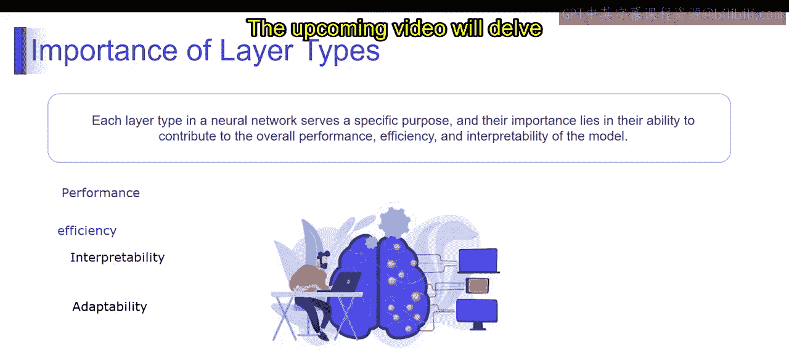

# Edureka《通过LLMs学习生成式人工智能（机器学习和NLP基础，第1课／共4课）｜Learn Generative AI with LLMs》中英字幕 - P48：47_层类型.zh_en - GPT中英字幕课程资源 - BV1q4421Q7qh

Hello everyone welcome back to machine learning and NLP basics so now let's understand the layer types in this we are going to cover importance of the layer types and what are the different types of layer types available and what are the uses of layer types by the end of the session you will be able to explore the diversity and applications of various layer types and comprehend the crucial role and versatility of layer types and able to delve into AI systems driven by functional principles and applications so let's get started before understanding the importance of the layer types what exactly a layer type is all about so the layers what exactly the layers in deep learning so the layers in deep learning refers to the building blocks of neural networks responsible so transforming input data into meaningful outputs。

Through a series of mathematical operations， they organize neurons into group and determine how information flows through the network。

 For example， imagine building a neural network for image classification Each layer of the neuron processes the input image Imagine you are building a neural network for image classification Each layer of the network processes the input image in the step by step manner extracting features at different levels of abstraction the initial layer might detect simple patterns like edges and curves while the deeper layers identify more complex structures like shapes and objectives Similarlyly in technical terms layers in the neural network is a collection of neurons organized in a specific architecture Each neuron in a layer receives inputs from the weighted sum of these inputs apply。

to an activation function in technical terms， a layer in a neural network is a collection of neurons organized in a specific architecture Each neuron in a layer receives input performs vital some of these inputs applied to an activation functions to the sum and then produces the output the outputs from one layers serves as an input to the next layer creating hierarchical representation of the input data so the layers in deep learning provide abstraction and hierarchy to neural networks allowing them to learn complex patterns and relationships in the data by organizing neurons into layers and stacking them sequentially neural networks can model increasingly sophisticated functions and make accurate predictions across the various domains so now let's understand the importance of layer types。

The importance of layer types in neural networks stems from their specialized functionalities which collectively enhances the model performance efficiency and interpretability each layer cells as a distinct purpose contributing uniquely to the overall architecture and capabilities of the model here so these are the capabilities pena performance different layer types enable the neural network to capture diverse aspects of the input data allowing for more effective feature extraction and representation learning for instance convolutional layer Excel at capturing spatial patterns in the image data while recurrent layers are well suited for processing sequential data such as text or time series then the efficiency by leveraging the specific layers types tailored to the characteristics of the data and。

The task at hand neural network can achieve better computational efficiency， for example。

 pooling layers reduce the spatial dimensions of feature maps leading to a reduction in computational complexity and memory requirements thereby improving efficiency during the training and inference then the next one is of interpretability certain layer types enhance the interpretability of neural networks by facilitating the insight into the models decision making process for instance attention mechanism in transformer architecture enable the model to focus on relevant parts of the input sequence providing transparency into the reasoning behind its prediction then adaptability the availability of diverse layer types allows the neural network to adapt to various types of the data。

And tasks making them versatile across different domains and applications adaptive layer types such as normalization layers or dropout layers enable the model to learn robust representations and generalize well on unseen data so the importance of layer types lies in their collective contribution to the performance efficiency interpretability and adaptability of neural network models by understanding the characteristics and functionalities of different layer types they can design and configure neural networks effectively to meet the specific requirements of the application so the upcoming video will delve further into the ongoing discussion。

