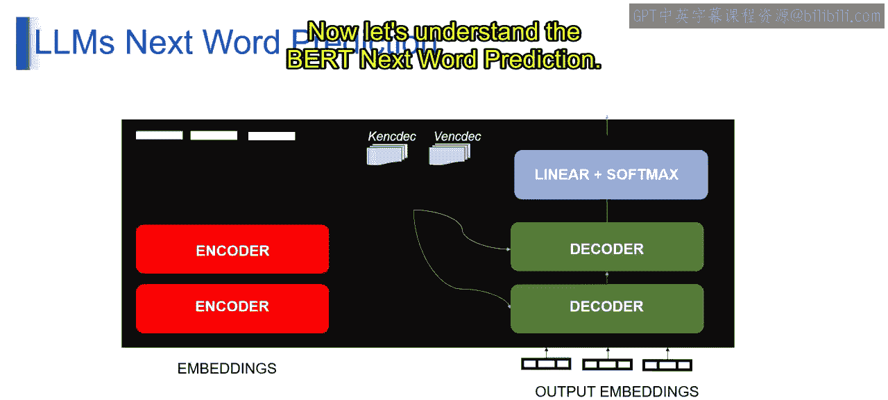
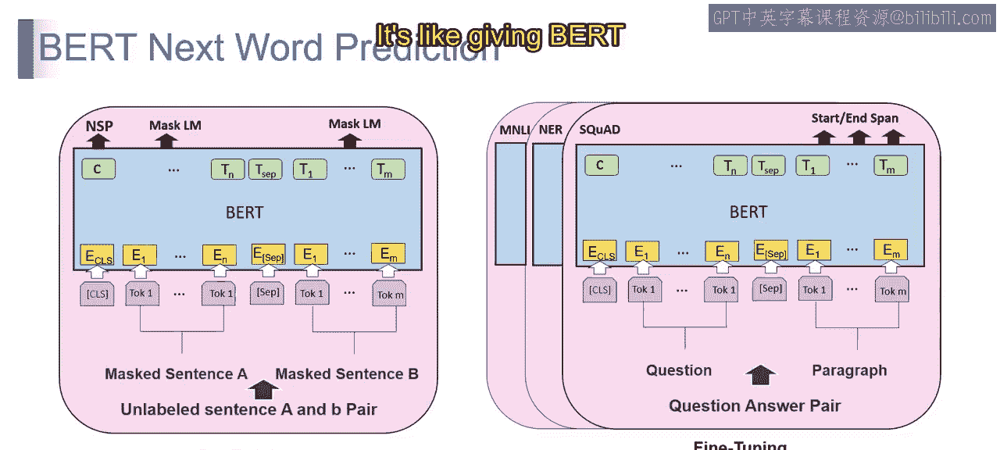
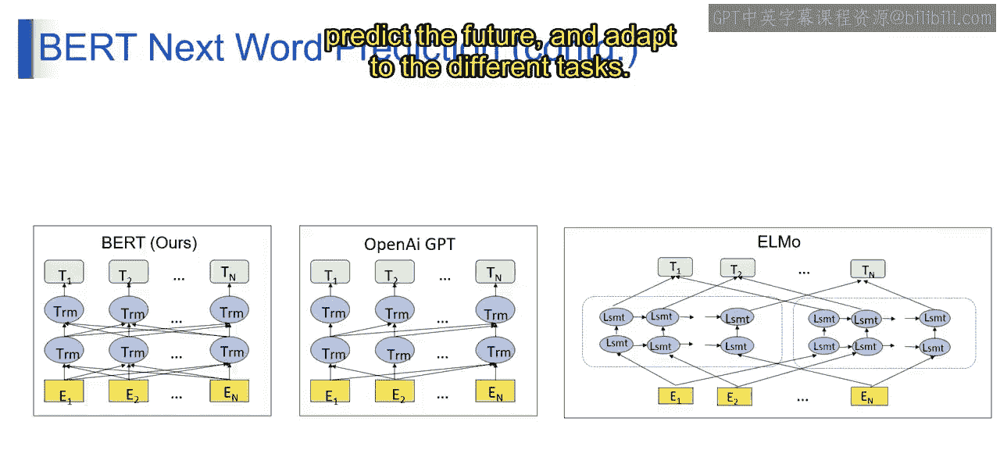
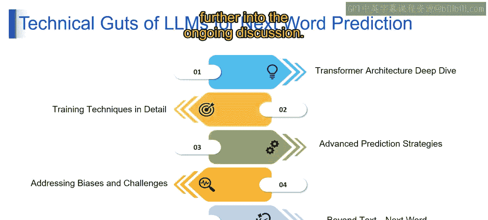

# Edureka《通过LLMs学习生成式AI（基础、应用开发、流行工具，第2、3、4课／共4课）｜Learn Generative AI with LLMs》中英 - P49：12_线性Softmax.zh_en - GPT中英字幕课程资源 - BV1ym421V7gx

Hello everyone welcome back So now let's understand the linear plus softms what exactly it is So the linear transformation and softmax function work together in the decoder part which acts like a word wizard predicting the next word in a sequence So what exactly the linear transformation will do here So imagine the encoded words like a secret codes from the encoder are fed into the decoder as a line of words the linear transformation acts like a stretching and sezing machine it takes all the lines of the numbers and and stretches or compresses each value based on the learn patterns this does not create new information but it adjusts the importance of each encoded word for the predicting the next word so what about the softmax function then so after the linear transformation you have a line of adjusted numbers but they don't directly tell you the probability of each word being the next one。

😊，So the softm function takes these adjusted values and converts them into the probabilities。

 So imagine putting them in a magic machine that turns them into percentages all summing up to 10 percent the word with the highest probability becomes a predicted next word means when we are combining these two the linear transformation helps the decoder focus on the most relevant information from the previous words。

 the softmax function transforms this information into clear probabilities。

 allowing the decoder to choose the most likely next word like a word wizard in simple terms linear transformation adjust the importance of the words for the prediction while the softm function turns those adjustments into percentages like a voting system for the next word together the word like a team to make the word wizard into the phone predict the next word accurately so now let's understand。

😊。

The bird next word prediction， it contains mainly two parts pretrain and also the fine tu so what exactly the pretrain can do here。

😊，It starts by predicting the words in a sentence， but here is a twist。

 Some words are masked with a mask。 It's like playing a hide and seek with the words。

 B has to figure out what's a hidden based on the words around it。

 This helps the model learn how words relate to each other in different situations。

 Then the next one is of the fine tu。 So B wants to be not just a wizard， but a task specific ward。

 It practices with a different task like answering questions or identifying the exact word positions。

 It's like giving bird a job and tailoring its skill for the job。😊。

So now let's understand the architecture for pretraining for the different models for different styles。

 So it introduces a different architecture used during the birth training process。

 Think of these as different styles of learning for our language wizard。 So B Rs。

 So this is original bird。 like the wise old wizard in our story。

 It looks at the whole sentence at once and uses stagged encoders to understand the words and the relationships。

 Then the next one is of open AI GPT。 So imagine a wizard who reads from the left to right。

 That's about the G。 It uses a single decoder block to predict the next word taking things one step at a time。

 Then the next one is of Elmo。 So Elmo stands for embedding from language models。

 It is a technique used in the NLP to represent the words considering their content。 In our case。

 the Elmo is。😊，Wizard with a unique style it uses bidirectional LSTM to understand the words capturing the context in a different way means word plays hide and seek with the words to understand them in context during the pretraining and fine tuning tailors words skills first specific tasks like predicting the next word。

 then the different architectures offer various ways for our language wizard to learn each with its own strands and weaknessness。

 So that's a magic behind the words next word prediction。

 It's like training language wizard to understand words predict the future and adapt to the different tasks。

 So now let's understand the technical guts of Lms for the next word prediction。

 The first one is of transformer architecture deep dive。😊。

So the transformer architecture think of it like the brainy blueprint of our language model instead of prepoing words one by one。

 it's like having a supersmart multitasking brain that looks at the entire sentence at once it uses tagged encoders to understand words and the relationship so it's not just reading left to right it's like having a panoramic view of the sentence capturing all the details in a one go that's about the transformer architecture detail。

 then the next one is of training techniques in detail。

 so now it's pull back the curtain on the magic of the training so it involves a technique calledmaed language model imagine playing a word game where some words in a sentence are hidden which are masked the model tries to guess these hidden words based on the context It's like a word detective game helping。

😊，Our language model learn how words fit to gather in different situations。

 So this technique provides a strong foundation for understanding the language as well as context then the next one is of advanced prediction strategies Our language model is not just about guessing the words It's about predicting with styles it uses techniques like beam search to explore multiple word options at once and selects the best ones based on various criteria It's like having a word explorer that does not settle for the first guess but carefully selects the most promising predictions making your next word predictions more accurate and also the stylish then the next one is of addressing biases and challenges Our language model wants to be fair and unbiased。

 It's like a responsible wizard The model undergo special training to recognize and minimize the biases ensuring that predictions are drill and considerate。

It's like teaching our wizard to be fair and treat everyone equally in the language kingdom then the next one is of beyond text next word prediction in other domains so lastly our language wizard does not just predict the words in a sentence it can also venture into the other domains It's like our wizard putting on different hats for various tasks whether it's predicting the next musical note or the next chmo our language model can adapt and predict in different domains showcasing its versatility beyond the just text so the upcoming video will delve further into the ongoing discussion。

😊。

