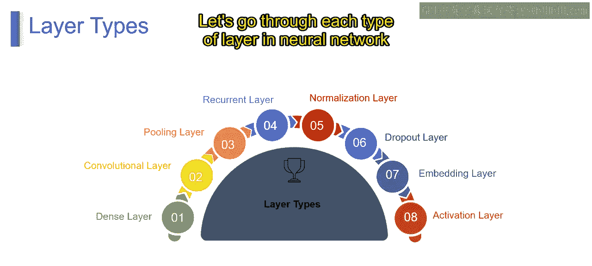
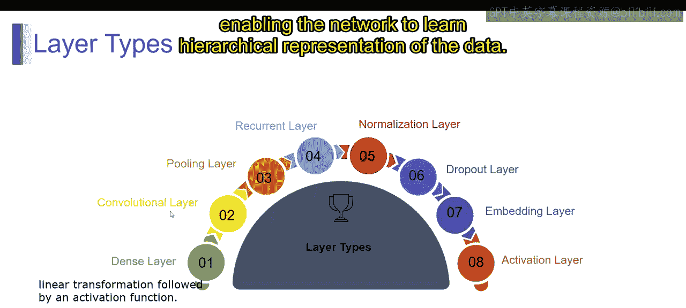
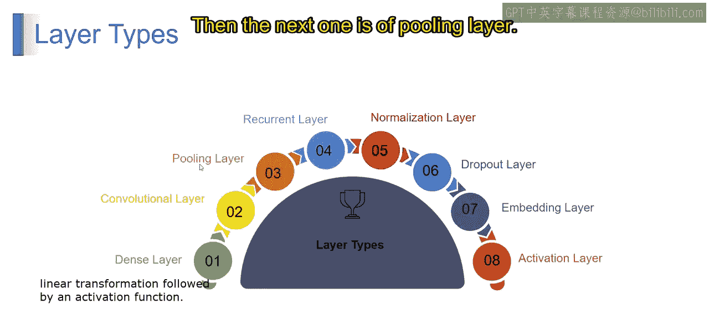
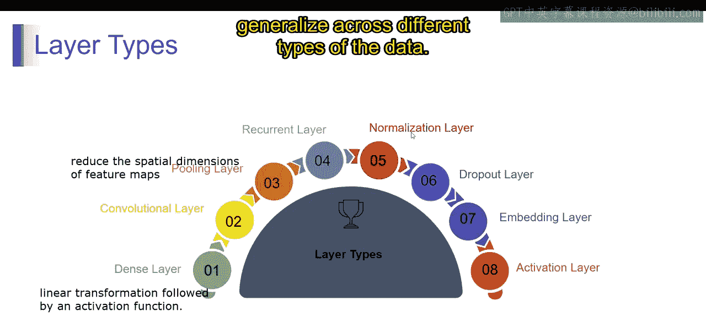
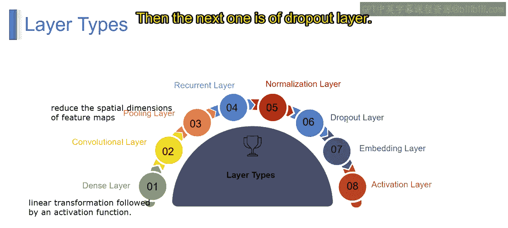
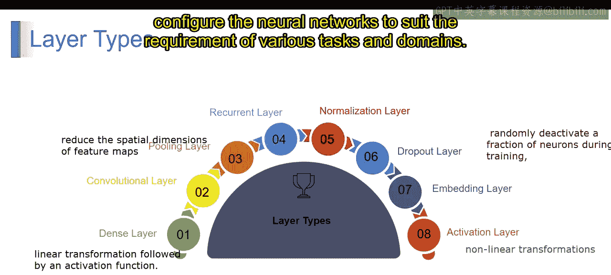
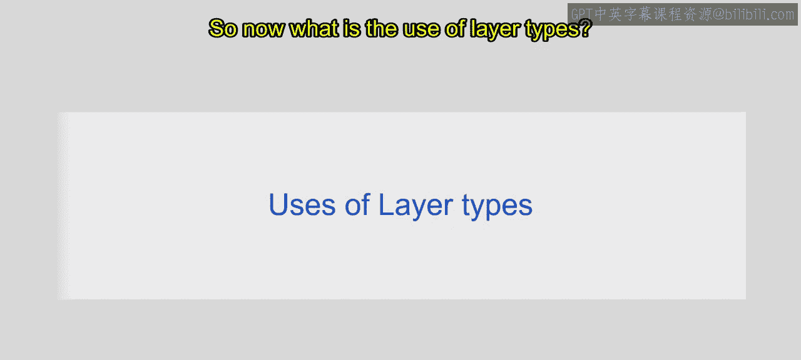
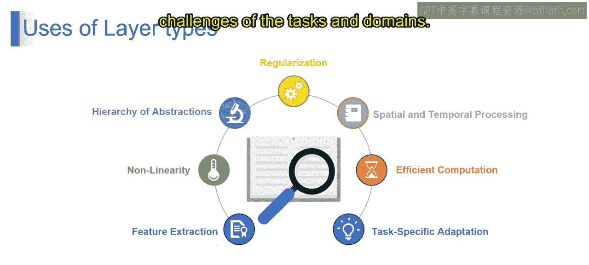
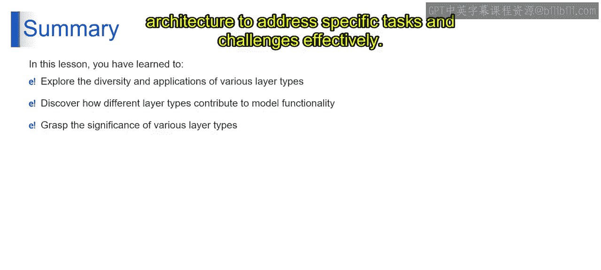

# Edureka《通过LLMs学习生成式人工智能（机器学习和NLP基础，第1课／共4课）｜Learn Generative AI with LLMs》中英字幕 - P49：48_层类型的种类.zh_en - GPT中英字幕课程资源 - BV1q4421Q7qh

So let's now explore the progression from our previous discussion。😊。

So now let's understand the types of the layer types let's go through each type of layer in neural network along with the main purpose the first one is of dense layer a dense layer is also known as fully connected layer connects each neuron current layer to every neuron in the subsequent layer it performs a linear transformation followed by the activation function think of a dense layer as a simple mapping where every input neuron is connected to every output neuron allowing the model to learn complex relationships between the features in the data then the next one is of convolutional layer the main purpose of convolutional layer apply convolution operations to the input data extracting features by sliding a filter nothing but kernel over the input they are particularly effective for processing spatial。

Data like images so picture a convolutional layer as filter that scans an image to detect the patterns such as edges textures or shapes enabling the network to learn hierarchical representation of the data then the next one is of pullinging layer pooling layers reduce the spatial dimensions of the feature maps。

So on the other day we discussed that pooling layers reduce the spatial dimensions of feature maps produced by the convolutional layers。

 they aggregate information by downsampling， helping to extract the most important features while reducing computational complexity imagine pooling layers as a way to summarize the information by selecting the most relevant features and discarding the redundant information。

 thereby aiding in feature extraction and dimensionality reduction that is about pooling layer。

 then recurrent layer， recurrent layers process sequential data by maintaining an internal state that is nothing but memory that captures temporal dependencies across the time steps they are commonly used for tasks like natural language processing and time series prediction。

Of recurrent layers as having memory， allowing the network to retain information about past inputs and use it to make predictions or decisions at each time step so that is about a recurrent layer then normalization layer normalization layers standardize the inputs to a neural network making training more stable and efficient they can improve convergence and prevent issues like vanishing or exploding gradients so normal layers ensures that the inputs to the network have similar scales。

 making it easier for the model to learn and generalize across different types of the data then the next one is of dropout layer dropout layers randomly deactivate a fraction of neurons during the training preventing overfitting by。

Encouraging the network to learn more robust and generalizable features Dout layers act as a form of regularization by randomly dropping out neurons during the training forcing the network to rely on different combinations of features and preventing it from becoming overly dependent on specific neurons then the next one is of embedding layer embedding layers map categorical input data such as words or categories to the dense vector of continuous values they capture semantic relationship between the input and are commonly used in natural language processing tasks。

 think of embedding layer as a way to represent categorical data in the continuous space allowing the model to learn meaningful representation of words or categories based on their context。

layersyers apply nonlinear transformations to the output of previous layers。

 introducing nonlinearity into the network and enabling it to learn complex patterns in the data means activation layers act as a gatekeeper controlling the flow of information through the network by applying mathematical functions that determine whether a neuron should be activated or not means combining all these each type of layer in neural network serves as a specific purpose and plays an important role in enabling the model to learn from data effectively by understanding the main purpose of these layers。

 we can design and configure the neural networks to suit the requirement of various tasks and domains。

So now what is the use of layer types The first one is of feature extraction convolutional layers are commonly used for feature extraction in tasks like image recognition that detect patterns and features from the raw data transforming it into a more meaningful representation then the next one is of non nonlinearity activation layers introduce nonlineity into the network enabling it to learn complex relationships and patterns in the data that cannot be captured by linear functions alone then the next one is of hierarchy of abstractions stacking multiple layers in a neural network creates a hierarchy of abstractions allowing the model to learn increasingly abstract and complex representations of the input data leading to better performance in tasks like image or speech recognition。

Then the next one is of regularization Dout layers act as a form of regularization by randomly deactivating neurons during the training。

 preventing overfitting and promoting the learning of more robust and generalizable features。😊。

Then the next one is of spatial and temporal processing convolutional and recurrent layers are specialized for spatial and temporal processing respectively convolutional layers capture spatial patterns in data like images while recurrent layers capture temporal dependencies in sequential data like time series or the text。

 then the next one is of efficient computation pooling layers reduce the spatial dimensions of feature maps leading to more efficient computation and memory usage by down sampling and summarizing information while retaining important features then the next one is of task specific adaptationion different layer types can be tailored to specific tasks and domains adapting the network architecture。

😊，To the characteristics of the data and the requirements of the task， for example。

 embeing layers are commonly used in natural language processing tasks to represent words or categories in a continuous space means the use of different layers in neural networks are diverseers and cater to various aspects of the model model training and performance by incorporating the appropriate layer type into the network architecture we can effectively address the specific requirements and challenges of the tasks and domains so now the summary in this lesson we have delved into the diverse applications of various layer types understanding their crucial roles in shaping the model functionality and performance by exploring the significance of different layer types we have gained insights into。

How neural networks leverage specialized architecture to address specific tasks and challenges effectively。

 Thank you。😊。

