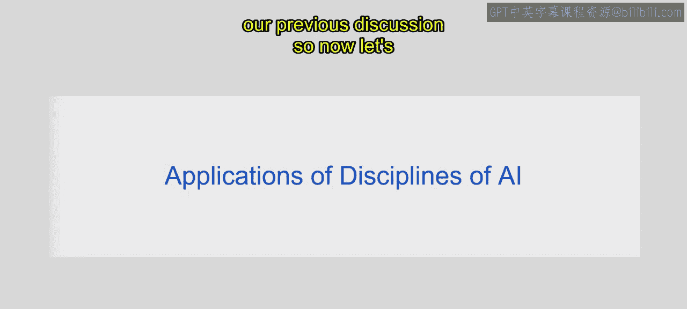
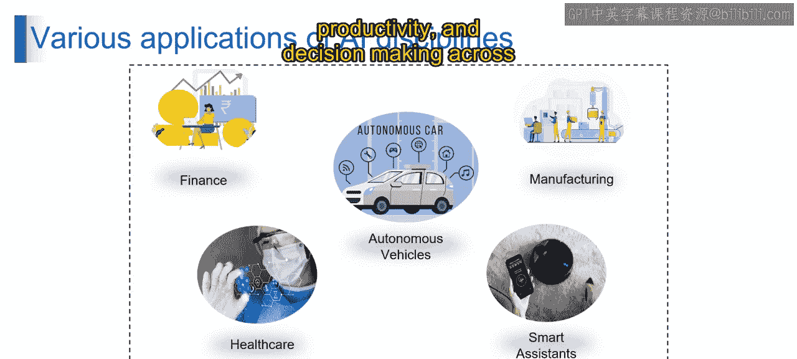
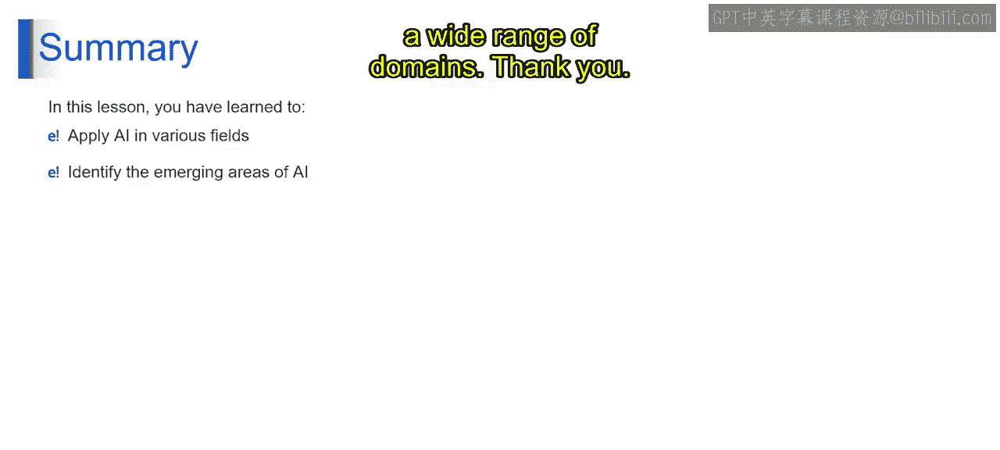

# Edureka《通过LLMs学习生成式人工智能（机器学习和NLP基础，第1课／共4课）｜Learn Generative AI with LLMs》中英字幕 - P4：3_AI学科的各种应用.zh_en - GPT中英字幕课程资源 - BV1q4421Q7qh

So let's now explore the progression from our previous discussion so now let's understand the applications of disciplines of AI The first one is going to be the finance so AI techniques such as machine learning and big data analytics are used in finance for tasks such as algorithmic trading fraud detection risk assessment and customer relationship management these applications leverage AI disciplines like mathematics economics and big data to make data driven decisions and optimize the financial processes then next one is of health in healthcare AI disciplines like machine learning NLP and computer vision are applied for tasks such as medical image analysis disease diagnosis personalized treatment planning drug discovery and patient monitoring so AI technologies enabled。

😊。

Healthca professionals to make more accuratecurate diagnose tailor treatments to individual patients and improve overall patient care。

 Then the next one is of autonomous vehicles。 So AI disciplines such as robotics control theory。

 computer vision and machine learning or essential for developing autonomous vehicles。

 So these technologies enable self-driving cars to perceive their environment， make decisions。

 navigate safely and interact with other vehicles and pedestrians on the road。

 contributing to safer and more efficient transformation systems coming to the manufacturing AI disciplines are utilized in manufacturing for tasks such as predictive maintenance。

 quality control， supply chain optimization and process automation。

 So machine learning algorithms analyze sensor data。😊。

From mission to predict equipment failures and prevent downtime while robotics and automation technologies streamline the production processes and improve the productivity。

 then the last one is of smart assistance smart assistance such as virtual agents and chatbots。

 leveraging AI disciplines like NLP ML and cognitive psychology to interact with the users and provide personalized assistance。

 these applications can answer questions perform tasks schedule appointments and control smart home devices enhancing user productivity and convenience so these examples demonstrate how the applications of disciplines of AI contribute to solving complex problems and improving efficiency productivity and decision making across various domains and industries so now。

😊。

The summary in this lesson you have gained knowledge on applying AI across diverse fields including finance。

 healthcare， autonomous vehicles， manufacturing and smart assistance。

 additionally you have identified emerging areas of AI applications showcasing its potential to revolutionize industries and address complex challenges。

 this understanding equips you to harness AI's capabilities for innovation and problem solving in a wide range of domains。

😊。

Thank you。