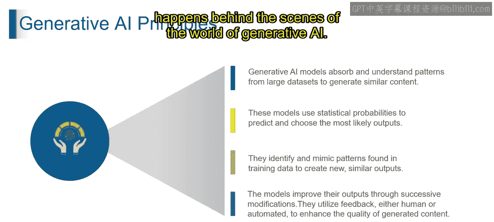
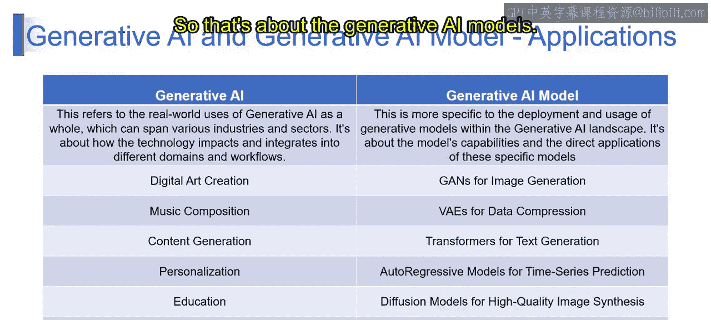
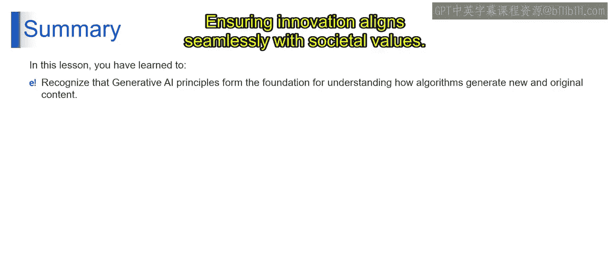

# Edureka《通过LLMs学习生成式AI（基础、应用开发、流行工具，第2、3、4课／共4课）｜Learn Generative AI with LLMs》中英 - P4：3_生成式AI vs 生成式AI模型.zh_en - GPT中英字幕课程资源 - BV1ym421V7gx

So let's now explore the progression from our previous discussion combining all these principles。

 it illustrates how generative AI launch predicts mimics and improves it's like having a smart and creative assistant idea of fingertips understanding these principles helps us appreciate the magic that happens behind the scenes of the world of generative AI so now let's understand the generative AI and its models and applications The first one is of generative AI。

😊。

This generative AI's broad impact reflects its versatility in influencing and enhancing various industries。

 This technology becomes a powerful force， shaping and optimizing workflows by leveraging its ability to generate content indistinguable from human creations。

 making it a transformative force in the technological landscape。

 So now let's understand its application like digital art creation。

 generative AI showcases its ability to produce original and visually appealing content。

 enhancing artistic process through learn patterns from the extensive data that's about digital art creation。

 then music composition。 So the application of generative AI in music composition highlights its capacity to generate innovative content mimicking music styles learn during the training process。

 then content generation within the。😊，generationeration Generative AI showcases its role in creating meaningful and context away content。

 drawing upon its ability to understand and replicate the patterns， then personalization。

 Generative AI's impact on personalization demonstrates its adaptability in tailoring content to individual preferences。

 creating unique user experience。 So that's about personalization。 then education in education。

 generative AI becomes a valuable tool creating tailored education content and supporting adaptive learning experience for individual tutor as an intelligent tutor。

 then product design。 Generative AI's role in product design emphasizes its ability to contribute to the creative process Gene design options by learning from the extensive data sets。

 That's about product design。 Now let's understand the。😊。

AI models so these generative AI models is more specific to deployment and usage of generative models within the generative AI landscape。

 so now let's understand the models capabilities and direct applications in the individual spaces。

 So first one is of GNs for image generations Gs generative adal network it replicates and creates realistic images acting like an AI artist refining the visuals means this Gs consists of generator creating synthetic data and discriminator which will distinguish the real images from the generated data。

 so that's about Gs for image generation Then next one Vas for data compression the name itself is indicating the compression So Vas the variational auto encoders for data compression means these models compress the data efficiently。

😊，serverving as data magicians for compact storage means this VAs learns to represent complex data in compressed format using an encoded decoder architecture so then the next one is of transformers for text generation this transformers or attention based models ideal for text generation utilizing the self attention mechanism then the next one is of autoregressive models for time series prediction。

Autoregressive models forecast accurate future points， acting as time traveling forecast。

 for example， arima， which is nothing but autoregressive integrated moving average So this model forecast time series based on the past observations considering dependencies between the data points then the next one is of diffusion model for high quality image synthesis means these diffusion models create images with breathtaking details revealing them gradually during the synthesis means these models focus on high quality image synthesis iteratively reducing noise for realistic outputs So that's about diffusion models for high quality image synthesis then the conditional models or control generation these conditional models generate content with specific characteristics or under predefined conditions offering control in the generation。

😊，So that's about the generative AI models In this lesson。

 we have grasped the fundamentals concepts of the generative AI and its principles。

 Those are the bedrock fair comprehending how algorithms bring forth new and original content。

 These principles serve as a guiding force， shaping the ethical and responsible application of generative AI。

 ensuring innovation alliances seamlessly with societal values。 Thank you。😊。

