# Edureka《通过LLMs学习生成式AI（基础、应用开发、流行工具，第2、3、4课／共4课）｜Learn Generative AI with LLMs》中英 - P50：13_其他领域的下一个词预测.zh_en - GPT中英字幕课程资源 - BV1ym421V7gx

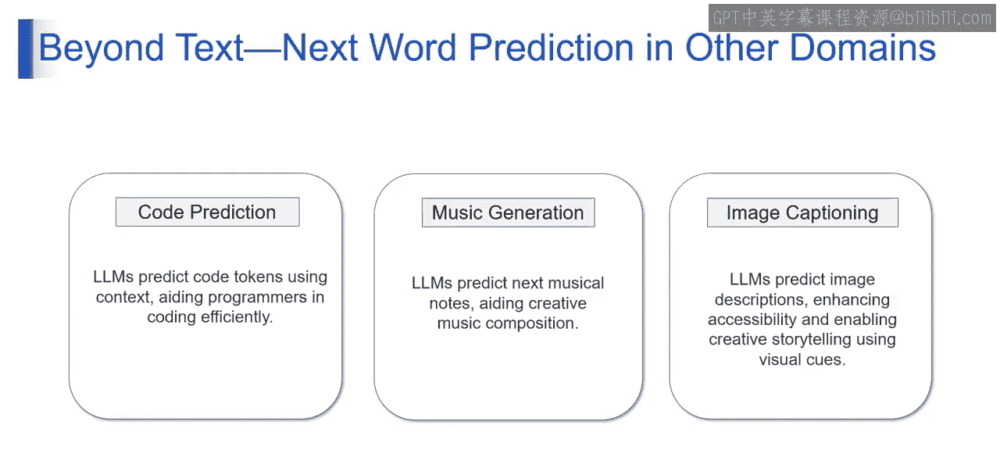

So let's now explore the progression from our previous discussion so here we can see the code prediction music generation and image captioning so code prediction imagine this language model stepping into the coding realm elementss predict the code tokens based on the context making coding a breeze for programmers It's like having a coding assistant that anticipates the next line or the function helping programmers write efficient and error freeee code then the music generation elementsms are not just about the words that predict the next musical notes also it's like having a musical companion that harmonizes with their tunes this aids creative music composition providing a melody of possibilities for musicians to explore and create then the last one is of image captioning so elementsms don't just stop the text music that predict the image's descriptions also so imagine a story。

😊。

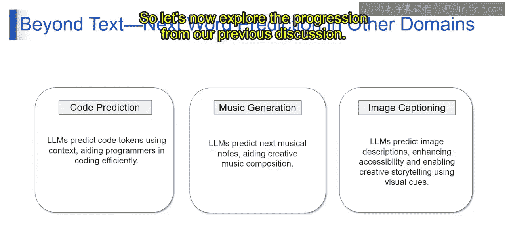

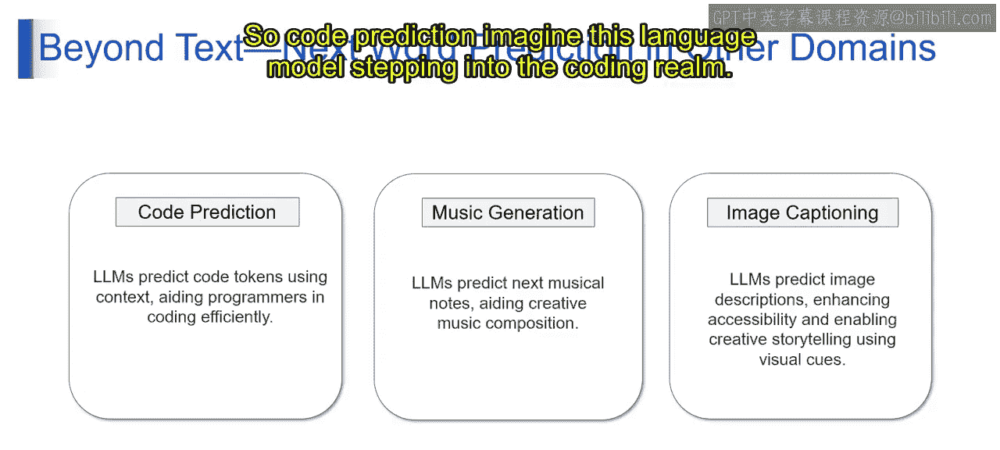

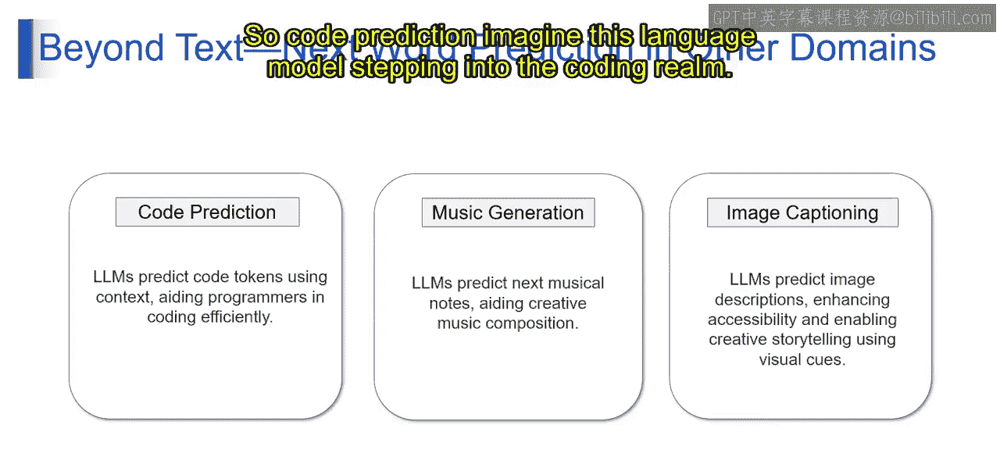

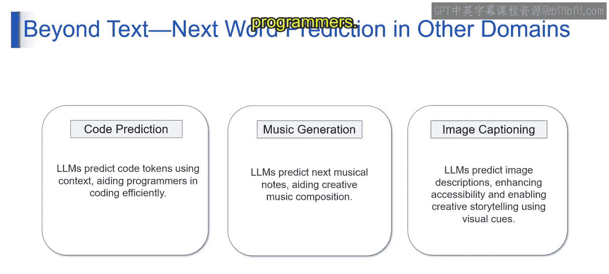

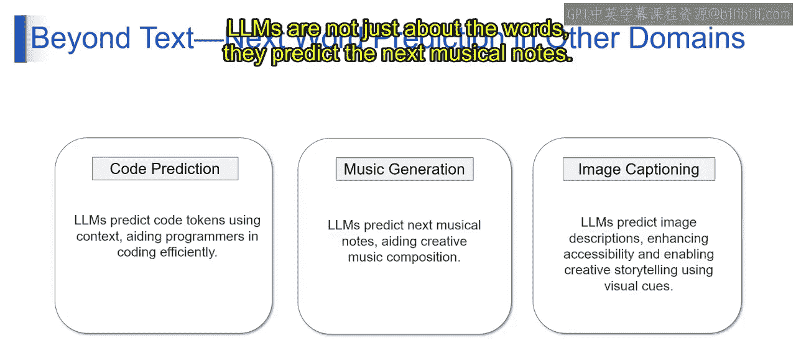

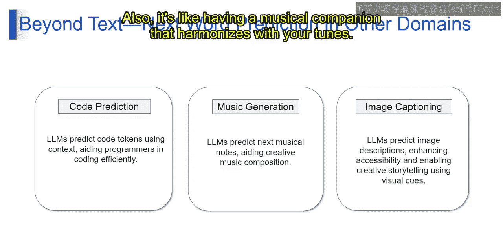

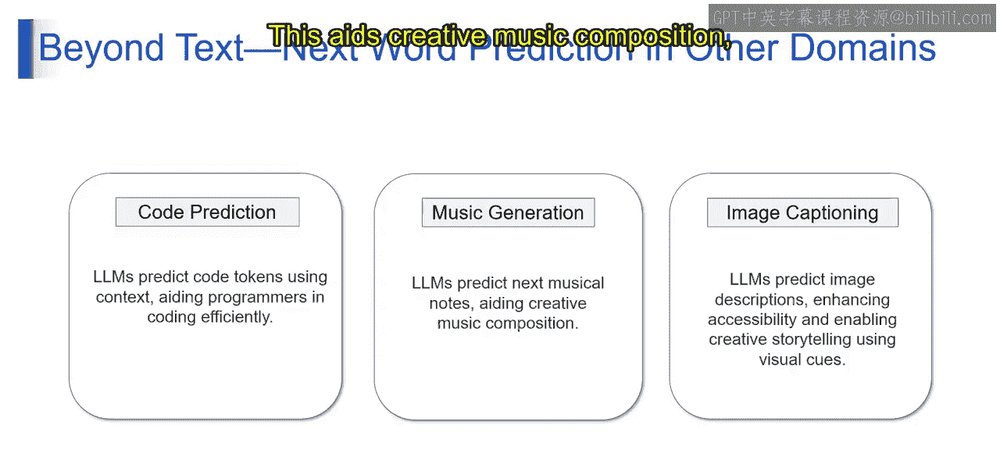

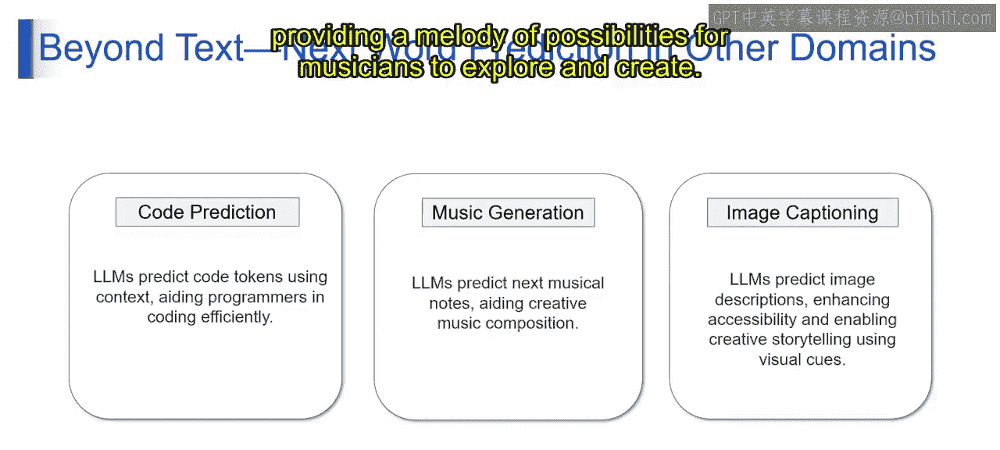

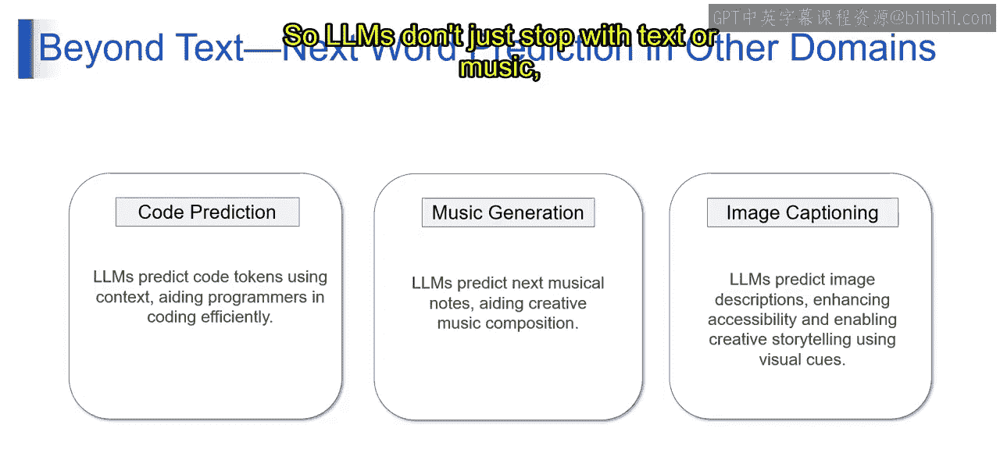

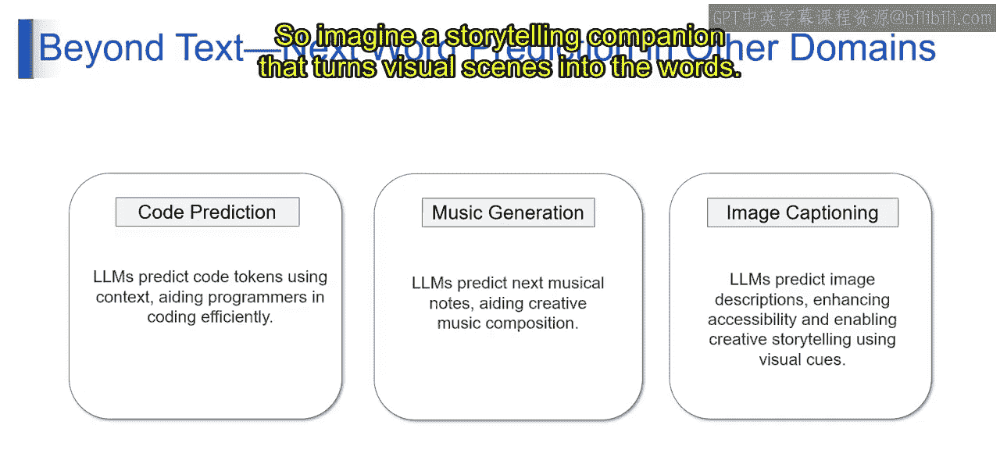

Companion that turns visual scenes into the words This enhances the accessibility for the visually impaired and sparks creative storytelling by adding descriptive captions to the images So now the summary So beyond the predicting the words in a sentence are versatile large language model extend its magic to diverse domains So in this lesson we delvet into the fundamentals of the next word prediction。

 Desstrifying the process of language models， predicting the next word with techniques likema language modeling。

 we explore the technical intricacies from transformer architecture to training model and uncovered how these models extend beyond the text aiding programmers encoding enhancing music composition and even describing image for the creative storytelling。

😊。

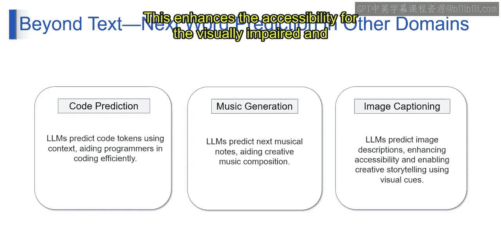

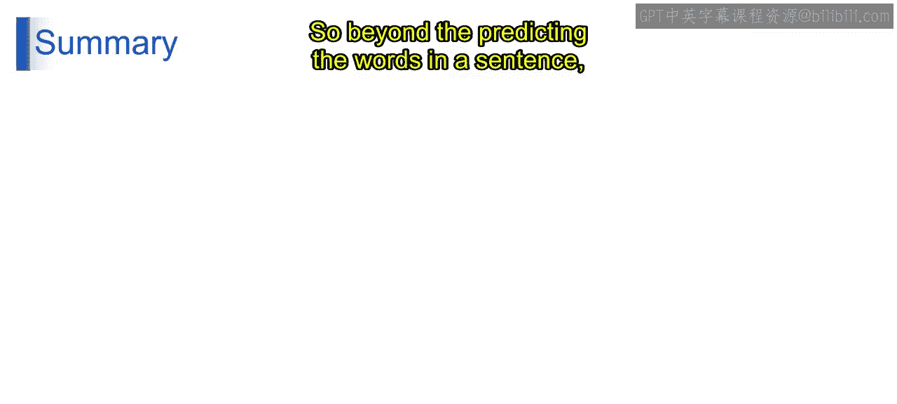

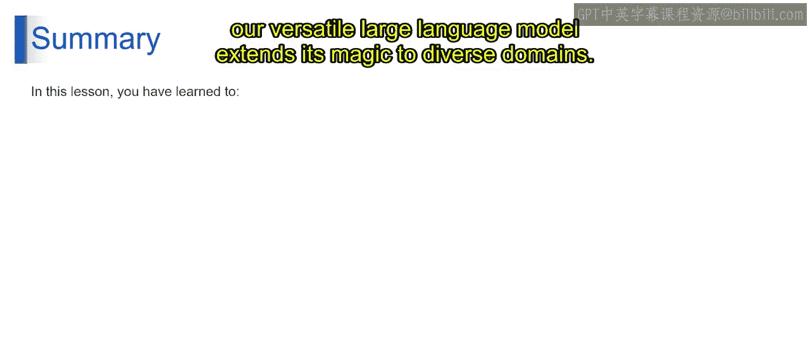

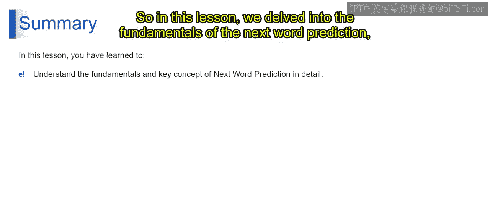

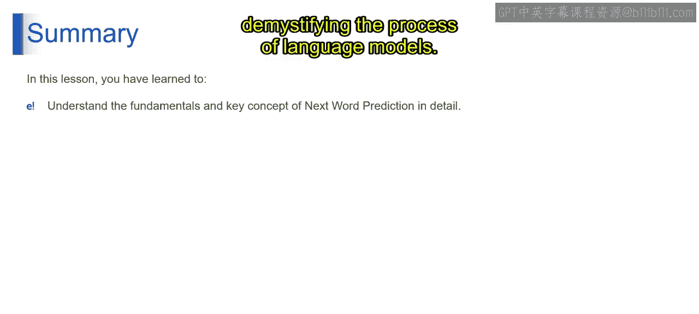

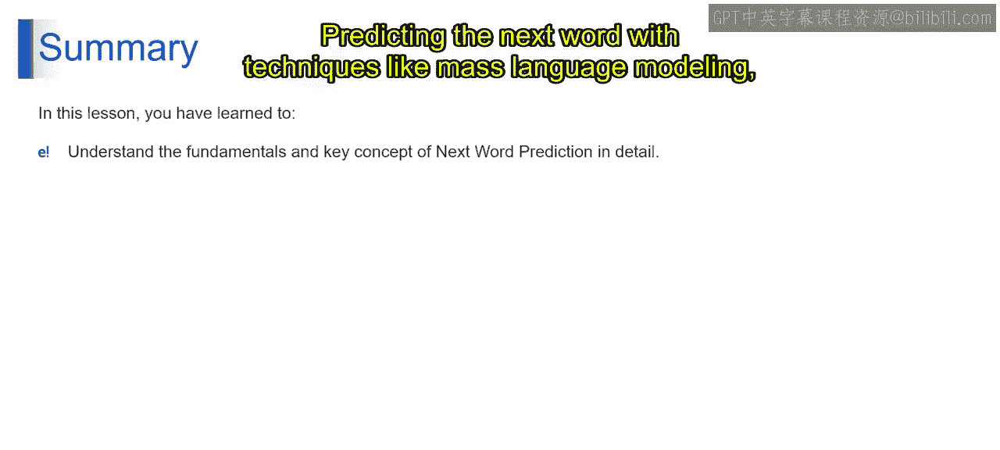

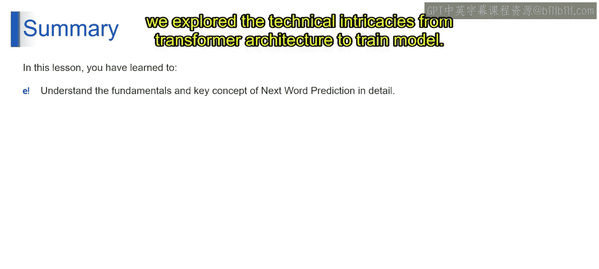

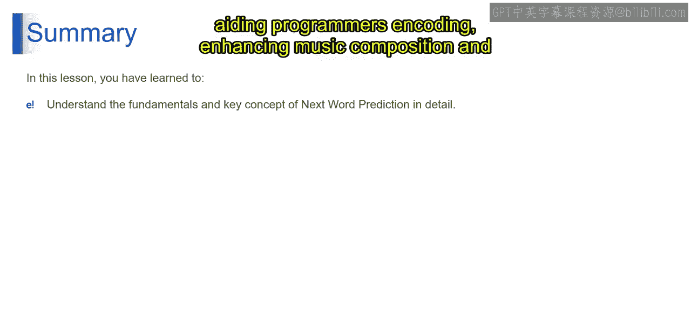

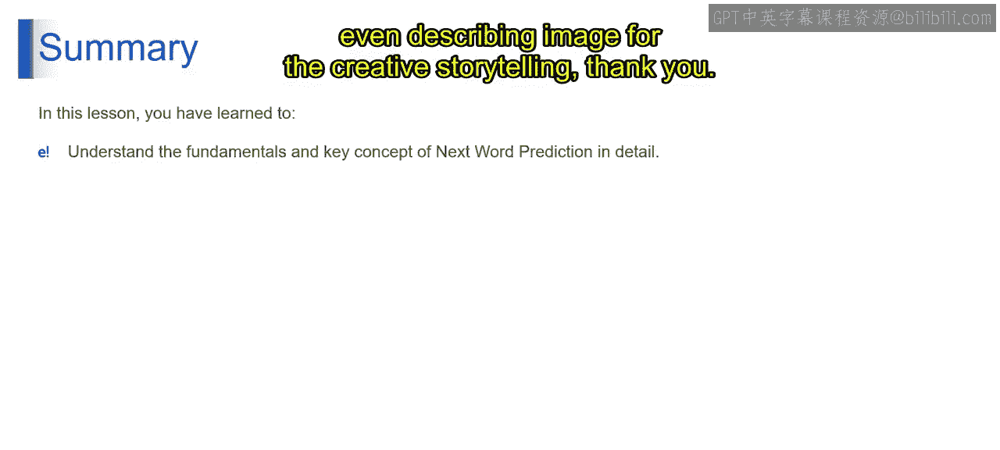

Thank you。