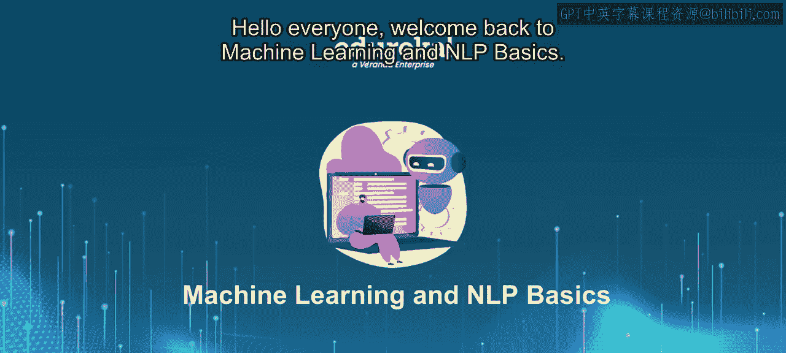
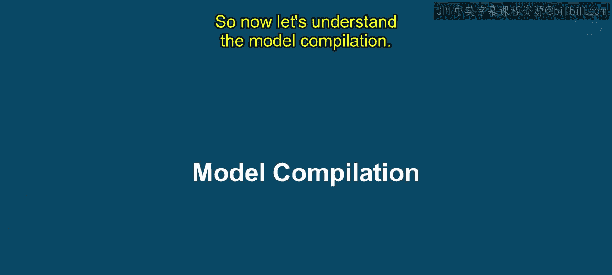
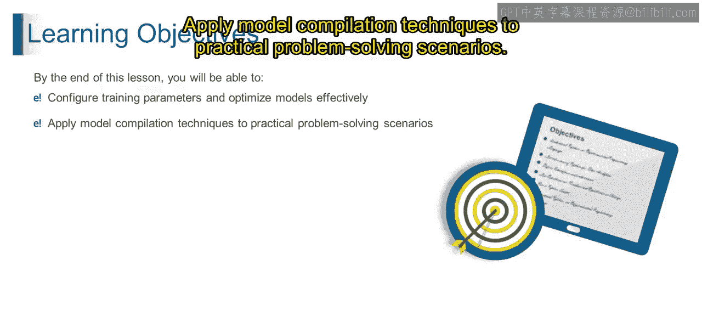
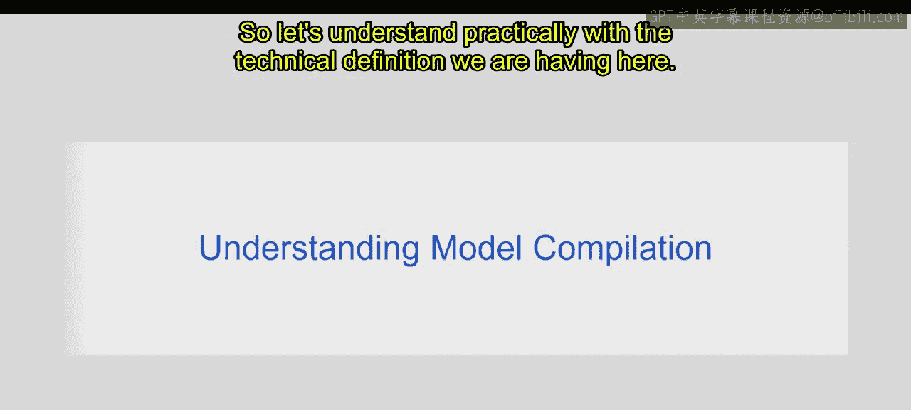
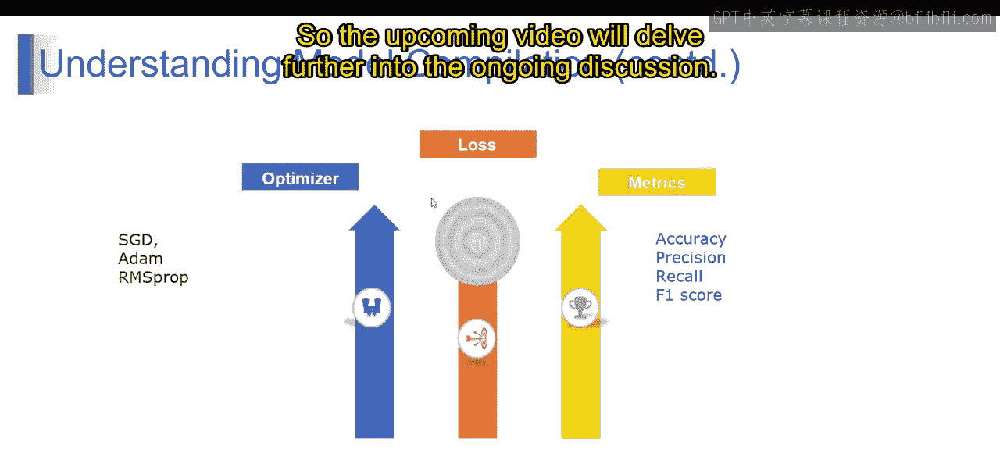

# Edureka《通过LLMs学习生成式人工智能（机器学习和NLP基础，第1课／共4课）｜Learn Generative AI with LLMs》中英字幕 - P50：49_模型编译.zh_en - GPT中英字幕课程资源 - BV1q4421Q7qh

Hello everyone we'll come back to machine learning and NLP basics so now let's understand the model compilation in this we are going to understand the model compilation and uses of model compilation and then real world applications by the end of the session you will be able to configure training parameters and optimize model effectively apply model compilation techniques to practical problem solving scenarios so let's get started first of all what exactly a model compilation is all about so model compilation is the process of configuring and preparing a machine learning or any kind of model for training by specifying various training parameters and optimization techniques for example when building a neural network for image classification the model compilation involves setting。

😊。

Parameterters such as optimizer loss function and metrics these parameters determine how the model will be trained and optimized during the training process means technically model compilation involves bindinging together the optimizer loss function and metrics with the model architecture creating a computational graph that specifies how the model will be trained and evaluated this compiled model can be trained on the training data and evaluated on the test data to make the predictions on the new unseen data so let's understand practically with the technical definition we are having here model compilation in deep learning involves configuring model training process by specifying three key components that is optimizer loss function and metrics。

First of all， when we say optimizer， the optimizer determines the algorithm used to update the model parameters during the training。

😊，The common optimizes include stochastic gradient or atom and RMSs Pro so these all are the basic optimizes that we generally use so coming to the loss function the loss function quantifies how well the model' prediction matches the actual target values during the training it measures the difference between the predicted output and the true target output the choice of the loss function depends on the type of problem being solved such as regression or classification task then the next one is of metrics so metrics are used to evaluate the performance of the model during the training and or testing they provide additional insights into how well the model is performing beyond the loss function common metrics includes。

Accuracy， precision and recall and F code so let's understand all this clearly step by step first of all the optimizer the optimizer is responsible for updating the parameters of the model during the training to minimize the loss function it determines the algorithm use it to perform this optimize process common optimizes include SGD atom and Rs Pro so when we say SGD it is nothing but stochastic gradient decent it updates parameters in the direction that minimizes the loss function using the learning rate then coming to the atom it combines aspects of momentum and Rs Pro to adaptively adjusts the learning rate for each parameter and then coming to Rs Pro it divides the learning rate by an exponentially decaying average of squared gradient。

😊，So that is all about the optimizer then the next one is of loss the loss function computes the discrepancy between the modelss prediction and actual target values it quantifies the error or loss associated with the models prediction the choice of loss function depends on the nature of the problem being solved so regression we use means squared error this is commonly used and coming to the binary classification we use binary cross entropy or sigmoid cross entropy and then coming to multiclass classification categorical cross entroies typically employed for this case that is all about the loss function and then coming to the metrics metrics are used to evaluate the performance of the model during the training and testing they provide additional insights beyond the loss function helping to assess。

😊，Different aspects of the model's performance。 so common metrics include accuracy， precision。

Recall if one score。So accuracy is nothing but the proportion of correctly classified instances and then precision is nothing but the proportion of the true positive predictions among all the positive predictions and then recall it is the proportion of true positive predictions among the actual positive instances and then finally a fund score it is a harmonic mean of predictions and recall providing the balance measure between the two means by configuring these components during the model compilation we define how the model will learn from the data and how its performance will be assessed the setting the stage for training and evaluation so the upcoming video will delve further into the ongoing discussion。

😊。

