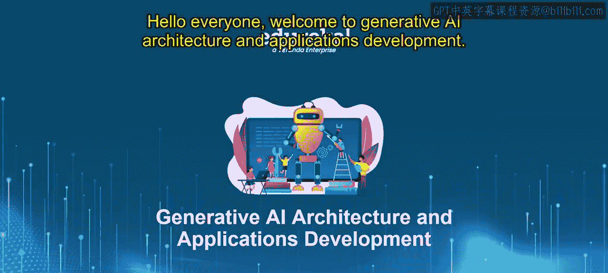
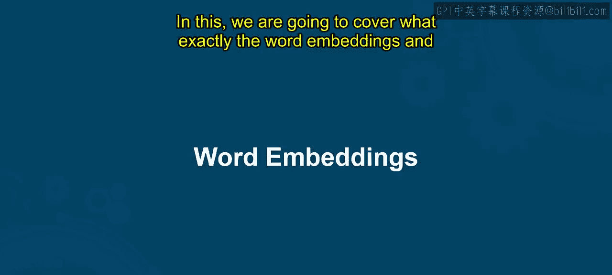
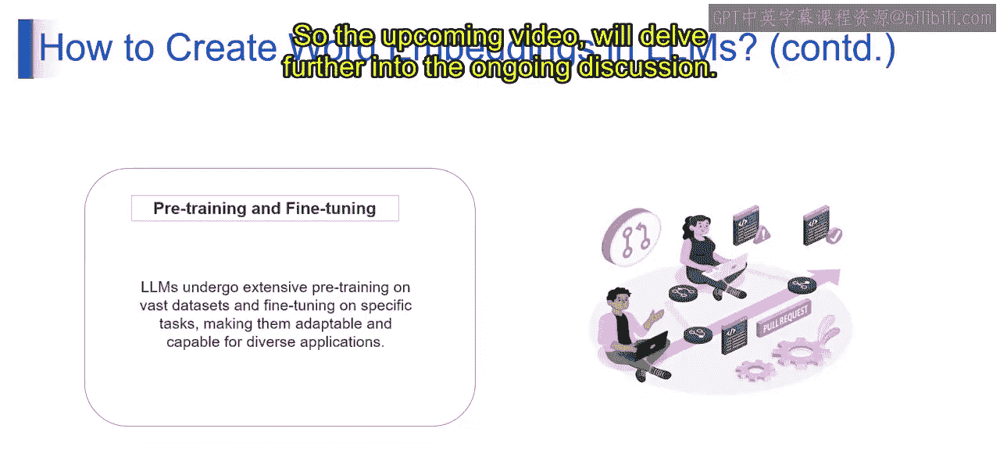

# Edureka《通过LLMs学习生成式AI（基础、应用开发、流行工具，第2、3、4课／共4课）｜Learn Generative AI with LLMs》中英 - P51：14_词嵌入.zh_en - GPT中英字幕课程资源 - BV1ym421V7gx

Hello everyone welcomele to generative AI architecture and applications development。

 So now let's understand the word embeddings in this we are going to cover what exactly the word embeddings and how can we create and what is a secret behind the word embeddings by the end of the session you are able to illustrate how word embeddings capture the semantic and syntactic word relationships so let's get started the word embeddings so the word embeddings are the numerical representation of words in a high dimensional space so each word transformed into a vector where each dimension represents a different feature of the word so now let's understand how exactly we can create the word embeddings in LLms so here are some steps to follow the very first step is that training on massive textp So imagine LLm as a language enthusiast exploring huge libraries。

😊。

Of books， they learn the language by reading massive amount of the text。

 understanding how words are used and connected。 It's like learning the rhymes of the language by immersing onese in countless stories。

 So the elementss under good training on massive text kpa absorbing language patterns from the diverse sources。

 this exposure helps them grasp the shades of the word usage and relationships forming the foundation for crafting meaningful word embeddings。

 Then the next one is of model architecture So think of the model architecture as the blueprint for our language model So elementss use transformer architectures equipped self-ed mechanism it's like having a supermart magnifying glass that captures the world that captures how words relate to each other in a sentence in ensuring a rich understanding means the model。

😊，Architecture in LLM， featuring transformer structure and self-findent mechanism。

 enables efficient capturing of word relationships and dependencies。

 It's the backbone that empowers our model to comprehend language intricacies Now the next one is of tokenization。

 So let's break down language into by sizeized pieces。

 So tokenization is like splitting a sentence into words or sub wordss。

 It's akin to breaking a puzzle into manageable pieces。

 making it easier for our language Expr to understand and process means tokenization in LLms involved dividing input text into smaller units such as words or the sub wordss。

 This step facilitates language understanding and processing by breaking down the text into more digestible component。

 Then the next one is of learning embeddings during the。😊。

So as our language enthusiast reads the star recognizing unique words and assigning special meaning to each Similarlyly。

 during the training process， LLms develop unique embeddings for each token it's like giving each word a distinct identity making our language model smarter with every sentence it encounters means during training LLm simultaneously develop unique embeddings for each tokens。

 this process occurs through back propagation， I the models performance as it refines its understanding of the language then the next one is of contextualization So contextualization in LLm involves updating token embeddings with context from surrounding words so this dynamic process enhances the representations meaning within a given context allowing the model to understand words in relation to their surroundings then the next。

😊，Thing is extraction of embeddings so LMs provide the flexibility to extract embeddings from the different layers Each layer captures varying levels of abstraction and context allowing users to choose the depth of linguistic understanding suitable further specific applications then the last one is pretraining and fine tuning LLms undergo extensive pretraining on vast data sets to grasp general language patterns so fine tuning allows tailoring the model first specific tasks this dualL process makes LLm adaptable and capable across the diverse applications These all of the steps that you can follow in order to create the word em in the LLm so the upcoming video will delve further into the ongoing discussion。

😊。

