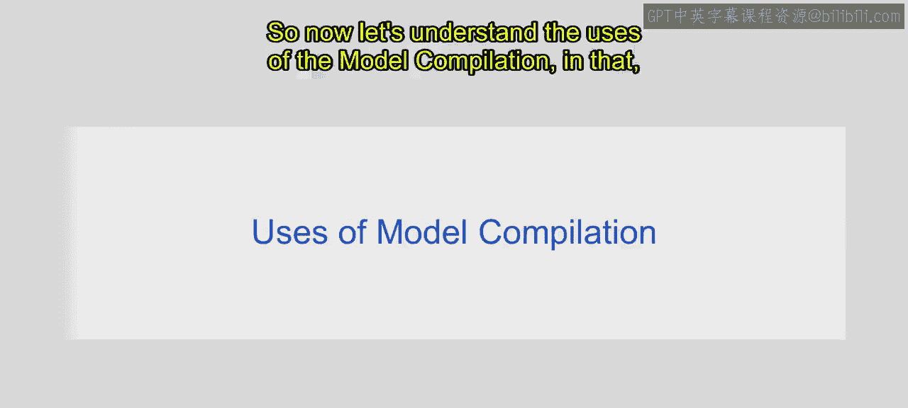
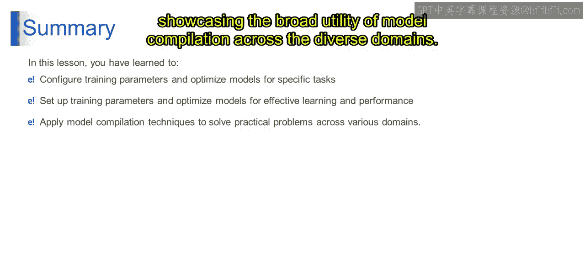

# Edureka《通过LLMs学习生成式人工智能（机器学习和NLP基础，第1课／共4课）｜Learn Generative AI with LLMs》中英字幕 - P51：50_模型编译的用途.zh_en - GPT中英字幕课程资源 - BV1q4421Q7qh

So let's now explore the progression from our previous discussion so now let's understand the uses of the model compilation in that the first one is of configuration of training parameter the model compilation allows us to set various training parameters such as learning rate batch size and number of epochs these parameters determine how the model updates its weights during the training and how data is processed in each training iteration then the next one is of optimization strategy choosing an appropriate optimizer is crucial for effective and efficient model training different optimizers offer unique strategies for adjusting the model parameters。

😊。

s as momentum， adaptive learning grade and gradient normalization。

 so the next one is of performance evaluation during the model compilation we specify the metrics that will be used to evaluate the model performance these metrics provide insights into the model accuracy precision recall and other performance aspects。

 helping to assess its effectiveness， then the next one is of customization and experimentation so model compilation allows for customization and experimentation with different architectures loss functions and optimizes model compilation allows for customization and experimentation with different architectures loss function and optimizes researchers and practitioners can explore various configurations to improve the model performance and address specific challenges。

😊，They domain then coming to debugging and troubleshooting model compilation serves as an important step in debugging and troubleshooting machine learning models by analyzing training parameters。

 optimization strategies and performance metrics， practitioners can diagnose issues and fine tune their model accordingly means overall the model compilation plays a very important role in configuring。

 optimizing， evaluating and refining the machine learning models。

 enabling practitioners to build effective and robust solutions for diverse tasks and applications。😊。

So these are the uses of model compilation。 So now let's understand the real world application。

 The first one is of research and development in research setting model compilation is used to experiment with novel architectures optimization techniques and training configurations researchers leverage model compilation to develop shape of the art models for various domains such as computer vision natural language processing and reinforcement learning so coming to the industry applications in industries like finance healthcare and e-commerce model compilation is employed to deploy machine learning models in production environments it enables companies to optimize the models for specific tasks fine tune performance and ensure scalability and efficiency in real world applications Then the next one is of education and。

😊，Training model compilation is integral to machine learning education and training programs where students learn how to configure and optimize the models for different tasks educational institutions use model compilation to teach concepts such as hyperparameter tuning optimization algorithms and model evaluation Then the next one is of open source projects many open source machines learning frameworks provide tools and libraries for model compilation contributions。

😊，And users of these projects leverage model compilation to build and share models。

 collaborate on research and develop innovative solutions for diverse problems Then finally the cloud computing platforms cloud platforms offer services for model training and deployment where model compilation is a fundamental step users can access cablealable computing resources and tools for compilation training and deploying models efficiently on cloud infrastructure means overall model compilation finds widespread applications across research industry education and open source communities and cloud platforms driving innovation and enabling the deployment of machine learning solutions in various domains and context Now the summary in this module。

😊，We have explored the concept of model compilation which involves configuring training parameters like optimizer loss function and metrics before training the model we discussed its importance in optimizing the models for specific tasks evaluating the performance and enhancing customization and experimentation then real world applications include research industry deployment education and open source projects and cloud computing platforms showcasing the broad utility of model compilation across the diverse domains Thank you。

😊。

