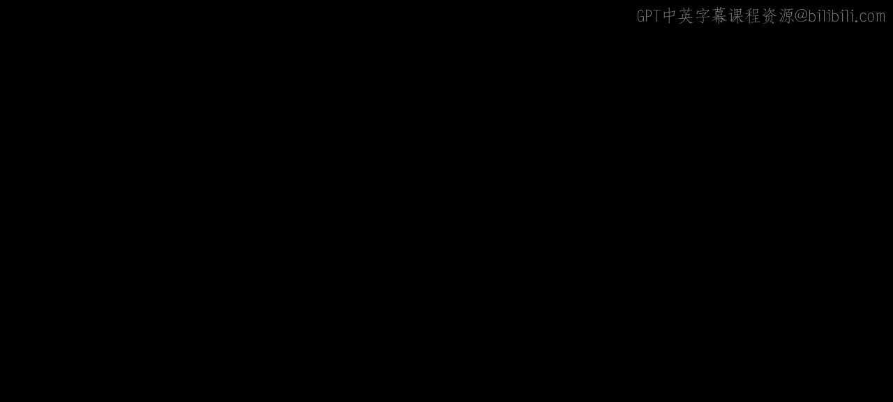
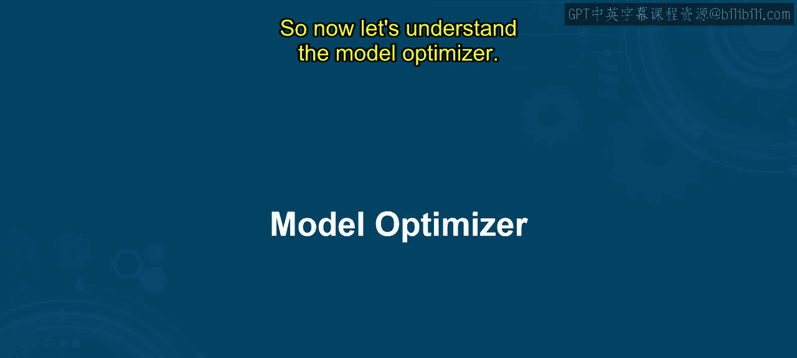
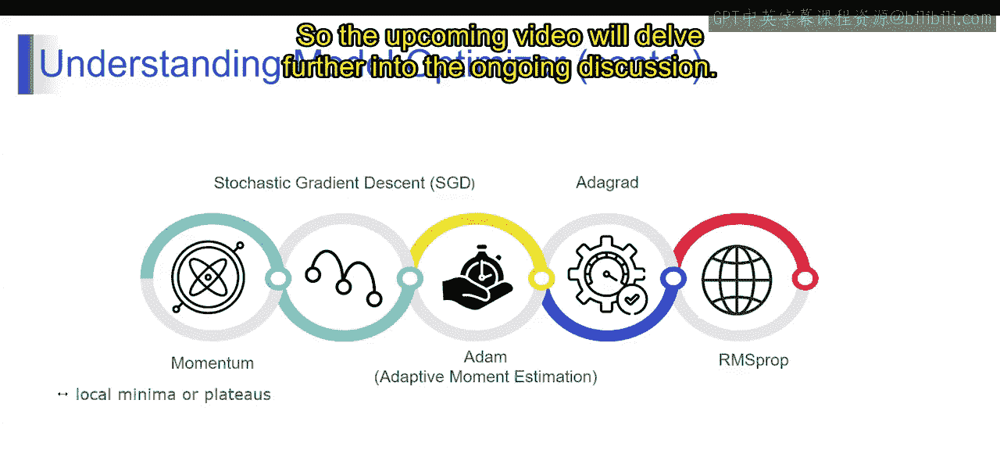

# Edureka《通过LLMs学习生成式人工智能（机器学习和NLP基础，第1课／共4课）｜Learn Generative AI with LLMs》中英字幕 - P52：51_模型优化器.zh_en - GPT中英字幕课程资源 - BV1q4421Q7qh

Hello everyone welcome back to machine learning and NLP basics so now let's understand the model optimizer in this we are going to understand what exactly a model optimizer and what are the users of model optimizer by the end of the session you are able to grasp the role of optimization algorithms in model training and you will be proficient in optimizing trained models for efficient deployment so let's understand understanding the model optimizer so what exactly the model optimizer is all about a model optimizer is one of the important component in the process of deploying machine learning models it involves transforming and optimizing a trained model to improve its efficiency reduce its size and make it suitable for deployment on various target platforms。

s as mobile devices， edge devices or the cloud imagine you have trained a deep learning model for image classification on a high performance GPU server while the model performs well on this powerful hardware it may not be optimized for deployment on a mobile device due to constraints such as limited memory and processing power in the scenario a model optimizer comes into play to compress the model reduce its computational complexity and adapt it to the target platform ensuring efficient inference without sacrificing the accuracy Now understanding the technical definition model optimizer performs a series of transformations and optimizes on the trained model such as such as quantizationne。

😊，And weight sharing to reduce its computational requirement and memory footprint while preserving its predictive performance。

 these optimizations aim to strike balance between the model size。😊，Technically。

 a model optimizer performs a series of transformations and optimizations on the trained model such as quantization pruning and weight sharing to reduce its computational requirements and memory footprint while preserving its predictive performance these optimizations aimed to strike a balance between the model size inference speed and accuracy。

 making the model suitable for deployment in the real world application。

 so technically model optimization is essential for deploying machine learning models in resource constrained environments where factors like memory usage and inference speed are important by applying optimization techniques we can tailor the models to meet the requirements of the target platform ensuring efficient inference。

😊，While maintaining satisfactory performance， thus。

 the model optimizer plays a very important role in bridging the gap between model training and deployment。

 enabling the practical applications of machine learning solutions across the diverse domains and devices Now let's understand the model optimizer here。

 the momentum momentum in an optimization technique that accelerates gradient descent by introducing a momentum term this tongue accumulates a fraction of the previous gradients and adds it to the current update。

 allowing the optimization process to gain momentum。😊。

And overcome obstacles local minima or plates more effectively， for example。

 imagine a ball rolling down a hill momentums simulates the ball's in oceanium。

 causing it to roll faster downhill and travis pla regions most smoothly。

 ultimately leading to faster convergence toward the optimal solution then。😊，Technically。

 mathematically， momentum is computed as weighted moving average of past gradients where the。😊。

Update at each iteration is combination of the current gradient and the momentum term from the previous iteration。

 this helps。Dampen oscillations and stabilize convergence during the optimization。

 so the upcoming video will delve further into the ongoing discussion。

