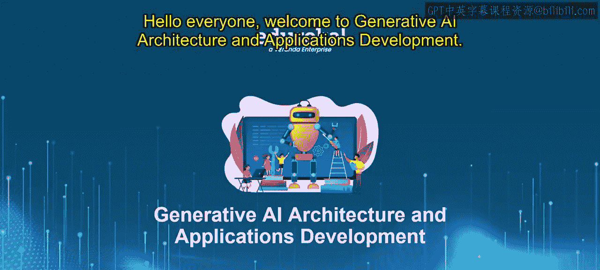
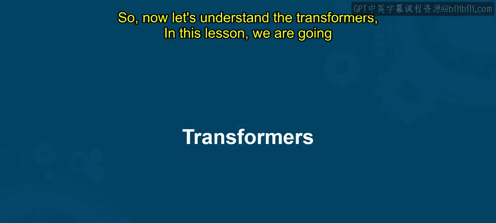
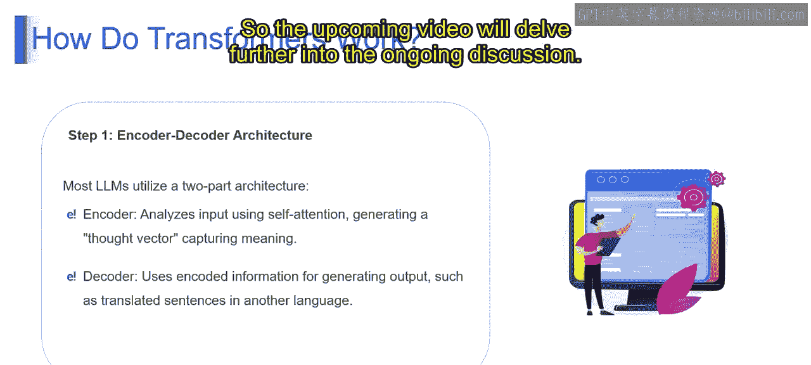

# Edureka《通过LLMs学习生成式AI（基础、应用开发、流行工具，第2、3、4课／共4课）｜Learn Generative AI with LLMs》中英 - P53：16_Transformer.zh_en - GPT中英字幕课程资源 - BV1ym421V7gx

Hello everyone， welcome to Generative AI Architecture and App development。😊。

So now let's understand the transformers in this lesson we are going to cover what exactly the transformers are and what is the role of it by the end of the session。

 you are able to understand the architecture and functioning of transformers in the machine learning。

 So let's get started the transformers first of。 So what are the transformers in Lm festival。

 imagine you are reading a story and you have a friend who is exceptionally good at paying attention to different parts of the story。

 So if there is an important character introduced， your friend focuses on that。

 if there is a trust in the plot， they quickly adjust their attention So this friend helps you understand the story better because they pay attention to the most relevant details means technically the transformers in Lms are like your attention friend but in the digital world。

 these neural network architecture use self-atten mechanic。😊。

All them to pay varying degrees of attention to different parts of the sentence。

 the model can dynamically decide which words are crucial for understanding the context。

 making it highly effective for natural language understanding as well as processinging means just like your attentive friend adapts attention mechanism or attention based on the story content or context。

 Transers in LLms use self- attentionten mechanism to dynamically adjust focus during the language processinging this adaptability enables theers to capture the intricate relationship between the words。

 making them powerful tools for understanding and generating humanlike text in by range of applications so now let's understand the translation sum question answering text generation So the translation So in Trans task Transer use their self- attentionten mechanism to。

😊，stand the relationship between the words in different languages。

 capturing the shades for accurate and coherent translation。

 Then the next one is of sumization in summarization Transers use their self-atten mechanism to focus on the crucial details。

 ensuring the generated summary accurately represents the essential content of the original text。

 then question answering So in question answering Transers leverage。

 their self- attentionten mechanism to grasp the meaning of the question Re the relevant information and generate the coher response out of it。

 So that's about question answering。 then the next one is of text generation So in text generation Transers use their self- attentionten mechanism to understand and capture the dependencies between the words enabling them to create diverse and meaningful textual output means Transers play a very important role in various natural。

😊，Language processinging tasks such as translation， sumization。

 question answering and text translation。 So now let's understand what is the use of the transformers first of all。

 The first one is of revolutionizing the communication。

 So imagine chatting with someone who speaks at different language and the transformers help translate the conversation in the real time。

 It's like breaking down language barriers and fostering the global communication。

 Transers revolutionized communication by facilitating seamless language translation allowing people to understand and interact across the linguistic dependencies and differences。

 Then the next one is of boosting productivity。 So think of a smart summarizing a lengthy report。

 saving your time Transers can automate tasks like document summarization and data extraction making information more accessible and saving valuable resources means。

😊，Transformers boost productivity by automating the textrelated task。

 streamlining information processing and providing quick and efficient resolution or efficient solution。

 Then the next one is of enhancing creativity So consider an AI that generates unique poems or creates innovative lines of the code Transformers support creative writing and code generation acting as creative collaborators for various artistic and technical projects。

 Transers enhance creative， by providing tools for generating diverseers and imaginative content。

 contributing to artistic endeavors and fostering the innovation then the last one is of advancing search So picture a researcher using a transformer to analyze vast amount of scientific literature。

 accelerating the discovery of patterns or the Transers assist in scientific research and technology。

😊，Virtical innovation by processing and understanding complex information means transformers play a pivotboal role in advancing research by providing powerful tools for analyzing summarizing and extracting insights from the large dataset sets in the various fields。

 That is how we can make use of these all of the reasons that we can make use of the transformers。

 So now let's understand why do we need to use the transformers。

 The first one is of superior context understanding。

 So the superior context understanding helps transformers Excelel in task that require grasping intricate relationships between the words and the context。

 making them valuable in NLP process Then the next one is of parallel processing So parallel processing significantly a the models's ability to learn from the data and make the predictions out of it enhancing the efficient。

😊，In training and inference compared to sequential processing models like RN。

 then the next one is of scalability。 So scalability allows transformers to handle vast amount of the information making them suitable for training large language models that excel in capturing the relationship details and the shades within it。

 Then the last one is of versatil。 So it makes them valuable across the spectrum of tasks。

 enabling them to be applied to diverse domains and solving a wide range of challenges beyond the traditional language processing。

 So these all of the reasons that we need to use the transformers。

 So the upcoming video will delve further into the ongoing discussion。😊。

