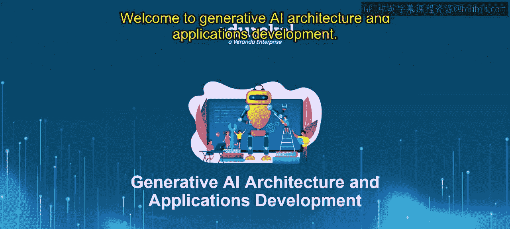
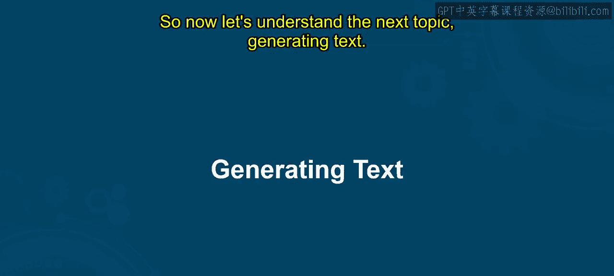
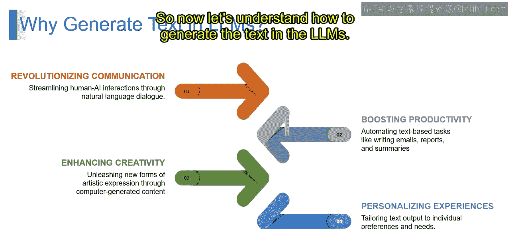
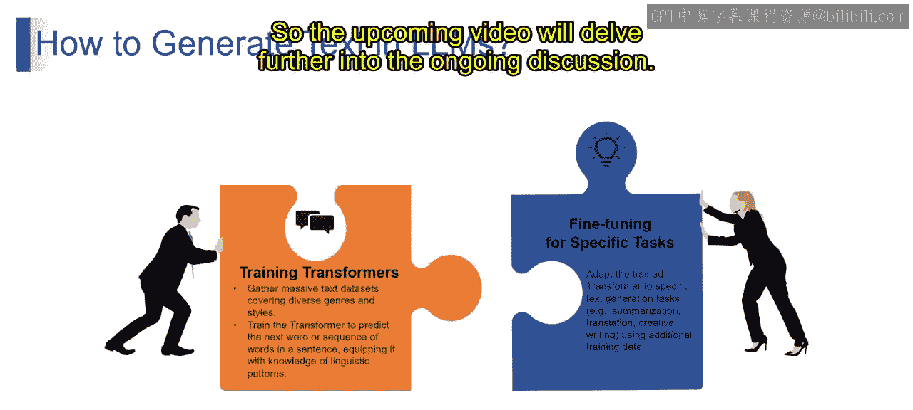

# Edureka《通过LLMs学习生成式AI（基础、应用开发、流行工具，第2、3、4课／共4课）｜Learn Generative AI with LLMs》中英 - P55：18_生成文本.zh_en - GPT中英字幕课程资源 - BV1ym421V7gx

Hello everyone， welcomee to generative AI architecture and applications development。

 So now let's understand the next topic generating text in this topic we are going to cover how to generate the text by using the large language models by the end of this session you are able to understand the concept of generating text and its working processor so let's get started generating the text imagine a smart robot that can write stories code or even have a conversation It's like teaching a computer to create a text on its own So text generation involves making missions capable of producing various types of contextual or textual content from the sentences to the entire narrative that is what exactly the text generation So why transformers matters in this thing is that think of transformers as。

😊。

Brain behind the operation。 These are the powerful neural networks like the superheroes of language understanding。

 That is what we understood in the previous module。

 So means this transformers are particularly famous for their knack in grasping the subtitles grasping the importance of the language。

 allowing them to create the text that sounds remarkably human。

 but how these transformers are working in back。 So consider transformers as language wards。

 they learn from the termss of examples， understanding how words and phrases fit together。

 So this knowledge combined with their ability to pay attention to different parts of the sentence empowers transformers to generate text that not only makes sense。

 but also mimics the shades of the human expression means text generation is like training missions to be creative writers and transformers are the superheroes。

😊，Enabling them to understand and produce humanlike text with fineness。

 So now let's understand why generate the text in LLms。

 The first one is of revolutionizing the communication。

 So imagine having a chat with a virtual assistant that understands your questions and responds like a helpful friend。

 It's like having a conversation with your computer。

 So text generation in LLm revolutionizes communication by empowerovering the NLP or the national language dialogue enabling missions to understand and respond to human queries with language fineness。

 Then the next one is of boosting productivity。 So picture a smart writing assistant that helps you draft emails reports or even summararies。

 So it's like having a writing bodydy that speeds up your work and ensures itss well crafted LLms boost productivity by automating。

😊，Text to-based tasks through the text generation， leveraging their understanding of language to assist in content creation。

 Then the next one is of enhancing creativity。 So think of an AI artist creating unique poems stories or even code snippets。

 It's like collaborating with creative partner that introduces fresh and innovative ideas。

 So text generation in LLs enhances creativity by generating the new forms of the artistic expression through computer generated content leveraging the model's ability to produce diverse and imaginative text。

 Then the last one is of personalizing experiences。

 So imagine a newsfe tailored just for you presenting the information in a way that matches your preferences。

 It's like having a personalized newspaper that understands what exactly you are interested in。

 So LLms personalized experience。😊，By tailoring the text output to individual preferences and the needs。

 using their understanding of context and user interactions to provide the customized content means generating a text in LLM serves in a various purposes from improving communication to the productivity to fostering the creativity and personalizing experience。

 these applications leverage and technical capabilities of these models showcasing their power in natural language。

 understanding and generation。 So now let's understand how to generate the text in the LLMs。

 The first step is training the transformers So what exactly we are doing here So how to generate the text in the LMs for the first step is training transformers means while for training the transformers。

 we are gathering a massive text data sets covering the diverse information from the diverse background。

😊。

The data and its styles means training the transformers to predict the next word or the sequence of words in a sentence。

 equipping it with the knowledge of linguistic patterns as because it will strain on the car amount of data from the diverse background of the information it is capable enough to generate the ans root of it So that is how the training process happens in the transformers then the next step is fine tuning for this specific task So now we are utilizing this pretrained transformers to understand for a specific task。

 such as for example， take summarization or the translation or the creative writing using additional training data means we are making use of the already pretrained models and we are fine- tuning them to improve or get specialized into any of the specific tasks as per our requirement that is how we can generate the text in elementss So the upcoming video will delve further into the ongoing。

😊。

。