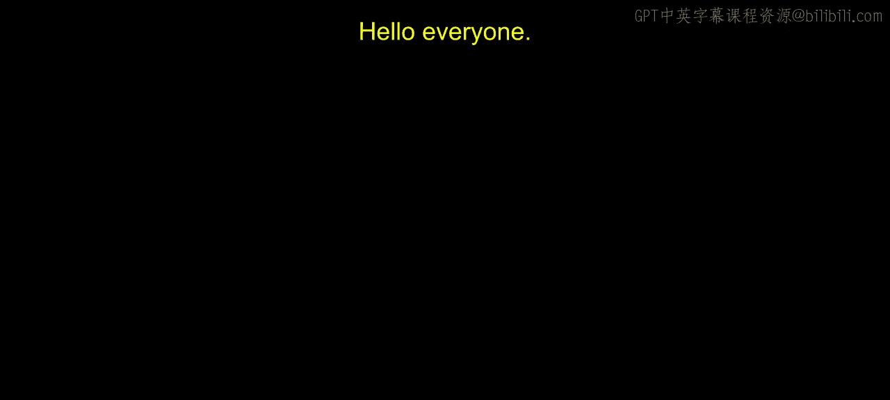
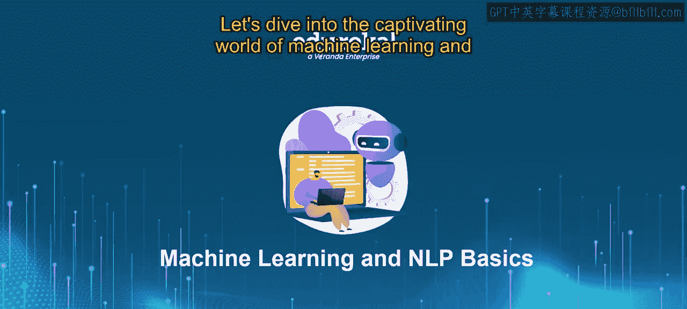
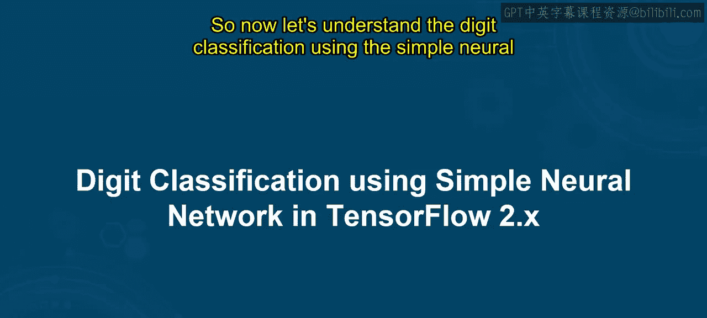
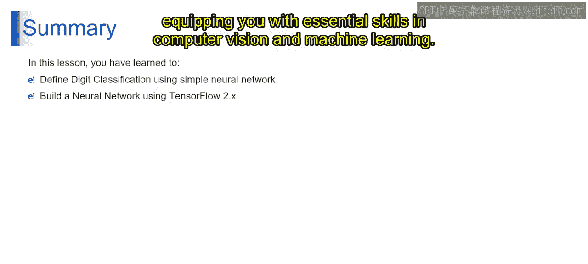

# Edureka《通过LLMs学习生成式人工智能（机器学习和NLP基础，第1课／共4课）｜Learn Generative AI with LLMs》中英字幕 - P55：54_使用TensorFlow 2.x的简单神经网络进行数字分类.zh_en - GPT中英字幕课程资源 - BV1q4421Q7qh

Hello everyone， let's dive into the captivating world of machine learning and the foundational concepts of NLP together。

 So now let's understand the digit classification using the simple neural network in Tensorflow 2。

 x in this we are going to cover the introduction to digit classification and the digit classification using Tensorflow 2。

 x by the end of this session you will be able to construct a simple neural network and examine the basics of the tensorflow 2。

x framework So let's get started the introduction to digit classification。

 Imagine you are teaching a friend how to recognize the handwritten digits to show them pictures of different handwritten images like 0 to9 and tell them what each digit is to help them learn you ask them to practice by looking at new pictures and guessing the digits whenever they make a mistake you correct them helping them improve。

😊。

Over the time means in technical definition in the context of machine learning。

 digit classification involves training a neural network to recognize the handwritten digits from the images。

 the neural network learns to map input images in pixels representing the digits to their corresponding labels that is nothing but digit values each image is represented as a vector of pixel values and the neural network uses layers of interconnected nodes。

 nothing but neurons to process this input data so through a process called training the neural network adjusts its internal parameters nothing but weights based on a labeled data of the digit images minimizing a predefined loss function。

 nothing but for example cross entropy to improve its accuracy in predicting the digit labels once trained the neural network in accurately classified。

😊，New unseen digit images by applying the learned mapping better way。

 the input images and the digit labels。😊，That is what about the digit classification。

 So now let's understand digit classification using the Tensorflow。

 It contains multiple steps that is prepared the data。 build a model， compile the model。

 train the model and evaluate the model。 Now let's understand with the demonstration。

 The first step is to prepare the data。 So what exactly we are doing here。

 we will gather a data set of labeled images containing handwritten digits such as the Ms data。

 What exactly the Ms data， it stands for modify national int of standards and technology。

 you can even download it from the kggle or the Google also where each image is associated with the digit label。

 Then split the data into two subset a training set use it to train the model and the testing set use it to evaluate the model performance。

 Then the next step is to build the model here， you can define a neural network architecture。

 typically startinging with。😊，Sential model， which consists of stacking layers sequentially。

 then add layers to the model， including input hidden and output layers for digit classification。

 the input layers size should match the dimensions of the input images and the output size should correspond to the number of classes that is example10 for the digits 0 to 9。

 then choosing the appropriate activation function for each layer such as value for hidden layer and the softm for the output layer based on the problem requirements。

 and the network design principle， then the next step is going to be the compile the model means here we will specify the loss function that measures the difference between the model predictions and the actual digit labels for multiclass classification like digit classification categorical cross entropy is commonly used So you need to select an optimal。

😊，such as Adam optimizer to update the model's weights during the training。

 aiming to minimize the loss function。 Opally， you can even define additional metrics like accuracy to monitor the model performance during the training and evaluation then the next step is going to be the training the model so here we will feed the training data into the model and specify the number of epochs which represents the number of times the entire training data settings passed forward and backward through the network then during the training the model learns to map input images to their corresponding digital labels by adjusting its internal parameters。

 nothing but weights based on the loss function and optimizer then you need to monitor the training process to ensure convergence and prevent the overfitting by employing techniques such as at least stopping or the regularization then the next step is going。

😊，To evaluate the model once training is complete， you need to evaluate the models' performance on unseen data from the testing set。

 then you need to compute evaluation metrics such as accuracy prediction recall and F1 score to assess the model's effectiveness in classifying the digits then analyze any misclassification or errors to identify the potential areas for improvement in the model architecture or the data set quality by following these steps。

 you can create a simple neural network using the tensorflow 2 point x for digit classification task laying the groundwork for more advanced techniques in computer vision and machine learning。

 So now the summary in this lesson， you have gained a proficiency in defining the digit classification task using a simple neural network and building such models using the tensorflow 2。

 x through a step by step process。😊，You have learned to prepare data set。

 design neural network architecture， compile models with appropriate parameters。

 train them on the label data and evaluate their performance for accurate digit recognition tasks equipping you with essential skills in computer vision and machine learning Thank you。

😊。

