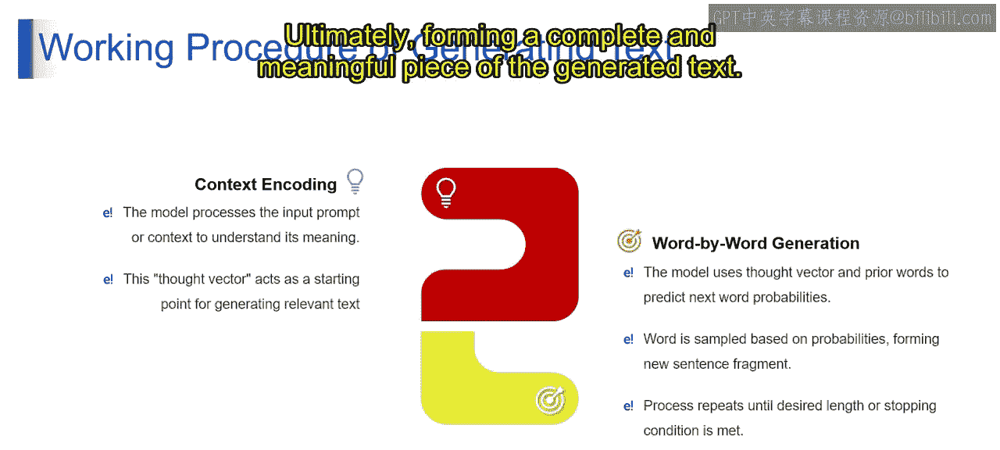
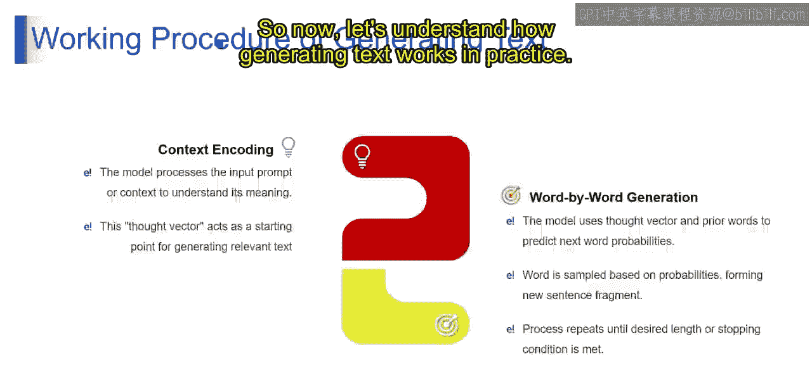
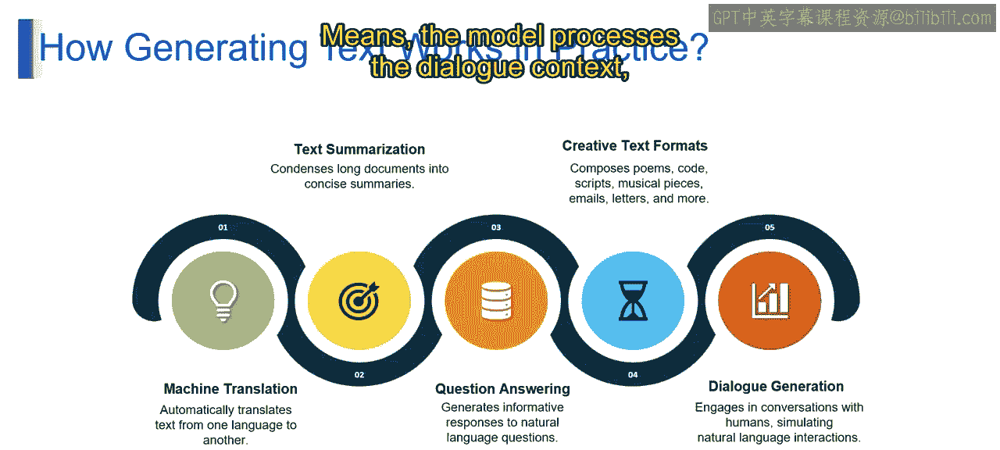
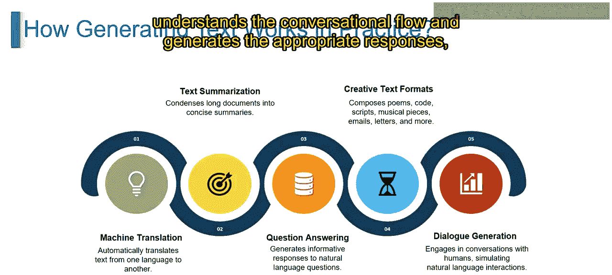
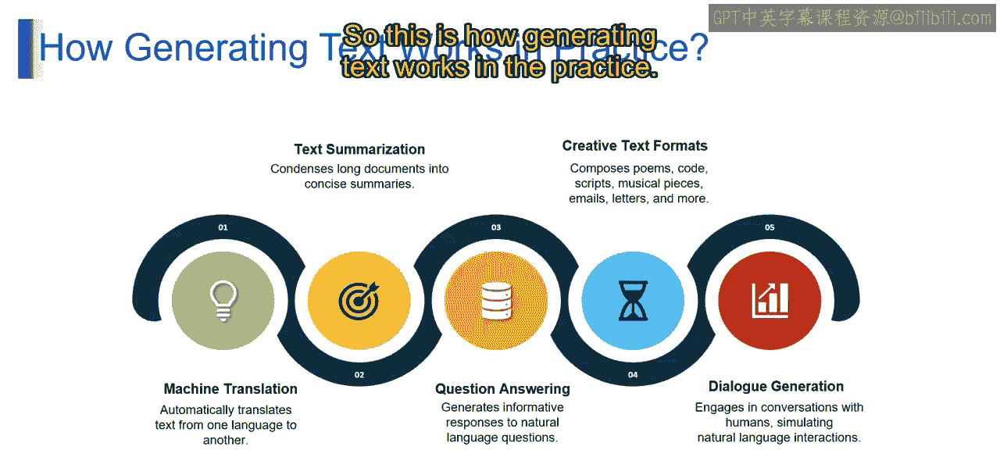
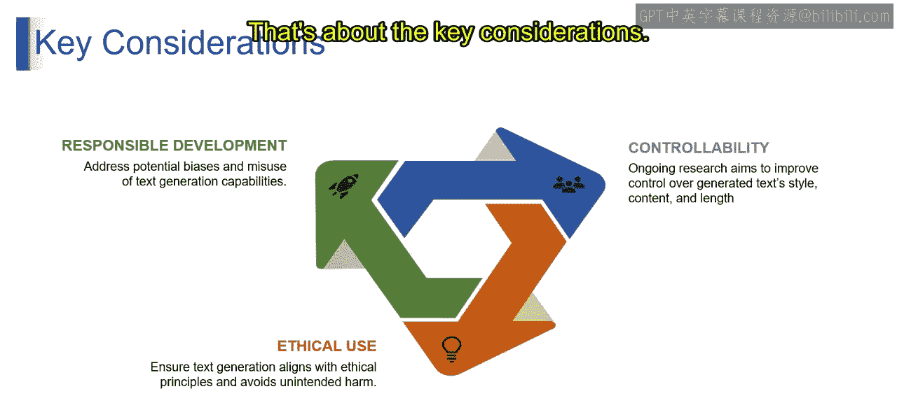
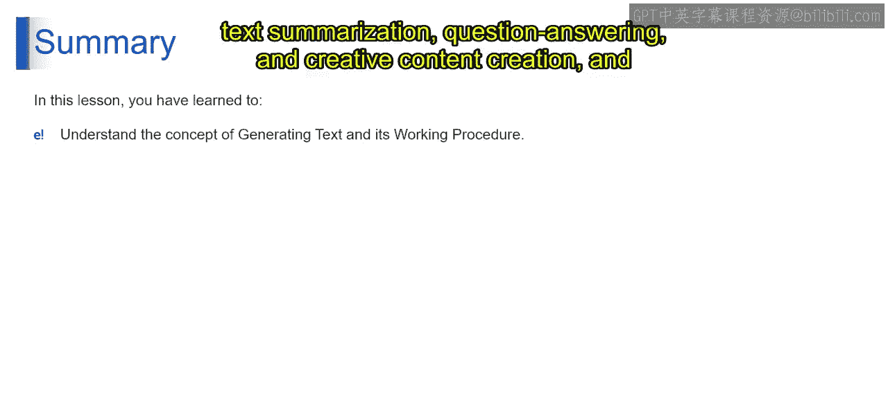

# Edureka《通过LLMs学习生成式AI（基础、应用开发、流行工具，第2、3、4课／共4课）｜Learn Generative AI with LLMs》中英 - P56：19_生成文本的工作原理.zh_en - GPT中英字幕课程资源 - BV1ym421V7gx

So let's now explore the progression from our previous discussion so now let's understand the working processor of generating text the first one is of context understanding so imagine reading a story prompt think of the model as a student reading a story prompt it carefully reads and understands what the prompt is about creating it through thought vector that holds a sense of the input means this thought vector is like a mental note preparing the model to generate the text that makes sense in the given context then the next one is of word by word generation means let's say for example our model is ready to start writing it uses the thought vector and considers the words that came before to predict the probabilities of the next word in a sequence means the model then samples the word based on these probabilityities。

😊，And adds it to the sentence。 This process repeats with each new word influencing the next。

 formatting a coherent sentence fragment means the model keeps generating words until it reaches the desired length or fulfills the stopping condition。

 creating a complete and contextually relevant piece of the text means in technical terms。

 this working processor reflects the process of text generation。

 in which the model encodes the input context， creating a representation of its understanding。

 subsequently it generate the text word by word predicting each word based on the context and prior word ultimately forming a complete and meaningful piece of the generated text So now let's understand how generating text works in practice。

 The first one is of machine translation。 So the model encodes the input English sentence。😊。

generateerate the translated version into French， for example。

 means leveraging its understanding of linguistic patterns and context。 Now。

 the next one is how generating text works in practice。 The first one is of machine translation。

 So imagine you are typing a sentence in a English and the language model effortlessly translates it into French。

 It's like having an instant language translator in your pocket means the model encodes your input in English sentence。

 then generates a translated version into the French。

 leveragingver its understanding of linguistic patterns and the context。

 Then the next one is of text sumization。 So picture a lengthy article being condensed into a few key sentences capturing the main points。

 It's like having an assistant that reads a long document and provides you with a quick summary means the model processes the。

😊，Extracts the essential information and generates a concise summary。

 showcasing its ability to distill the content efficiently。 That's about textization。

 Then the next one is of question answering means asking a virtual assistant a question and receiving a detailed and informative response。

 It's like having a knowledgeable friend who understand your queries。

 The model decos the meaning of the question， retrieves the relevant information and generates a coherent response。

 De its ability in answering the natural language processing or the questions。

 So that's about the question answering。 Then the next one is of creative text format。

 So imagine an AI generating a beautiful poem writing a piece of code or composing a unique piece of music。

 It's like collaborating with a creative pattern with the player for diverse。😊。

Atistic expression means the model uses its learned patterns to create content in various formats。

 showcasing its versatility in generating creative and meaningful text。

 Then the last one is of dialogue generation means engaging in a chat with a virtual assistant or a chat board that responds intelligently and conversationally。

 It's like having a virtual friend who can chat with you on a wide range of topics means the model processes the dialogue context understands the conversational flow and generates the appropriate responses emulating the natural language interactions。

😊。

So this is how generating text works in the practice so now let's understand the key considerations。

 The first one is of responsible development so imagine a guided storyteller think of the model as responsible storyteller guided by ethical practices so developers ensure that the model understands and follows these principles to avoid biases and also inappropriate content means responsible development involves addressing potential biases in the training data and fine unique processes prompting fair and unbiased text generation then the next one is of controllability picture a customizable writer envision a model that can be customized based on your preferences means choosing the writing style content and even the length it's like having a control over the personality。

😊。

And writing style of your virtual writer researchers continuously work on enhancing control over the generated text。

 allowing users to influence and tailor the output according to their needs and preferences。

 Then the last one is of ethical use。 Consider the model as a responsible assistant that ades by ethical guidelines。

 It's crucial to ensure that the generated text aligns with the ethical principles and avoids the unintended consequences or the harm means ethical use involves implementing safeguards and guidelines to prevent the misuse of text generation capabilities ensuring that the generated content contributes positively to the various context that's about the key considerations Now the summary in this lesson we explore the concept talkgene text where the language models or the elementss use the sophisticated。

😊。

To create human like textual context or content the working processor involves encoding context。

 creating the thought vector and generating the text code by word。

 producing a coherent and contextually relevant outcomes。 Additionally。

 we understood practical application such as machine translation text sumization questionan and creative content creation and dialogue generation Thank you。

😊。

