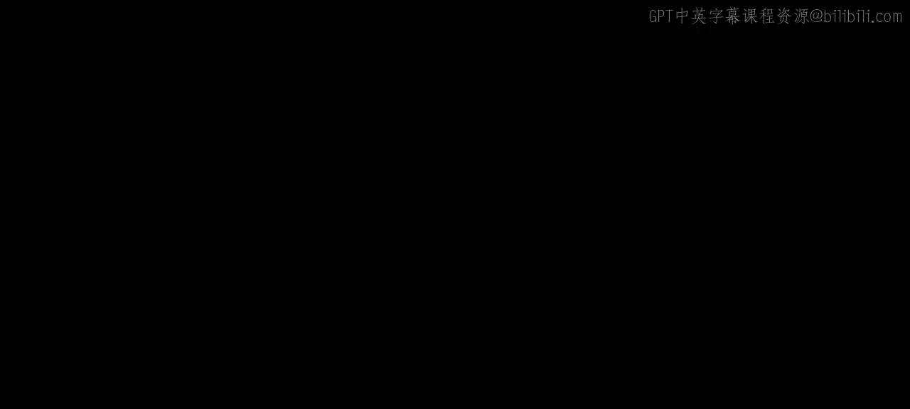
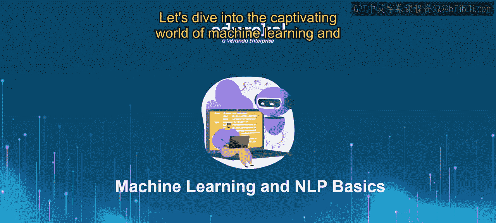
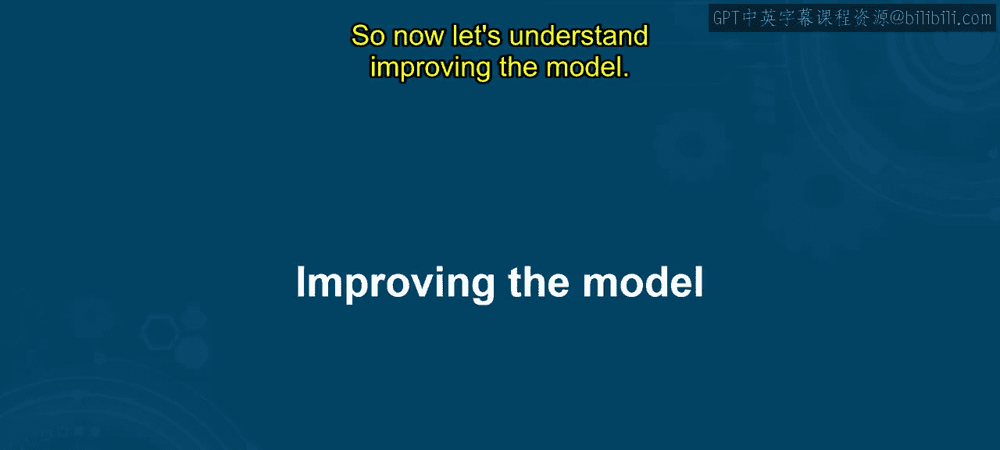

# Edureka《通过LLMs学习生成式人工智能（机器学习和NLP基础，第1课／共4课）｜Learn Generative AI with LLMs》中英字幕 - P56：55_改进模型.zh_en - GPT中英字幕课程资源 - BV1q4421Q7qh

Hello everyone， let's dive into the captivating world of machine learning and the foundational concepts of NLP together。

 So now let's understand improving the model in this we are going to cover enhancing the model architecture by the end of the session you are able to understand how to increase the digit classification model efficiency。

😊。

So let's get started enhancing model architecture imagine you are baking a cake using a recipe initially you follow the recipe as it is。

 but after tasting the cake you feel like it could be improved so you start experimenting by adding extra ingredients like chocolate chips and adjusting the baking time and temperature to achieve a better texture and a flavor so by tweak the recipe based on your performance and the feedback you end up with a delicious cake that exceeds your expectations seem like this however you have done here in machine learning enhancing model architecture involves making adjustments to the structure and parameters of the model to improve its performance this can include adding or removing the layers changing layers。

😊，Sizes， applying regularization techniques like dropout or L2 regularization。

 tuning hyperpara such as learning rate or bath size or incorporating advanced architectural components like residual connections or attention mechanisms these models aim to optimize the model's ability to learn and generalize from the training data。

 leading to better accuracy faster the convergence and improve the robustness on unseen data in our cake baking example adjusting recipe based on taste preferences and feedback corresponds to tweak the model architecture in response to its performance on training and validation data just as you experiment with ingredients and baking techniques to enhance the cake taste and texture data scientists and machine learning engineers experiment with。

😊，Model architectures and parameters to enhance the model's predictive power and effectiveness。

 Both processes involve a cycle of iteration and dement to achieve the desired outcome whether it's a delicious cake or an accurate machine learning model here。

 for example， we have provided deepening the network means adding more hidden layers to enable the model to learn more complex features of the digits means imagine you are building a model to classify different types of flowers based on the images。

 Initially your model has a single hidden layer。 However。

 you notice that it struggles to capture the intricate details and variations among the flower spaces to add this you decide to deepen the network by adding more hidden layers with each additional layer the model becomes capable of。

😊，Increasingly complex features， representations， allowing it to better discriminate better weigh the different flower types based on subtleial characteristics like petal shapes and colors means deepening the network refers to the process of adding more hidden layers to the neural network architecture。

 This technique allows the model to learn hierarchical representation of the data。

 where each layer extracts increasing abstract features from the input data with deeper networks。

 the model gains the capacity to capture more intricate patterns and relationships in the data leading to improved performance and generalization on complex tasks Then widening the network means increasing the number of neurons in the hidden layer here。

 suppose you are developing a model to predict housing prices based on the various features such。😊。

Square footage， number of bedrooms and locality initially。

 your model has a narrow architecture with a smaller number of neurons in each hidden layer。 However。

 you find that it struggles to capture the diverse range of factors influencing the housing prices to enable the model capacity you widen the network by increasing the number of neurons in in the hidden layer with the wider network。

 the model becomes more adept at capturing the shades and relationships between the different features and producing more accurate predictions of housing prices means widening the neural network involves increasing the number of neurons in the hidden layer of a neural network architecture by adding more neurons the model gains a larger representational capacity。

 allowing it to learn more complex and detailed patterns from。😊，The input data。

 this technique enhances the model's ability to capture the diverseers and intricate relationships between the features。

 leading to improved performance and accuracy on challenging prediction tasks。

 Then the next one is of convolutional neural network transitioning from fully connected architecture to CNN means what exactly we are doing in this case。

 Consider a scenario where you are developing a model to classify images to animals into different categories。

 Consider a scenario where you are developing a model to classify images of animals into different categories instead of using traditional fully connected neural network you opt for a convolutional neural network architecture CNns are specifically designed for imagerelated tasks and consists of convolutional layers that efficiently。

😊，Extract hierarchical features from the images by transitioning to a CNN architecture。

 your model becomes more adept at capturing spatial relationships and local patterns in the images。

 enabling it to achieve higher accuracy and robustness in animal classification means CNNs are a specialized type of neural network architecture designed for processing and analyzing the visual data。

 such as images， CNNs leverage convolutional layers which apply convolution operations to input images。

 enabling the model to extract the hierarchical features and spatial patterns by efficiently capturing the local relationships and hierarchies of features。

ns Exceled tasks like image classification， Ob detection and image segmentation。

 making them widely used in computer vision applications。 So that's about enhancing。😊。

The model architecture now the summary in this lesson。

 you have gained expertise in enhancing digit classification model in tensorflow to botex by employing techniques such as deepening the network。

 widening the network and transitioning to specialized architecture like convolutional neural network。

 facilitating improved accuracy and performance in recognizing the handwritten digits or any other things。

😊。

Thank you。

