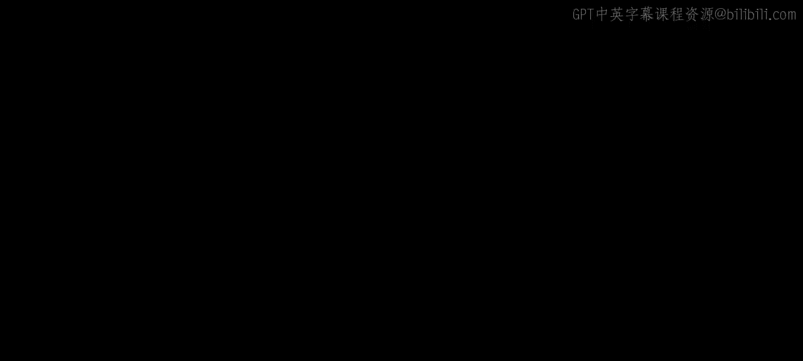
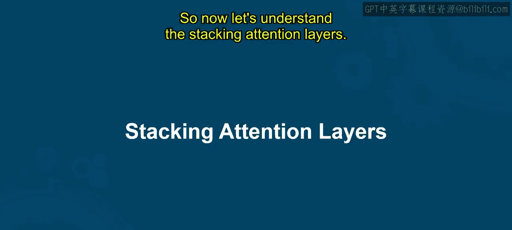
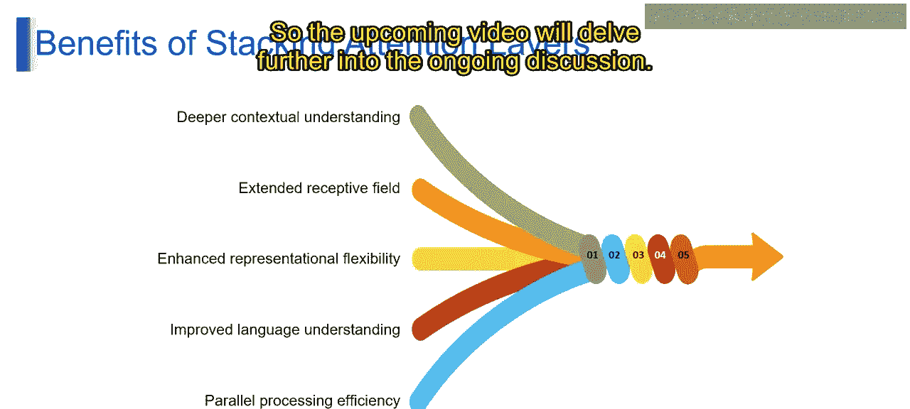

# Edureka《通过LLMs学习生成式AI（基础、应用开发、流行工具，第2、3、4课／共4课）｜Learn Generative AI with LLMs》中英 - P57：20_堆叠注意力层.zh_en - GPT中英字幕课程资源 - BV1ym421V7gx

Hello everyone。 welcomele to generative AI architecture and applications development。

 So now let's understand the stacking attention layers So in this we are going to cover what exactly the stacking attention layers and what do they do So by the end of the session you are able to understand and apply the concepts of the stacking attention layer to improve the text generation of the models So let's get started the stacking attention layers So think of stacking attention layer as building a ta with multiple flows Each floor represents an attention layer and the information gathered on one floor becomes the foundation for the next It's like stacking blocks of understanding with each layer refining and enriching the models's comprehension means stacking attention layer is a ta in LM architecture where multiple attention layers are arranged one。

😊。

After the another the output of each layer serves as the input for the next layer。

 allowing the model to iteratively refine its understanding of the input sequence。

 this stacking process enhances the model's ability to capture complex dependencies and the shades within the data by stacking attention layers elements can develop a more intricate understanding of the context and relationships within a sequence of the world。

 it's akin to peeling layers of an onion each layer exposes new insights and refines the models comprehension ultimately leading to the more robust and the shades of language understanding So now let's understand the visual representation of stacking attention layer here first of all。

 we are having the encoder base and the bird large So here in the encoder we are having multihi attention add norms feed forward neural network and the add and norm so let's understand all。

😊，です。The encoder layer typically consists of two sublay。

 the multihi attention layer and the feed forward layer。

 So these layers are stacked on top of each other with this residual connection and the layer normalization around each sublay。

 This residual connection allows the model to learn from the gradients of the previous layers more easily and the layer normalization helps to stabilize the training process。

 The number of encoder layers can vary depends on the specific bird model in this。

 if we can see the bird base， it depends on the number of encoder layers can vary depending on the specific bird model The diagram shows two examples。

 the bird base and the bird large， the bird base has to well encoded layers and the bird large has 24 encoded layers。

 So here is a more detailed breakdown of the encoder layer as we。😊。

encoder layer contains multihi attention layer。 So what exactly it will。

 This layer allows the model to attend to different parts of the input sequence simultaneously it does this by learning multiple attention heads where each head focuses on different aspect of the relationship between the words。

 Then the next one is of fade forward layer。 So this layer is a simple fully connected neural network that is used to learn nonlinear relationship between the words in the input sequence Then the next one is of add and no。

 So these are the residual connections and layer normalizations respectively as mentioned before the residual connection adds the output of the sublay to the input of the sublayer and the layer normalization normalizes the activations of the sublay means overall the stacking attention layers allows the。

B model to learn in increasingly complex relationship between the words in a sequence。

 the more layers there are the more complex the relationships the model can learn。 However。

 more layers also mean more parameters and also the more computation。

 So that's about the visual representation of the encoder bird base and bird large。

 So now let's understand the benefits of stacking attention layer。

 The first one is of deeper contextual understanding。 So imagine reading a story。

 think of reading a story and trying to understand the characters and the plot。

 stacking attention layer is like dividing deeper into each layer of story。

 allowing the model to capture richer context and the shades and details at different levels of the comprehension。

 Then the next one is of extended receptive field visualizing scanning lens let's example picture。😊。

Using a lens to examine the different parts of the landscape。

 Staing attention layer is like having multiple lenses， each focusing on a specific area。

 This extracts the model vision to encompass a broader range of information in a input sequence。

 Then the next one is of enhanced representational flexibility。

 So means adapting to different styles， Think of a model。

 trying to understand the various writing styles， stacking attention layer offers flexibility by accommodating diverse aspects of the input。

 enabling the model to adapt and represent information in different ways from formal to informal language。

 Then the next one is of improved language understanding means learning from examples。

 Consider a student learning a language through the examples。

 stacking attention layers allows the model to learn from the various angle。😊。

Improving its overall understanding of the language sheets， semantics and even syntactic structures。

 then the last one is of parallel processing efficiency。

 so it is like efficient teamwork analogy imagine a team working on a project where each member handles a specific task concurrently。

 so stacking attention layer allows the model to efficiently process information in parallel A its ability to understand and generate the text by distributing the workload across the multiple layers。

 So the upcoming video will delve further into the ongoing discussion。😊。

