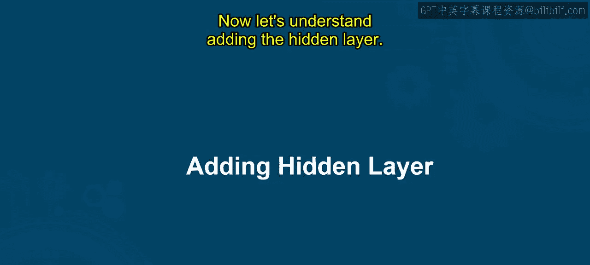
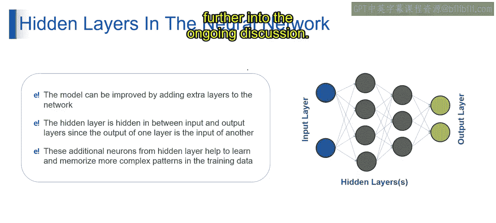

# Edureka《通过LLMs学习生成式人工智能（机器学习和NLP基础，第1课／共4课）｜Learn Generative AI with LLMs》中英字幕 - P57：56_添加隐藏层.zh_en - GPT中英字幕课程资源 - BV1q4421Q7qh

Hello everyone， let's dive into the captivating world of machine learning and the foundational concepts of NLP together。

 So now let's understand adding the hidden layer in this we are going to understand the theory behind adding hidden layers in the neural network and then where understanding the demonstration by the end of the session you are able to comprehend the role and significance of hidden layers within the neural network。

 so let's get started hidden layers in the neural network adding a hidden layer refers to incorporating an additional layers between the input and the output layers in neural network architecture so this hidden layer contains neurons that perform computations on the input data enabling the network to learn complex patterns and representations from the data by adding the hidden layers the model gains the capacity to capture more。

😊。

Features and the relationship between the input data。

 potentially enhancing its performance and accuracy on various tasks means adding hidden layers involves defining the new layers with the specified number of neurons and connecting it to previous layer each neuron in the hidden layer receives input from the neurons in the preceding layer applies avaed sum of inputs along with the biost and passes the result to the activation layer to produce an output this process allows the hidden layer to learn and extract meaningful features from the input data contributing to the overall predictive power of the neural network but while it is actually required。

 so we add hidden layers to neural networks to increase the model's capacity to learn complex patterns and relationships in the data like feature learningline。

😊，Enhanced expressiveness improved generalization so when we see feature learning hidden layers allow the neural network to abstract and hierarchical representations of the input data。

 each layer extracts and transforms features from the previous layers output。

 enabling the network to capture the intricate patterns that may not be directly observable in the raw input。

 then I set nonlinearity means this hidden layers introduce nonlinear transformation to the input data enabling the network to model nonlinear relationship between the input and the output without the hidden layers the network would only be able to learn the linear mappings limiting its ability to handle the complex tasks。

😊，Then to enhance the expressiveness means adding the hidden layers increase the expressiveness of the neural network。

 allowing it to approximate more complex functions。

 this is especially important for tasks with high- dimensionmensal input data or nontrivial decision boundaries then improve generalization with the hidden layers the network can learn more diverse and robust representations of the data leading to better generalization to unseen examples。

 hidden layers help prevent overfitting by capturing relevant patterns while filtering out noise and relevant information from the input means adding the hidden layers to the neural networks enable them to learn intricate features。

 model nonlinear relationships， enhance the expressiveness and improve the generalization making them more effective in solving complex machine learning tasks here as per。

😊，Standing hidden layers in neural networks plays a crucial role in enhancing model performance and capacity to learn indicatetricate patterns in the data。

😊，The first one is of model improvement。😊，By adding extra hidden layers to the network。

 we increase its depth and complexity， allowing it to capture more shades and indicatetricate patterns in the data。

 This can lead to significant improvement in the model performance。

 then intermediary processing means the hidden layer serves as an intermediary between the input and the output layers。

 the output of one layer becomes the input to the next layer allowing for a hierarchical representation of the data。

 this hierarchical representation enables the network to learn and extract increasingly abstract and complex features from the input data。

 Then learning the complex patterns。 The additional neurons to the hidden layer contribute to the network's ability to learn and memorize complex patterns present in the training data These neurons can detect subtle relationships and dependencies among the input features leading to a more。

😊，hensive understanding of the underlying data distribution means hidden layers plays a very important role in deep neural networks by enabling them to learn intricate patterns and representations from the data by adding these hidden layers we enhance the models capacity learn and generalize from the training data ultimately improving its performance on various machine learning tasks so the upcoming video will delve further into the ongoing discussion。

😊。

