# Edureka《通过LLMs学习生成式人工智能（机器学习和NLP基础，第1课／共4课）｜Learn Generative AI with LLMs》中英字幕 - P58：57_神经网络中的隐藏层.zh_en - GPT中英字幕课程资源 - BV1q4421Q7qh

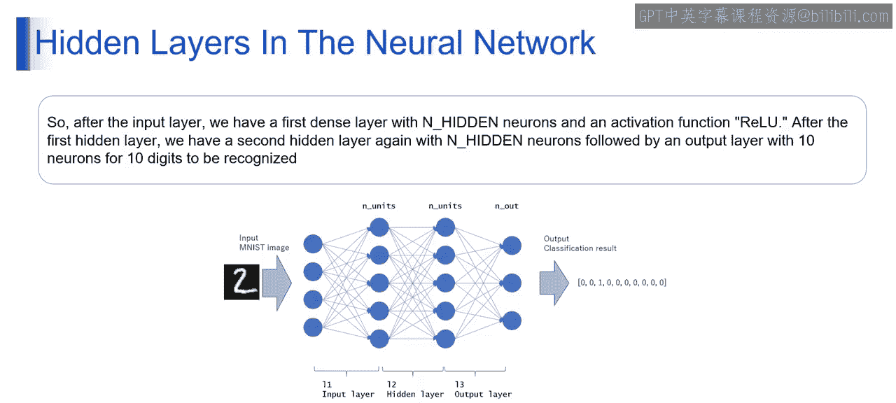

So lets now explore the progression from our previous discussion。

 So now let's understand with an example in the neural network architecture。😊。

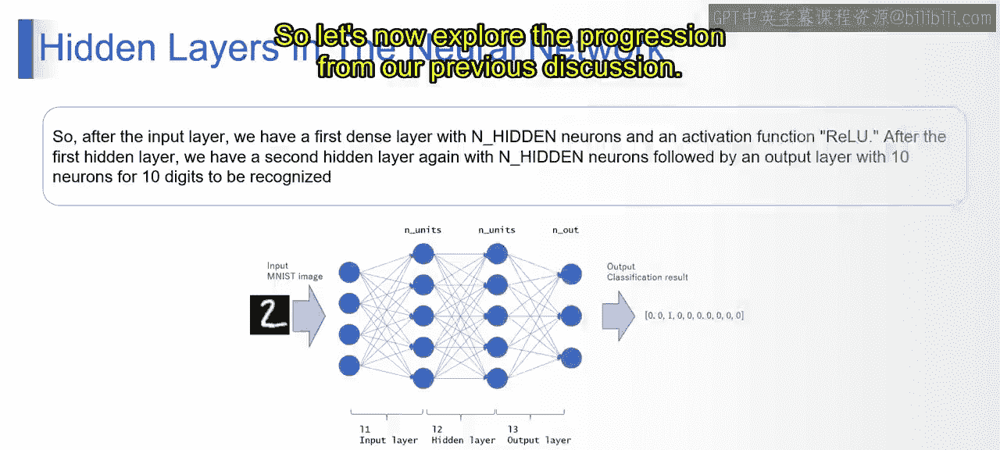

After providing the input with Mnes image we are having two hidden layers and then the output layer so first hidden layer what exactly it is going to do it is also known as first dense layer The first hidden layer consists of n hidden neurons n hidden is a predefined number and applies the relu activation function Each neuron in this layer takes input from all the neurons in the input layer performs a weighted sum of inputs add a biostrom and applies the relu activation function to produce an output Relu is nothing but rectified linear unit it is a popular activation function that introduces non-lineity to the network by outputting the input directly if it is positive and0 otherwise then the second one is of second dense layer or the second hidden layer。

😊。

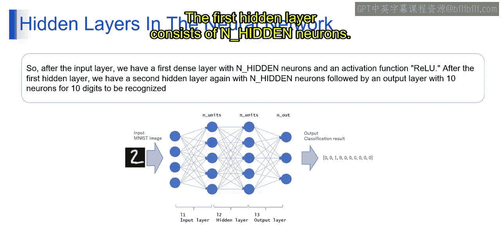

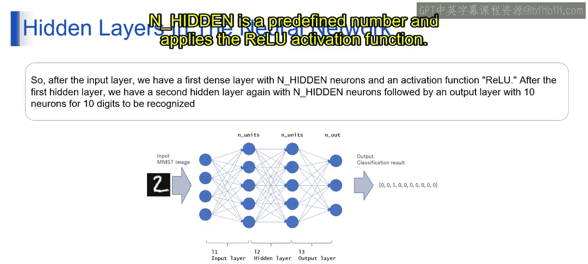

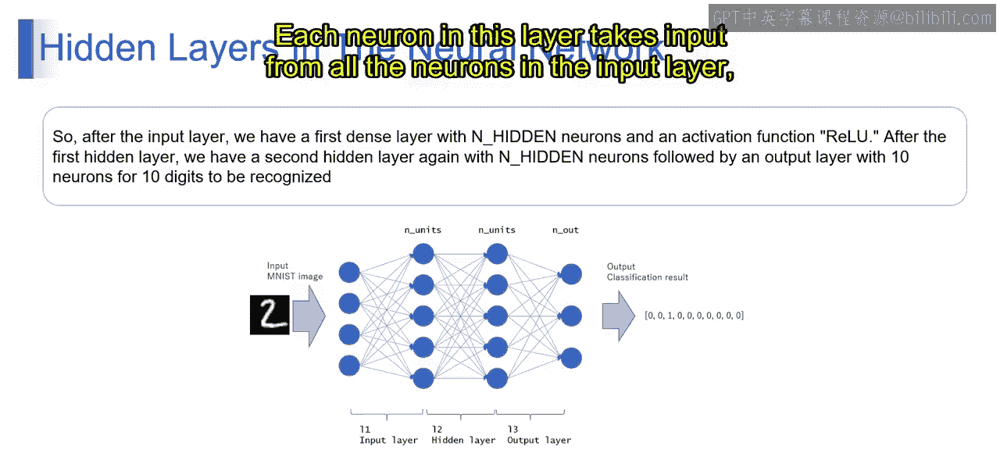

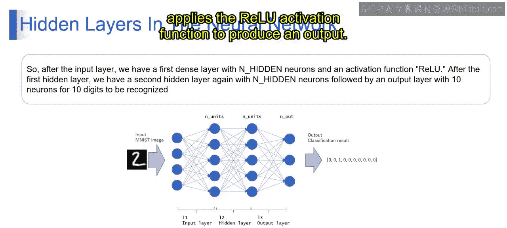

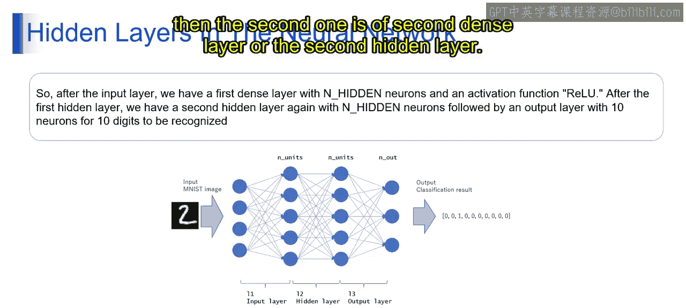

So what exactly it will do following the first hidden layer。

 we have a second hidden layer with again n hidden neurons similar to the first hidden layer。

 each neuron in this layer computes aed sum of inputs adds a bioastom and applies the relu activation function to produce an output。

 This additional hidden layer allows the neural network to learn more complex and abstract representations of the input data。

 Then finally， the output layer。 We have an output layer with 10 neurons。

 Each corresponding to one of the 10 digits like 0 to 9 to be recognized。

 the output layer uses an appropriate activation function typically softm or multiclass classification tasks like digit recognition。

 Softax function normalizes the output scores across all neurons producing a probability distribution over the possible classes means。

😊。

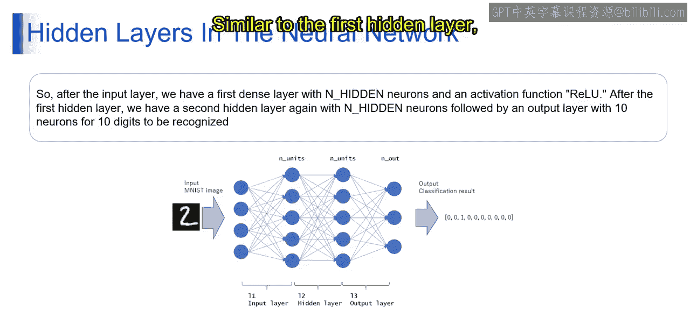

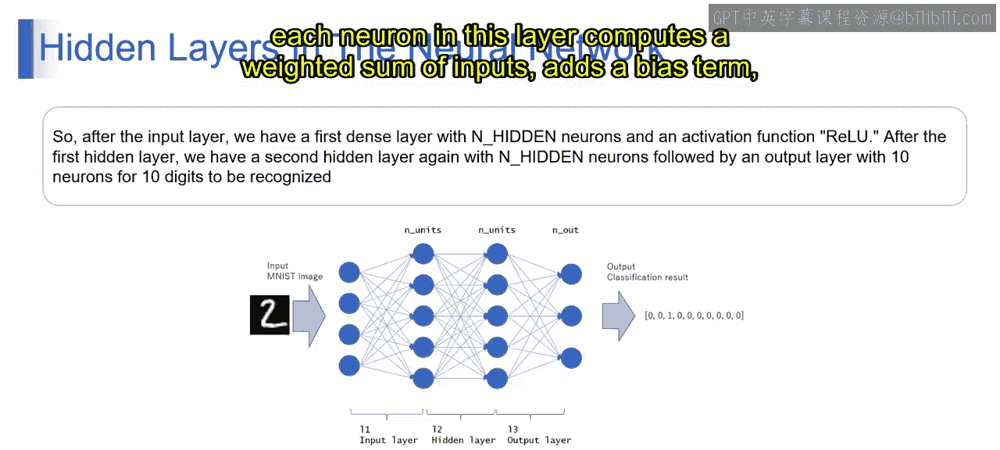

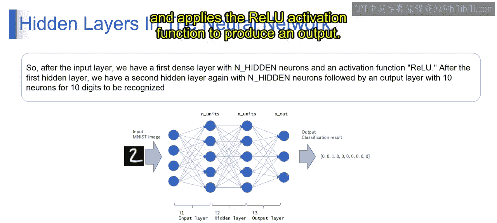

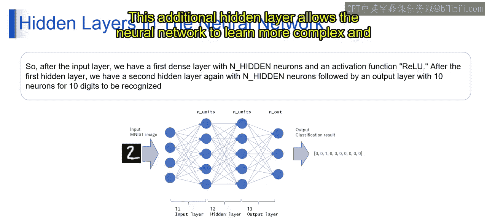

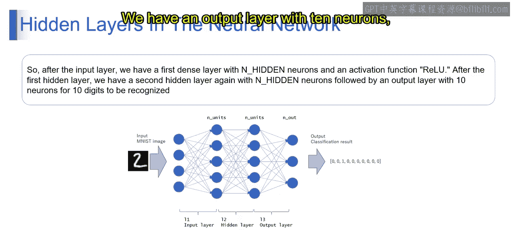

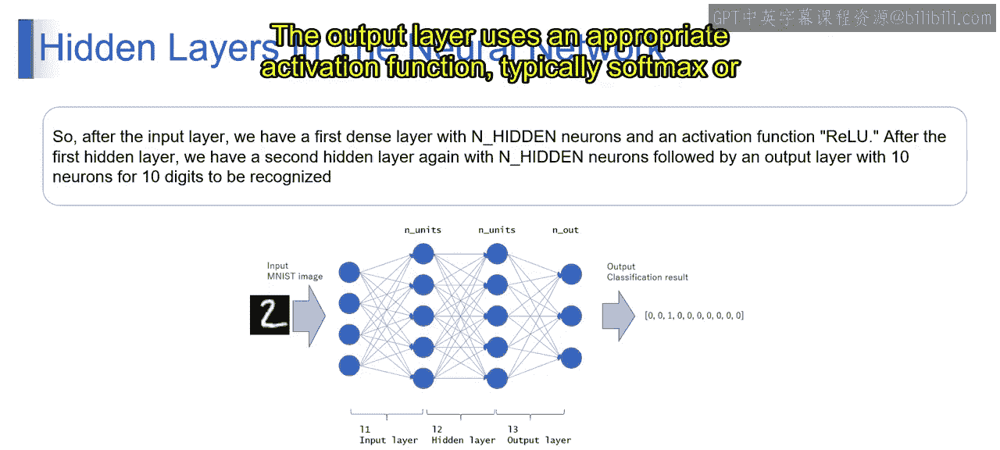

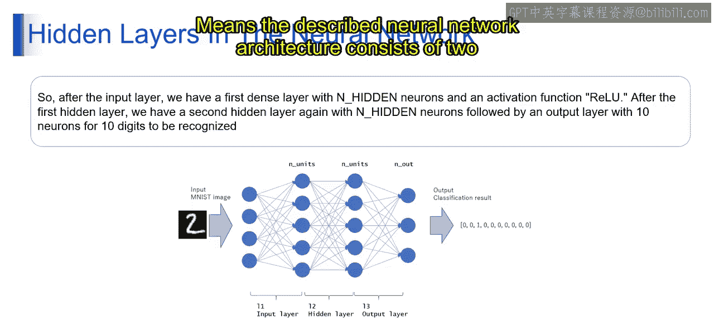

The described neural network architecture consists of two hidden layers with n hidden neurons each applying the relu activation function followed by an output layer with 10 neurons using So match activation for recognizing digits from the images。

 This architecture allows the network to learn complex patterns and relationships in the input data and make accurate predictions for the digit classification tasks。

 Now this is the output。 This is all about the demonstration。 So now the summary in this lesson。

 you have gained the ability to utilize the hidden layers within the neural network models to capture and predict the complex relationships within the data。

 Thank you。😊。

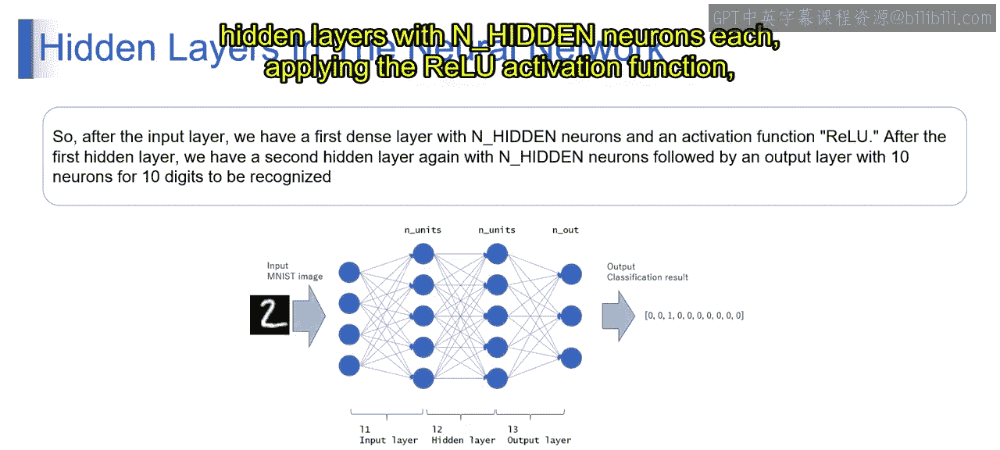

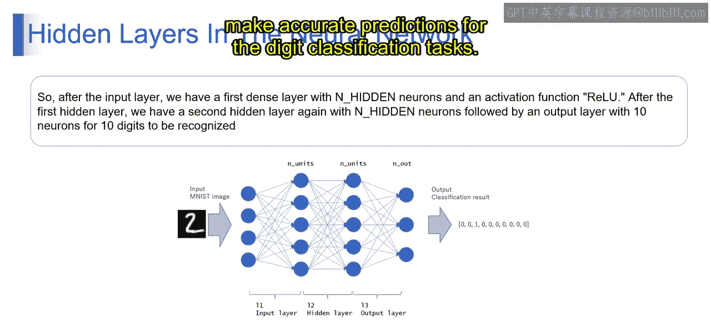

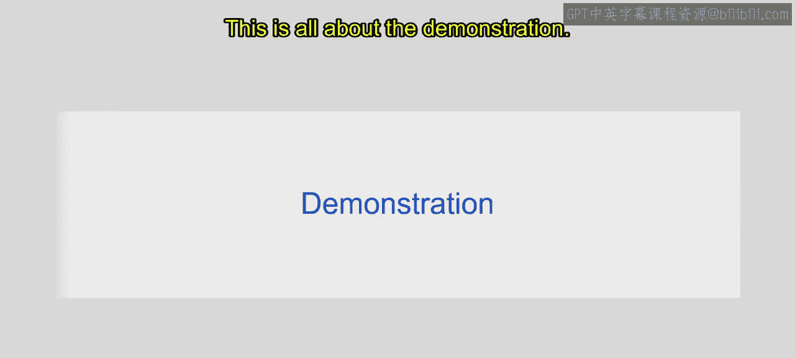

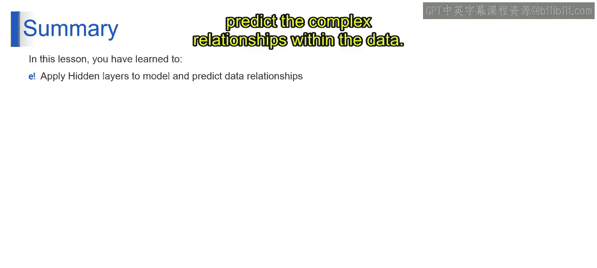