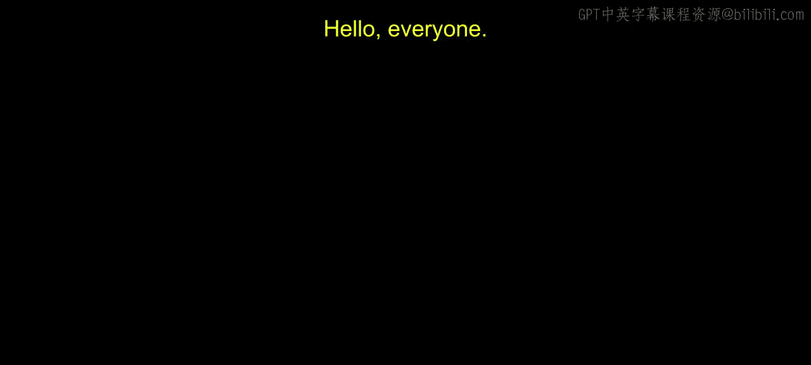
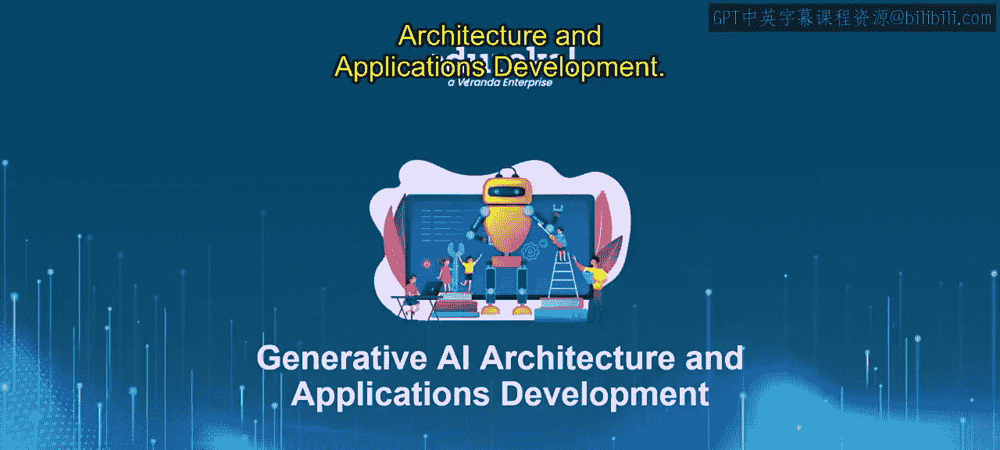
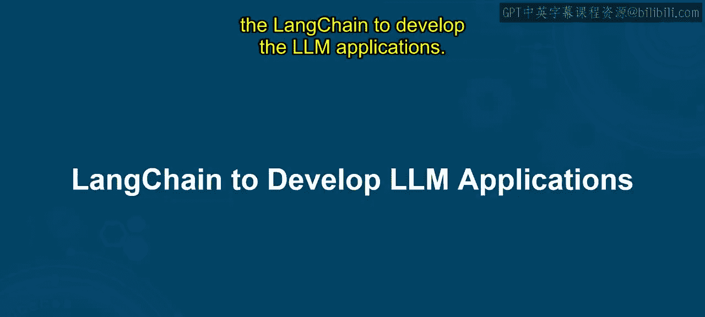
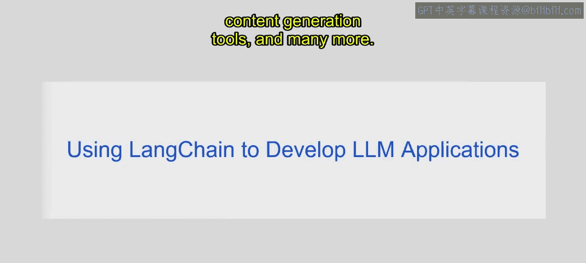
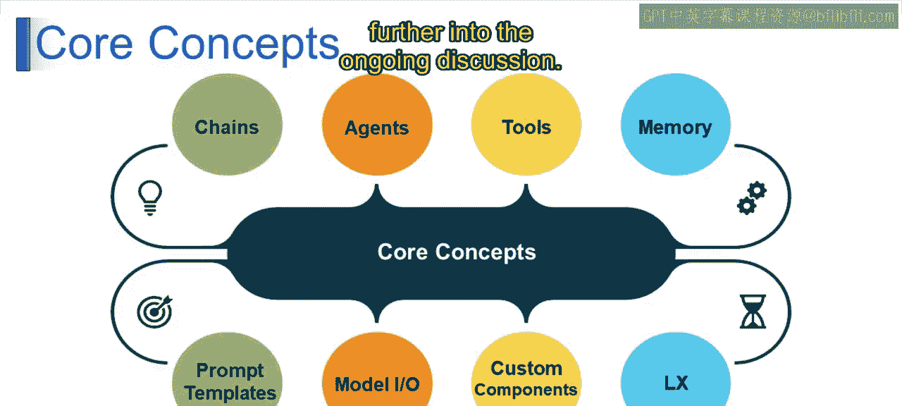

# Edureka《通过LLMs学习生成式AI（基础、应用开发、流行工具，第2、3、4课／共4课）｜Learn Generative AI with LLMs》中英 - P59：22_使用LangChain开发LLM应用.zh_en - GPT中英字幕课程资源 - BV1ym421V7gx

Hello everyone。 welcomee to Generative AI architecture and applications development。

 So now let's understand the Lcha to develop the LLM applications In this lesson you are going to understand what exactly a L chain is and what it will do with the LLms and using the L chain how you will develop the LLM applications So by the end of the session you are able to understand and develop the LLM application using the Lcha So let's get started using the Lcha to develop the LLM application So prior getting into this first let's understand the definition of what exactly the Lcha is all about So imagine you have a friend who is a storytelling genius every time you give them a topic they come up with the fantastic stories So Lcha is like a magical tool that lets you chat with this intelligent storytelling trend that turns their tails into cool stuff。

😊。

Like games or question answersing machines。 So your super creative friend。

 the LLM here this friend is like a computer program filled with ideas and stories。

 It's smart enough to understand your words and respond with new ones just like chatting with your buddy So then the chat tool is here is nothing but the Lcha。

 So now made the Langcha。 It's the tool that helps you talk to your super creative friend。

 Langcha helps you give instructions and understand what your friend。

 the computer program says it even remembers the past conversations to make the stories even better。

 Then what about the school app that is nothing but the LLM application the real magic happens here by using thecha to chat with your super smart creative friend。

 you can create awesome applications picture a game where the friend makes up silly story based on your choices all。

😊，A program that answers your questions in a clever way。

 So Langcha transforms the superpower of understanding and creating language into useful applications。

 Pre cool， right， So now let's understand in a technical terms。 So L is an open source framework。

 Think of it as again toolbook for your programmers。

 This provides tools for building applications using the large language models So these elements are like brains behind the scenes。

 train on tons of textual data to understand and respond to language like humans。

 So here is a quick look at La key partss。 So to understand the quick look of a。

 It mainly come up with the key points of framework。 open source and also a large language models。

 So with the La programmers can create the chatbos， question answering systems。

 content generation tools and。😊。

The next one is core concepts of the la So before understanding the core concepts behind the L chain now let's understand the blocks that we use in the chain Here is a breakdown of some core la building blocks The first one is of the chain So imagine a chain reaction where one even leads to the other event in chain change or the core workflow concepts the link together with the different components like Lego bricks for example。

 a chain might involve sending a pro to the large language model building its response and then using the response to generate the another prompt So that's how the chains work Now the next one is of the agent So these are like the managers in your large language applications Age handle tasks like connecting to the LLM sending。

Proms and receiving the responses， they act as intermediates between your application and the powerful LLM。

 Then the next one is of tools。 So Lcha offers various tools that perform specific functions within your application These might include tools for data processing next manipulation or formatting the LLM output for your application。

 That's about the tools。 Now the next one is of memory。

 just like you remember the things in a conversation L chains memory component allows your application to store information from the past interactions within the LLm。

 So this can be helpful for tasks that require the context while building a chatbo that remember the past conversation。

 That's about the memory。 Then the next one is of pro templates。

 So these are predefined structures for giving instructions to the LLM。

 Think of them like the recipe。😊，Ps for cooking， they can save the time and ensure consistency when crafting prompts for the LLms。

 Then the next one is of model input output。 This refers to the components in the la that handles communication with the different LLM providers。

 It ensures compatibility with various Lm As。 So that's about model input output。

 Then the next one is of custom components。 So Ls open source nature allows the developers to create their own custom components to address specific needs within their applications。

 So that's when we are utilizing the custom components。 Then the last one is of expression language。

 This is also known as L。 So this is a powerful feature within the language that allows for more complex and dynamic prompt creation。

 It's like having a specific programming language specially designed for integrating with the large language。

😊，They combine these core building blocks together gather programmers can create sophisticated LLm applications that interact with the world in a unique way。

 Laangin provides a flexible and user friendly environment to unleash the potential of the LLm。

 It may getting expanded like lasmith and many more。

 So the upcoming video will delve further into the ongoing discussion。😊。

