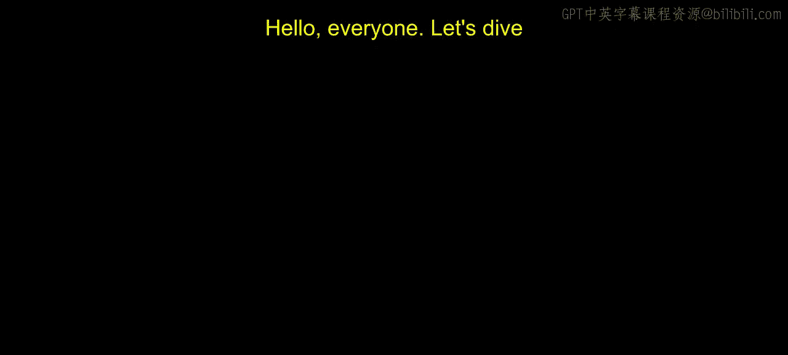
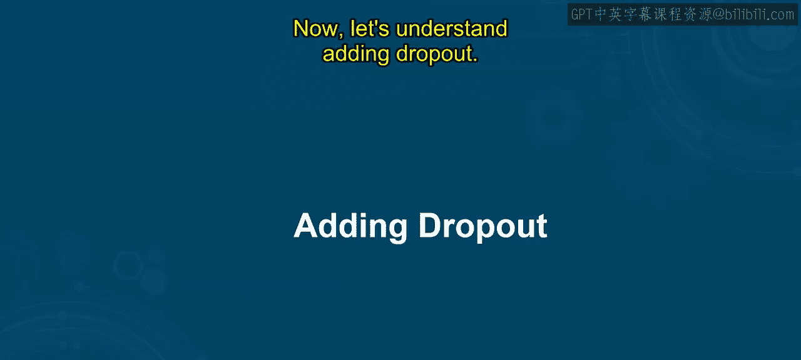
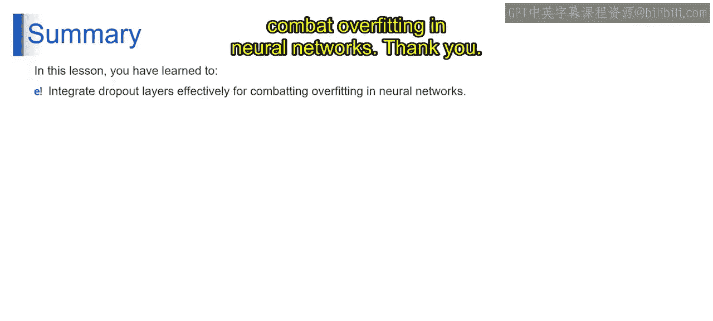

# Edureka《通过LLMs学习生成式人工智能（机器学习和NLP基础，第1课／共4课）｜Learn Generative AI with LLMs》中英字幕 - P59：58_添加dropout.zh_en - GPT中英字幕课程资源 - BV1q4421Q7qh

Hello everyone， let's dive into the captivating world of machine learning and the foundational concepts of NLP together。

 So now let's understand adding dropout in this， we are going to cover inclusion of dropout layers and its demonstration by the end of this session you are able to grasp why dropout layers are crucial for preventing overfitting and enhancing generalization in neural networks。

 So based on the previous understanding of how the neural networks work along with the activation input layers。

 hidden layers and output layers Now let's understand the inclusion of dropout layers。

 Let me start explaining with an example Imagine you are studying for a test and you are practicing with a friend who tends to memorize answers rather than understanding the material。

 So to prevent yourself from relying too much on your friends memorize。😊。

Answers you decided to randomly skip some of the practice sessions with your friend and study independently this way。

 you ensure that you are learning the material more robustly and not just memorizing the specific answers in a similar way in neural networks inclusion of dropout layers involves randomly deactivating or dropping out a fraction of neurons during the training process。

 This prevents individual neurons from relying too heavily on specific features or the patterns in the data and encourages the network to learn more robust and generalized representations。

 Dropout helps mitigate overfitting by introducing noise and redundancy。

 forcing the network to learn more resilient features and reducing reliance on any single neuron or features。

😊，During inference means while testing or prediction。

 Dout is typically turned off and the full network is used for making the predictions means in our example your decision to occasionally study independently instead of always practicing with your friend mirrors the dropout technique in neural network just as you introduce availability in your study routine to prevent overreliance on specific study sessions。

 Dropout layers introduce randomness in neural neuraln activations to prevent overfitting in neural networks by diversifying the learning process Dout encourages the network to learn more robust representations enhancing its generalization capabilities So now let's understand exactly what it is and why it is even required Dout is required。

😊，neuralural networks to address the problem of overfitting。

 so overfitting occurs when a model learns to memorize the training data too closely。

 capturing noise or irrelevant patterns that do not generalized well to unseen data means dropout helps mitigate overfitting by introducing randomness during the training。

 forcing the network to learn more robust and generalized features。

 especiallyly dropout randomly ignores a fraction of neurons during the age training iteration。

 effectively creating a diverse ensemble of smaller networks by doing so dropout prevents individual neurons from becoming overly specialized or co-adaping with each other。

 En the network to learn more independent and robust features。

 this regularization technique promotes。😊，Better generalization by ensuring that the network does not relate too heavily on specific patterns in the training data。

 leading to improved performance on unseen data means dropout is essential for improving the models ability to generalize and perform well on new unseen examples in complete technical understanding。

 Dout is a regularization technique used in the neural networks， where during the training。

 randomly selected neurons are ignored or dropped out with a certain probability this prevents individual neurons from relying too much on specific features reducing the risk of overfitting to the training data by encouraging the network to learn more robust features and preventing it from the memorizing noise in the training data Dout involves the models general。

😊，ization performance on unseen data。 So now the demonstration。

 So imagine you are learning a play game of dots when the target represents the optimal solution。

 you are aiming to achieve initially you practice by throwing dots at the target repeatedly。 However。

 you notice that your aim becomes too precise and you start hitting the same spot consistently which might not be a bulls eye this scenario reflects overfitting in machine learning。

 when the model becomes overly specialized to the training data and fails to generalize well to new data to address this。

 you introduce a dropboard mechanism during your practice sessions occasionally。

 you decide to blindfold yourself and through the dots randomly without aiming precise at the target。

 this dropout technique introduces variability in your。😊。

I preventing you from becoming too reliant on specific aiming technique as a result。

 you develop a more robust and adaptable throwing technique capable of hitting various areas of the target。

 including the bulls eye。 even under the different conditions Similarlyly in neural networks drop out randomly ignore some neurons during the training process。

 forcing the model to learn more robust features and preventing it from becoming overly specialized to the training data。

 This encourages the network to develop a more generalized understanding of the data。

 enhancing its ability to make accurate predictions on unseen examples。 So that's a demonstration。

 Now， the summary in this lesson， you have acquired the skills to。😊。

How to effectively integrate dropboard layers to combat overfitting in neural networks。 Thank you。

