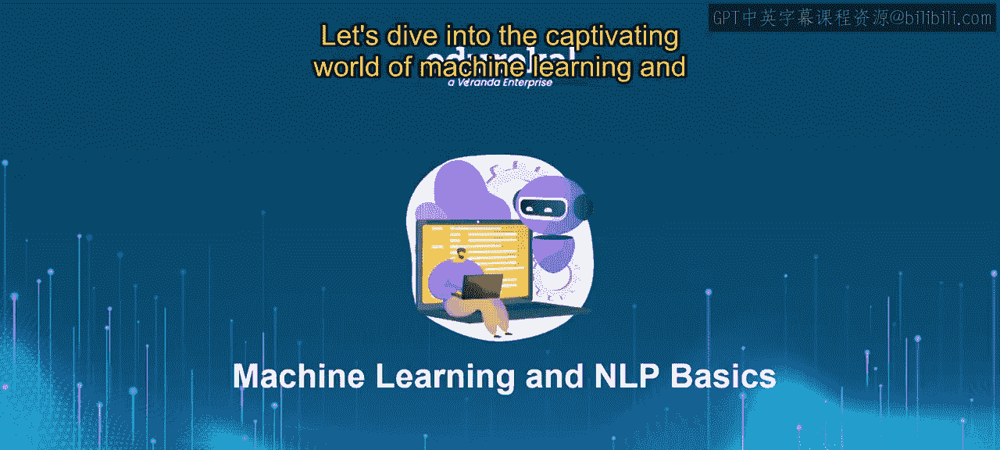
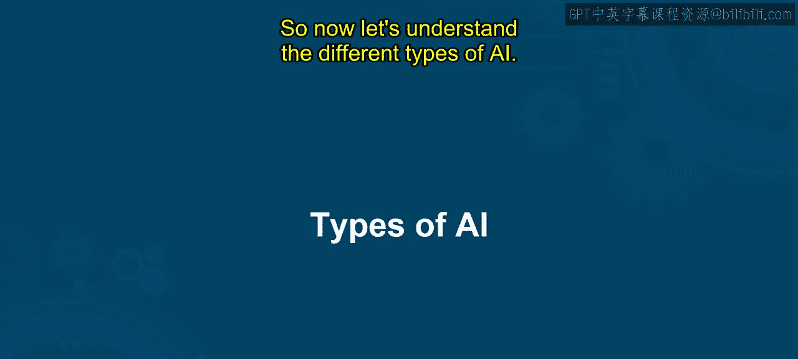
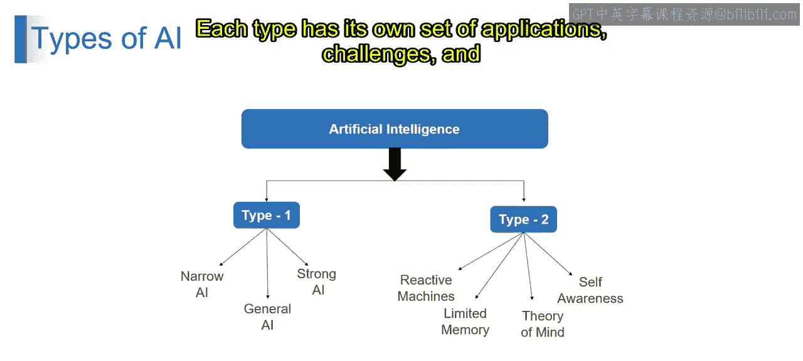

# Edureka《通过LLMs学习生成式人工智能（机器学习和NLP基础，第1课／共4课）｜Learn Generative AI with LLMs》中英字幕 - P5：4_AI的类型.zh_en - GPT中英字幕课程资源 - BV1q4421Q7qh

Hello， everyone， let's dive into the captivating world of machine learning and the foundational concepts of NLP together。

 So now let's understand the different types of AI In this。

 we are going to cover a broad classification of AI and narrow AI。

 which is nothing but weak AI versus general AI。 that is strong AI， versus artificial superinligence。

 that is Ai。😊。

By the end of the session you are able to identify and explain the discussions between the various types of AI and develop a comprehensive understanding of the broad classification of AI so let's get started So let's break down the types of the AI first to all the artificial intelligence it contains two different types type 1 type 2 So type 1 consists of narrow AI general AI and strong AI So narrow AI it is also known as a weak AI or narrow intelligence refers to AI systems that are designed and trained for specific task or the domains these systems excel a performing predefined task but lack the ability to generalize or adapt to new situations beyond their intended scope that's about narrow AI then coming to the general AI it is also known as。

😊，Strong AI or AG artificial general intelligence。 It aims to replicate the broad range of cognitive abilities exhibited by humans。

 So general AI systems would possess the ability to understand。

 learn and also apply knowledge across the diverse domains similar to human intelligence。

 then coming to the strong AI So strong AI refers to AI systems that exhibit human level intelligence across all domains and tasks。

 these systems would possess consciousness， self-awareness and the ability to reason understand the context and engage in complex decision making independently。

 So that's about the type1 coming to the type2 here we are having four different types Reactive machines。

 limited theory theory of mind self-aware。 So let's understand first of all， reactive mission。

So these are AI systems that operate solely based on the current input without any memory of past events they react to stimulate in real time but do not have the ability to store or recall information from the previous interactions so then the next to one is of limited memory so unlike reactive mission AI systems with limited memory can store and recall past experience to inform their decision making processes these systems have a short termm memory that allows them to learn from recent interactions and adapt their behavior accordingly then coming to the theory of mind so this refers to the ability of AI systems to understand and attribute mental states。

 beliefs， intentions and emotions to themselves and others AI with theory of mind can infer the mental states of humans。

😊，And other agents enabling more sophisticated interactions and collaborations The next one is of selfaware。

 The self-aware AI systems possess the ability to recognize their own existence。

 identity and internal states these systems have a sense of consciousness and introspection enabling them to reflect on their own thoughts。

 emotions and experiences so these types of AI represent different levels of intelligence capabilities and characteristics ranging from specialized task oriented systems to more general purpose and humanlike intelligence Each type has its own set of applications challenges and implications for the future of artificial intelligence so the upcoming video will delve further into the ongoing discussion。

😊。

