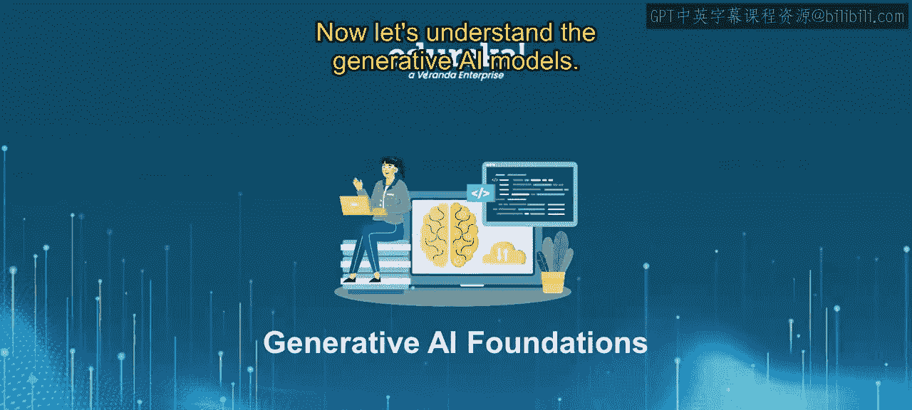
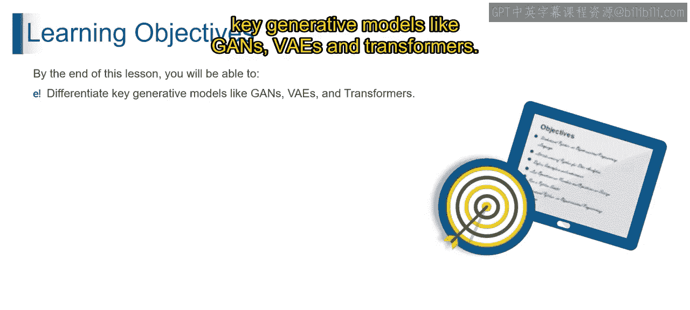
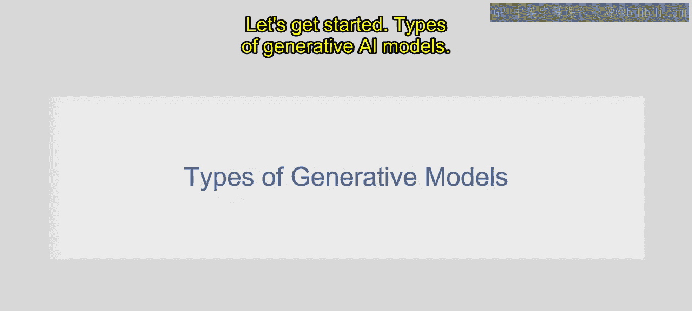
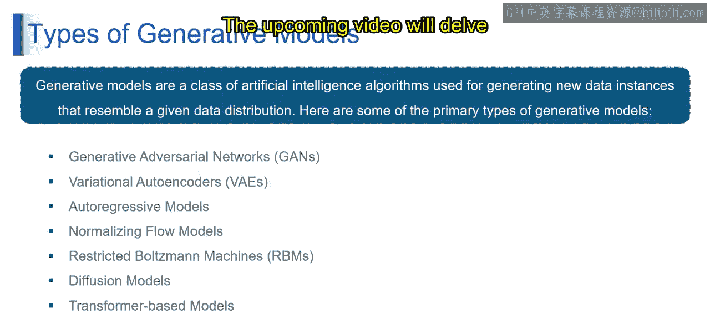

# Edureka《通过LLMs学习生成式AI（基础、应用开发、流行工具，第2、3、4课／共4课）｜Learn Generative AI with LLMs》中英 - P5：4_理解生成式AI模型.zh_en - GPT中英字幕课程资源 - BV1ym421V7gx

Hello everyone， welcome to Generative AI Foundations。

So now let's understand the generative AI models in this we are going to cover the types of generative AI models By the end of the session you are able to understand and differentiate key generative models like GNs PAs and transformers so let's get started types of generative AI models so first let's understand what all these generative AI models actually so generative AI models are a class of artificial intelligence algorithms designed to generate new data instances that closely resemble a given data distribution in simpler terms they create new realistic data that mirrors the patterns of the data they were trained on so now let's break down some of the primary types of generative models with easy to understand examples so here are the different types of generative models the first one is of generative adversarial networks which are also known。

😊。

As Gs and variational auto encoders， V As and autoregressive models， normalizing flow models。

 restricted Bsman machines， diffussion models， transformer based models。

 energy based models and then last conditional generative models。

 So let's understand all this with practical examples。 The first one is of Gs。

 So just imagine a forger and a detective in the art world show on。

 So the forger creates beautiful paintings。 and the detective's job is to tell which ones are genuine and which ones are the forged ones。

 So this ongoing challenge reflects the essence of the Gs。

 the forger is the generator creating the data and the detective is the discriminator。

 So trying to distinguish real from the generated ones。

 So together they play a game of one upmanship resulting in the。😊。

Creation of incredibly realistic data。 So in technical terms。

 generative adversarial network or the Gs are type of generative models where two neural networks。

 the generator and the discriminator are pit against each other in a constant battle。

 The generator creates the data and the discriminator evaluate its authenticity So through this a process Gs produce data that closely resemble the original distribution。

 So that's about Gs。 then the next one is of variational auto encoders， which is also known as Vs。

 So picture a student summarizing their notes to study efficiently。

 So now let's add at of creativity。 The student intentionally introduces a bit of randomness each time recreate their notes。

 So this element of randomness is the。😊，So variational auto encoders。

 So the VaEs add diversity and uniqueness to the generated data by incorporating random variations during the generation process means in technical terms Vs or variation autoenrs are a type of generative models that introduce probabilistic elements into the traditional autoencoder architecture。

 So they generate diverse and novel data instances by incorporating randomness during the encoding and decoding process。

 So that's about Vas。 Now， let's understand the autoregressive models So think of writing a story where each word depends on the words that came before it autoregressive models work similarly。

 Imagine predicting the next word in a sentence based on the other words that。😊。

these models generate data sequentially with each element depend on the ones that came before。

 like building a story one word at a time。 So if we understand technical standpoint。😊。

Autoregressive models are generative models that generate data one element at a time in a sequential manner。

 Each element is conditional on the previous ones capturing dependencies within the data distribution so that's about autoregressive models then the next one is of normalizing flow models。

 so just imagine a river flowing through a landscape taking various paths to reach its destination So normalizing flow models operate similarly transforming a simple initial distribution of data into more complex one through a series of transformations。

 it's like culturing the data landscape to match the desired output in technical terms normalizing flow models are generative models that use series of invertible transformers to map a simple distribution to a more complex ones This allows them。

😊，To generate data with intricate patterns and structures。

 then the next one is of restricted Bzeman missions， which is also known as RBm。

 So just imagine a room filled with musicians playing various instruments Each musician represents a feature and the collaboration produces beautiful music which symbolizes the data generated by the restricted Bozeman mission。

 which is nothing but RBm So RBm models， complex relationship Bin features capturing dependencies within the data。

 So technically this RBm are generatedrative models that learn a probability distribution over their set of input data the capture dependencies B input features making them effective for generating data with intricate relationship So that's about RBm then the next one is of diffusion models。

 So just picture spreading。😊，Perfume in a room， just a perfume。

 So initially it's concentrated in one area， but over the time it diffuses reaching every corner of the room。

 So diffusion models operate exactly in a similar way。

 So starting with simple and concentrated data and progressively spreading complexity throughout the entire data set。

 So in technical terms diffusion models are generative models that generate data by simulating the gradual diffusion of simplicity to complexity So the upcoming video will delve further into the ongoing discussion。

😊。

