# Edureka《通过LLMs学习生成式AI（基础、应用开发、流行工具，第2、3、4课／共4课）｜Learn Generative AI with LLMs》中英 - P60：23_LLM的核心概念.zh_en - GPT中英字幕课程资源 - BV1ym421V7gx

So let's now explore the progression from our previous discussion so now let's understand the core concepts here so LLM as a building blocks so imagine large language models as incredible powerful Lego bricks just like Legos LLMs can be combined in various ways to create complex structures La chain provides the tools and instructions like Lego instructions booklet to connect these LLM bricks and build sophisticated applications then the chaining capabilities as discussed they don't settle with simple onetime interactions with the LLM La chain chaining capabilities allows you to string together manipulate multiple prompts and LLM interactions this is like building a multistep Lego creation you can guide the LLM through the conversation flow ask followup questions based on its response。

😊。

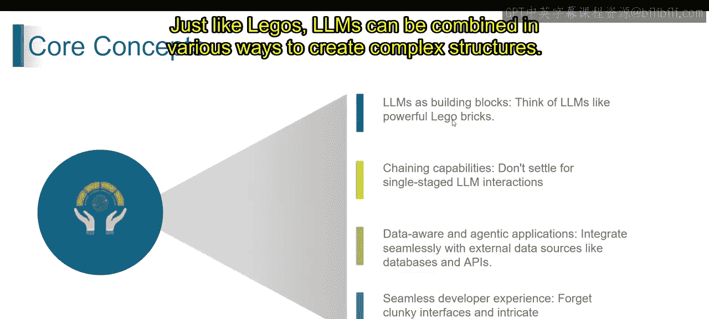

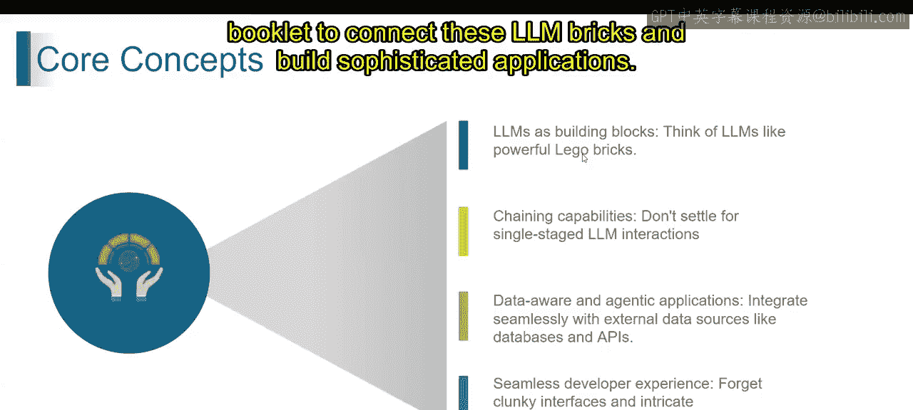

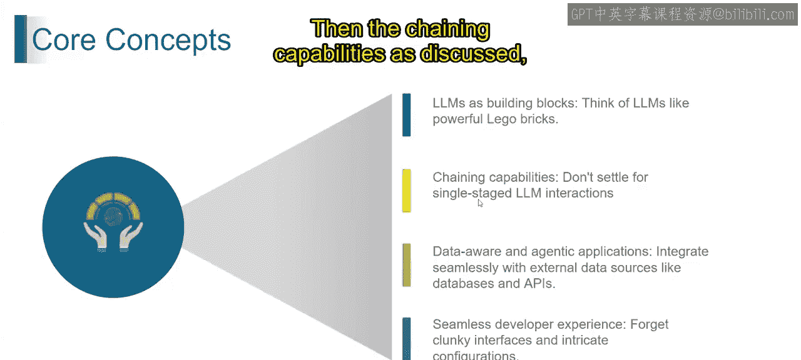

And create a more interactive and dynamic experience Then the next one is of data aware and agent applications。

 think beyond the LLM itself so Langcha allows you to integrate your application with the external data sources like databases as well as As this makes your application data aware imagine a Lego set that can interact with other toys or building materials So Lchas agent application act like a manager as discussed controlling the flow of information between the LLM your application and external data sources then the next one is of seamless developer experience so forget clunky interfaces and complex configurations So Lcha is designed with the developers in mind it offers user friendly and well documented framework think of it as having a Lego set that's easy to understand and assemble。

😊。

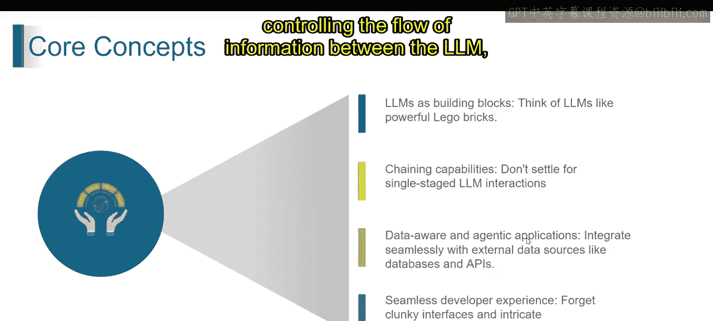

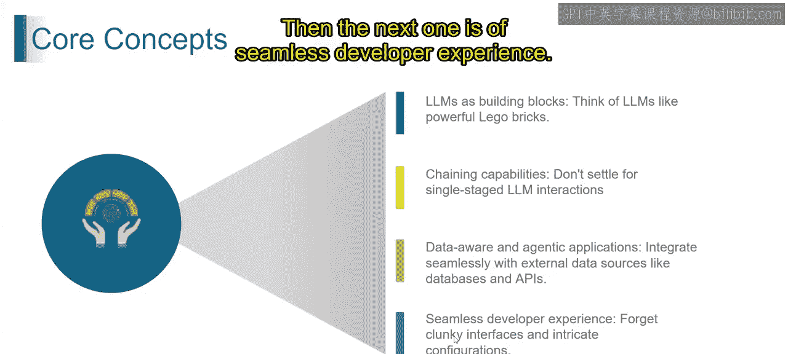

Even for the beginners， this allows the developers to focus on building their applications without getting bogged on in technical details。

 In the essence， Langcha provides a powerful and accessible environment for developers to unleash the potential of LLms and create innovative applications So these all are the core concepts of the Lcha。

 So now let's understand LLm powered applications across the drivers domains。

 First one is of intelligent search and question and answering。

 So imagine searching the web for some information but instead of just getting links you get a clear and concise answers to your questions。

 LLms are trained on likewise LLms are trained on massive amount of text data that we already know allowing them to understand the meaning of your search query and find the relevant information。

 they can then use their knowledge to answer。😊。

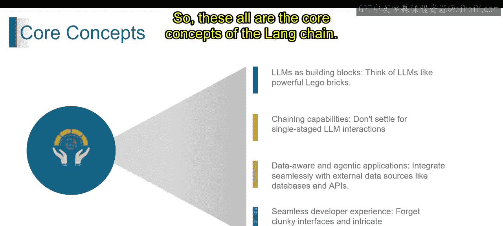

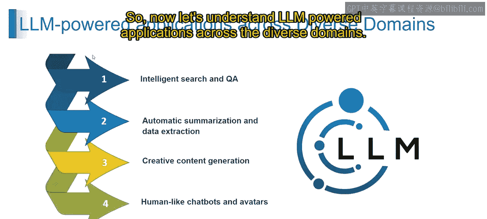

Questions directly like a superpower search engine。

 Then the next one is of automatic sumization and data extraction。

 Imagine having a long document or the article and the LLm tool can automatically create a short summary that captures the main points with the LLms likewise。

 LLms can analyze large documents of the text and identify the key information they can then condense this information into shorter more digestible format。

 saving you the time as well as efforts。 So that's about automatic summarization as well as data extraction。

 Then creative content generation。 So for example， imagine getting writers block but an LLm tool can help you brainstorm your ideas or even write different creative text formats like poems or the code scripts or the musical pieces So means LLms are exposed to the vast amount of the creative text during the training process。

😊。

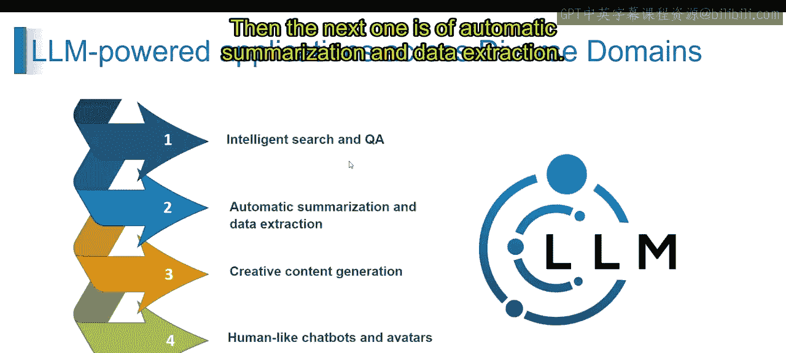

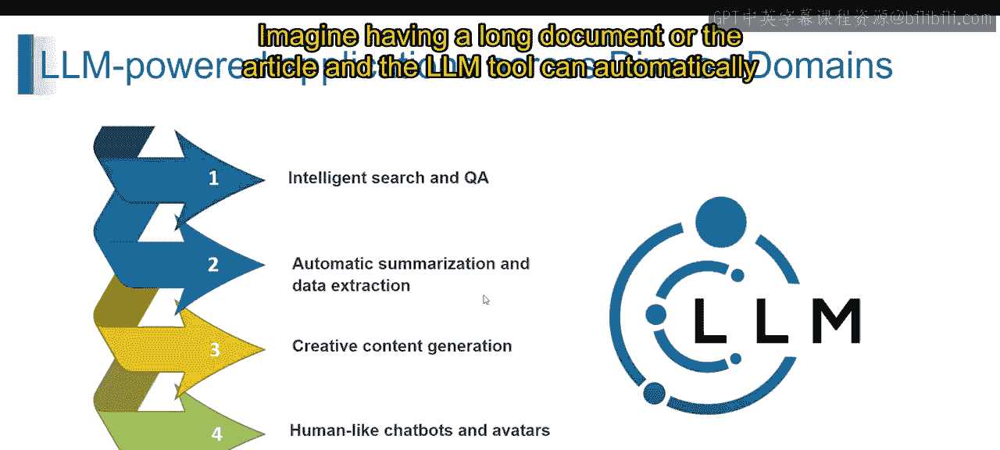

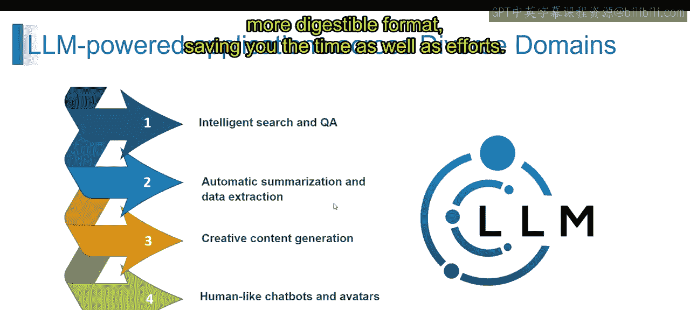

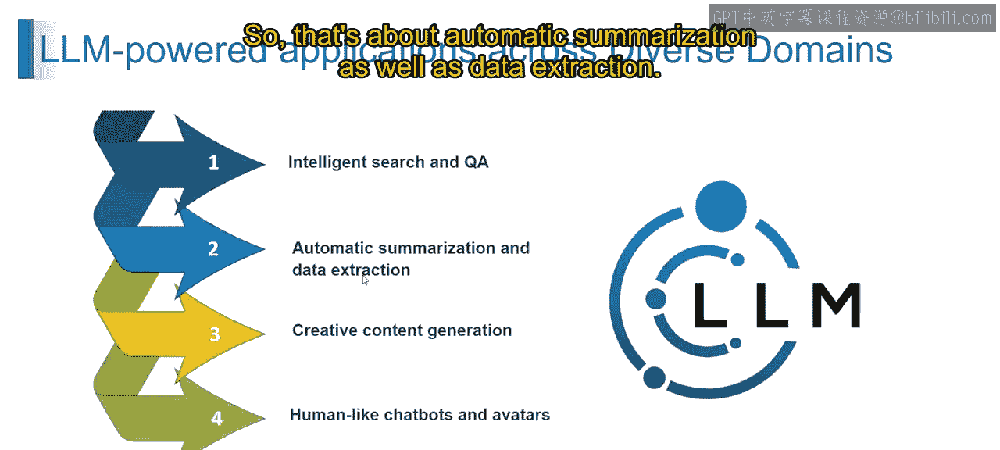

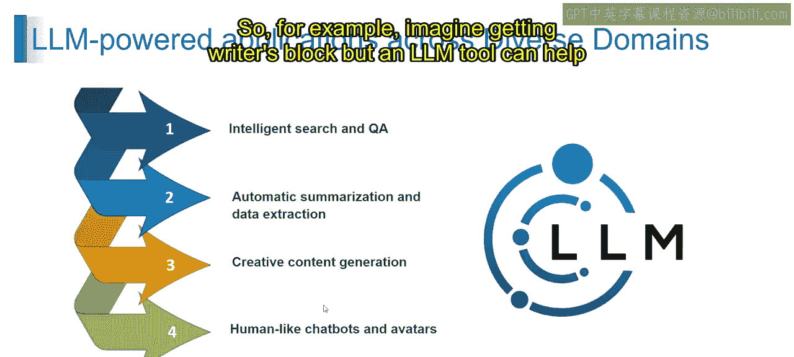

Because of that reason， it will allow them to learn different writing styles and generate the new creative text formats based on your prompts and instructions。

 so that's about creative content generation then the last one is of humanlike chatbos and avatars so imagine having a conversation with the virtual assistant that can understand your questions and response in a natural human like way rather like a robot means LLMs are as because they train on the conversational data which will allow them to understand the shades of the human language。

 chatbos and avatars powered by the LLMs can engage in meaningful conversation and your queries and even provide emotional support as well means these are just few examples and potential applications of the LLM technology and constantly evolving by combining the power of LLM with the Lchas development framework。

😊。

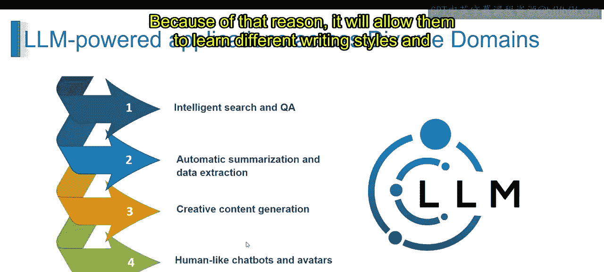

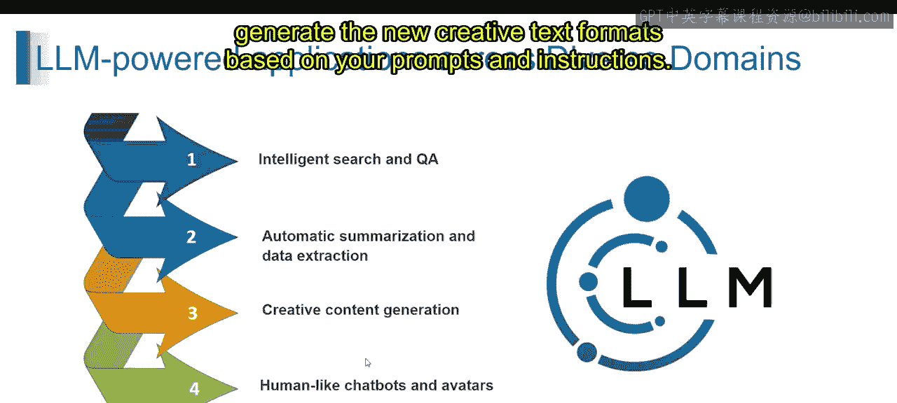

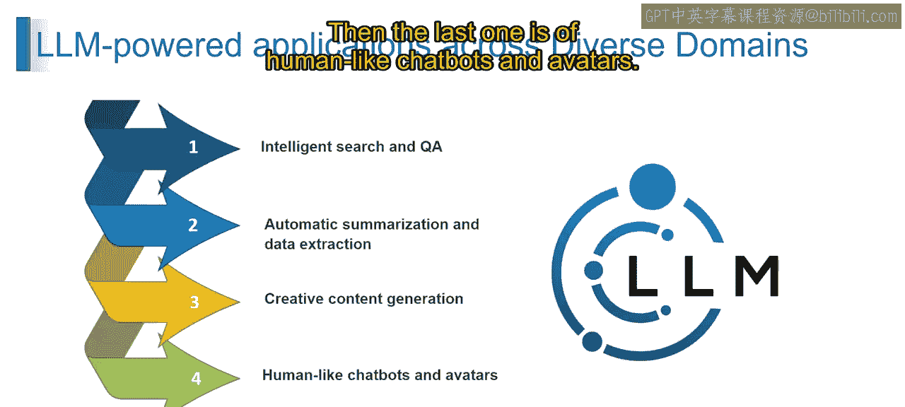

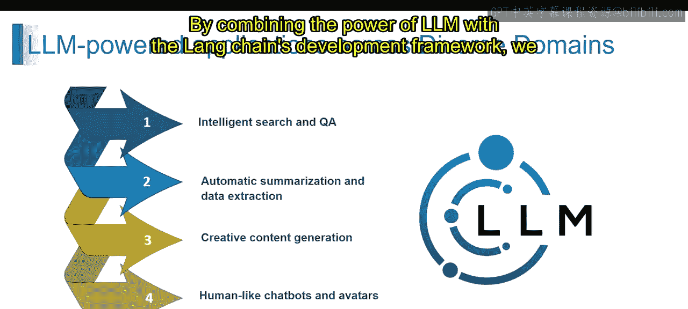

You can create even more innovative and useful applications across the diverse' domain。😊。

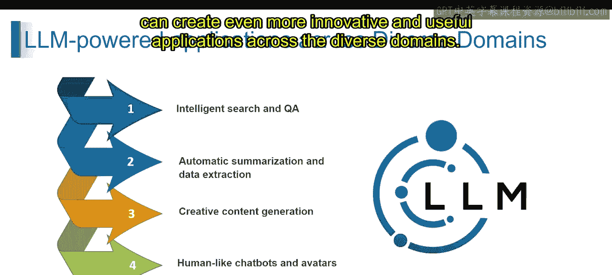

So the upcoming video will delve further into the ongoing discussion。😊。

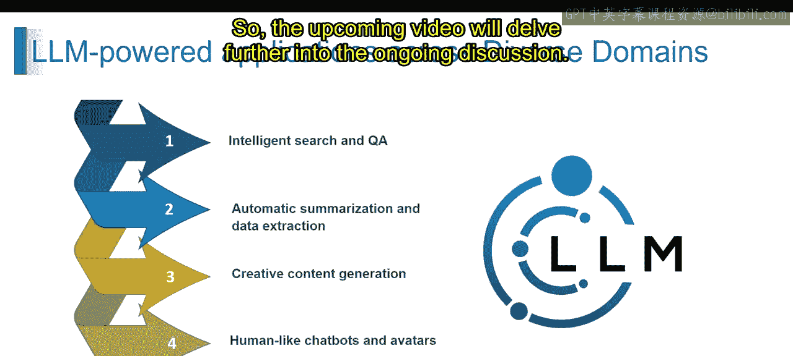