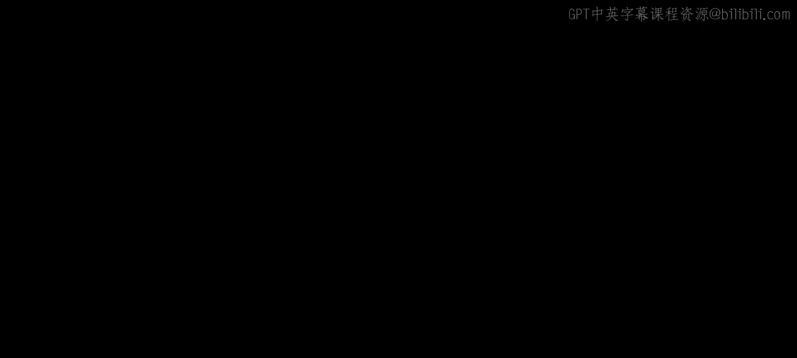
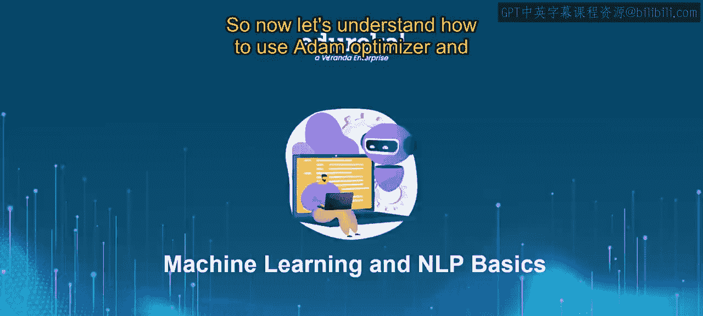
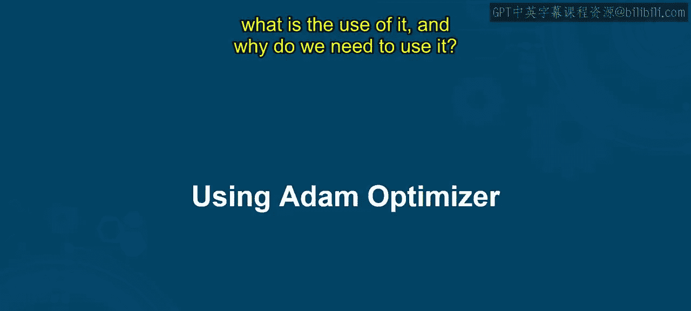
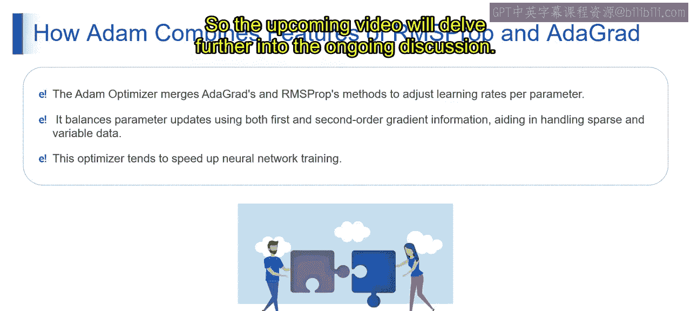

# Edureka《通过LLMs学习生成式人工智能（机器学习和NLP基础，第1课／共4课）｜Learn Generative AI with LLMs》中英字幕 - P60：59_Adam优化器.zh_en - GPT中英字幕课程资源 - BV1q4421Q7qh

Hello everyone， let's dive into the captivating world of machine learning and the foundational concepts of NLP together。

 So now let's understand how to use aom optimizer and what is the use of it and why do we need to use it in this we are going to cover the overview of aom optimizer and how to use the atom optimizer by the end of the session。

 you are able to grasp the fundamentals of the atom optimizer including its adaptive learning rate and momentum features。

 and you are able to apply Adamom optimizer efficiently in Tensorflow or other deep learning frameworks to train the neural network with improved performance。

 So let's get started the overview of Adamom optimizer。 Let me start with an example。

 Imagine you are heing up a mountain trying to reach the peak as quickly as possible while navigating through varying terrain。

😊。

As you ascent， you encounter steep inclines and flat stretches。

 each requiring different levels of effort to tra to optimize your progress。

 you adapt your pace dynamically based on the slope of the terrain and your momentum on steep inclines。

 you slow down to mount stability while on flat stretches。

 you pick up the pace to make faster progress by adjusting your speed adaptively。

 you can reach the peak efficiently， even in challenging terrain means in technical definition the neural network training the a optr is an adaptive optimization algorithm。

 the dynamically adjust the learning rate based on the gradients of the parameters and their historical momentum it combines the benefits of two other popular optimization techniques。

 Rs。😊，And momentum to offer improved convergence and the generalralization Adam computes individual adaptive learning rates for each parameter。

 ensuring faster convergence and better performance on a wide range of deep learning tasks in our hiking analogy your adaptive pace adjustments based on terrain slope and the momentum mirror the functionality of the atom optimizer in neural network training just as you dynamically adjust your pace to navigate varying terrain efficiently the atom optimizer adaptively adjust the learning rate for each parameter based on the gradients and historical momentum enabling faster convergence and improved performance in training neural networks So now let's understand the overview of atom optimizer So the atom optimizer short for adaptive moment。

😊，I widely used optimization algorithm for training the neural networks。

 It combines the benefits of two other popular optimization techniques。

 namely Ars probe and agrad Ars probe， nothing but root mean square propagation at just the learning rates of individual parameters based on the magnitude of recent gradients it scales the learning rates by dividing the gradients by the exponentially decaying average of past squared gradients。

 which helps to accelerate convergence in deep learning models then the agrad it is nothing but adaptive gradient algorithm it adapts the learning rates of parameters based on their historical gradients it decreases the learning rate for frequently occurring features and increases it for infrequent ones allowing the model to convert。

😊，Efficient， even with this past data means Adam integrates these principles by computing individual adaptive learning grades for each parameter。

 it combines the benefits of both Rs probe and AD grid by incorporating the advantages of adaptive learning grades and momentum into one opt algorithm This enables faster congence and improved performance in training deep neural networks across a variety of tasks means Adamom opt offers an effective resolution for optimizing neural network training by dynamically adjusting learning grades based on the magnitude of gradients and their historical momentum resulting in faster congence and enhanced performance then the atom optr combines the key features of ArMS probe and a gridd to effectively adjust。

😊，Leararning rates per parameter during the network training。

 First integration of agraded and Rs probe method。 So Adam integrates adaptive learning rate mechanism with Rs probe and the historical gradient information from the agraded。

 it computes individual adaptive learning grades for each parameter based on the magnitude of gradients and their historical momentum and then balancing parameter updates with first and second order gradient information Adam balances parameter updates by considering both first order gradients means current gradient and the second order gradients means historical momentum by incorporating information about the current gradient and their historical trends。

 Adamom optimizes the learning process， particularly firstpa and variable data。

 then acceleration of neural network。😊，Tining by leveraging the adaptive learning grades and momentum based updates Adam tends to accelerate the training of neural networks。

 the combination of these features enables Adam to converge faster and achieve improved performance across a wide range of deep learning tasks means the aom optr combines the strengths of RMS Pro and othergrad by integrating adaptive learning grades and historical gradient information This allows it to effectively balance parameter updates and accelerate neural network training making it a popular choice for optimizing deep learning model So the upcoming video will delve further into the ongoing discussion。

😊。

