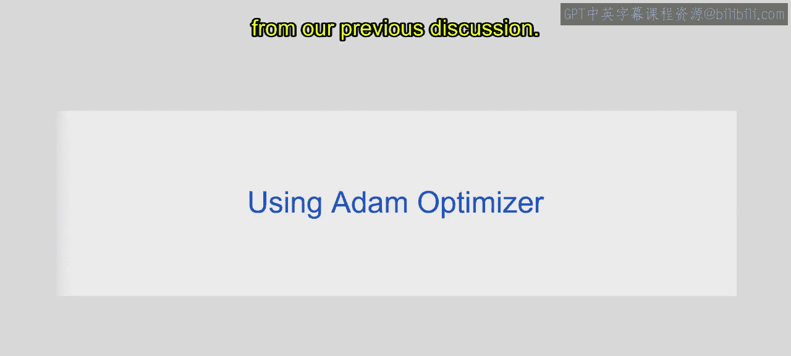
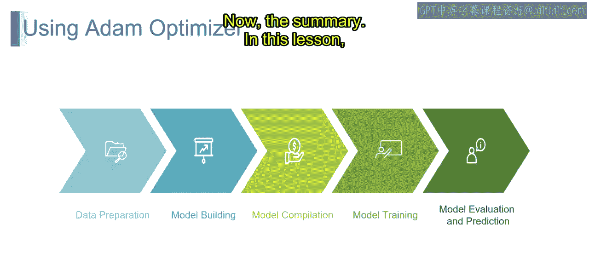
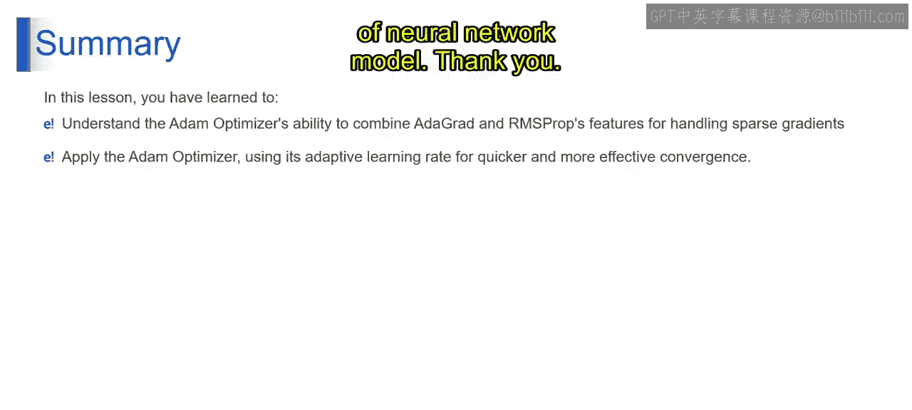

# Edureka《通过LLMs学习生成式人工智能（机器学习和NLP基础，第1课／共4课）｜Learn Generative AI with LLMs》中英字幕 - P61：60_如何使用Adam优化器.zh_en - GPT中英字幕课程资源 - BV1q4421Q7qh

So let's now explore the progression from our previous discussion so now let's understand how to use this Adamom optimizer here the steps involved here is the data preparation model building model compilation model training model evaluation and prediction so when we say data preparation this step involves preparing the data set for training you will typically split your data set into training validation and testing sets ensure your data is pre-processed and formatted appropriately for input into the neural network then the second step is of model building design and construct your neural network architecture using the tensorflows highleve API such as ks define the layer activation functions and other parameters of your model specify the optimizer as atom and configure its parameter for example。

😊。

Learning rate beta 1， beta2 and epsilon if needed， and then the next one is of model compilation after building the model compile it by using the compile function in the tensorflow or ks specify the loss function to measure the model performance。

 for example， categorical cross entropy for classification tasks chooseose the addom optimizer as the optimizer for training the model Choose the addom optimizer as the optimizer for training the model optionally define additional metrics example accuracy to monitor during the training then the next step is of model training train the compiled model on the training data using the fit function specify the number of epochs iterations over the entire dataset and the batch size during the training the Adamom optimizer will dynamically adjust the learning rates for model。

😊，Parameterters to minimize the specified loss function。

 then model evaluation and prediction as a last step。

 evaluateval the trained model's performance on the validation or testing data using the evaluate function and obtain the performance metrics such as loss and accuracy to assess the model generalization ability optionally you use the trained model to make the predictions on new unseen data using the predict function by following these steps you can efficiently utilize the aom optimizer insorflow to train the neural networks and make predictions on various machine learning tasks the adaptive learning rate and momentum features of the atom optimizer help improve the convergence convergence speed and performance of the trained models。

 So now the summary in this lesson you have grasp how the aom optimizer。😊。

Udgege the adaptive learning rate mechanism from ADgrad with the historical gradient information of RMS probe。

 enabling efficient handling of sparse gradients and faster convergence by leveraging its adaptive learning rate。

 the atom optimizer enhances the training process leading to quicker and more effective convergence of neural network model。

 Thank you。😊。

