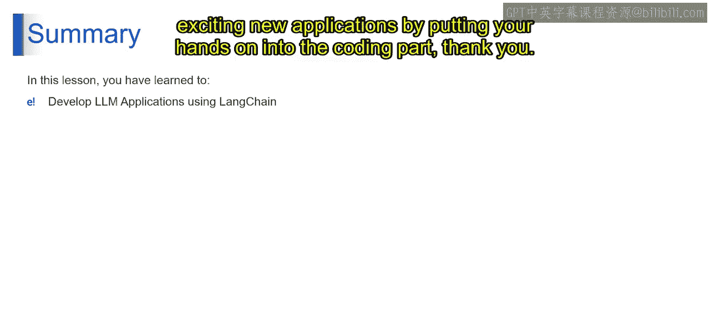

# Edureka《通过LLMs学习生成式AI（基础、应用开发、流行工具，第2、3、4课／共4课）｜Learn Generative AI with LLMs》中英 - P62：25_LLM应用的逻辑.zh_en - GPT中英字幕课程资源 - BV1ym421V7gx

So let's now explore the progression from our previous discussion so now let's understand the configure credentials in Langcha act as a middleman between your application and the powerful LLM that is what we have been discussing right so to use these LLM you will need to configure the credentials that grand L access here is a breakdown of the key points the first one is of supported providers so Langcha can connect with the several popular LLM providers some common examples include open AI hugging phase or cohert open AI is a leading provider of the large language models like G33。

5 and even4 so hugging phase is this is a platform that offers access to various pretrain LLMs and tools for working with them。

😊，So。😊，On the other hand， the Co， it is another provider of advanced LLms with a focus on enterprise applications。

 So that's about supported providers， then the next one is of API keys。

 think of API key as special quotes that grant access to the providers LM services。

 Each provider has its own process for obtaining an API key。

 you will typically need to create an account on their platform and follow their instructions to generate the unique API key for even whether if it is of the open AI hugging phase or co。

 whatever it is， you need to prepare or you need to create an API key to work on the application。

 Then the last one is of the configuration。 So once you have the API key ready with you you need to tell the La how to use it。

 there are two main ways to configure the credentials in the La。😊。

So these are are the two different ways， environment variables and also context manager so you can use anything。

 The first one is of environment variable。 This is a very common approach where you set the environment variables on your system with the specific names。

 For example， you might set an environment variable name with open AI API key and assign your open AI API key as its value then by using the context manager Lacha offers a more advanced approach using the context manager this allows you to manage your credentials within your code itself providing more control and flexibility for specific use cases So here are some additional pointers like security and provide a specific configuration by following these steps and keeping your credentials secure you can empower Lacha to interact with your chosen LLM provider and unlock the potential for these powerful language model。

😊，In your application。 So that's about configure credentials。

 So now let's understand the logic behind LLM powered application。

 The first one is of making LLM calls。 So this is the core functionality where you will use the language to send prompts。

 which is nothing but instruction to the chosen LLM provider these prompts tell the LLm exactly what you want it to do like answering a question generating a creative text or summarizing information whatever it is So La handles the communication with the LLM provider and retrieves the LLM response So that is where you are making a call to the LLM as a very first step then the next one is of parameter tuning So here is the second step that is parameter tuning here I chose some important ones。

 that is temperature maximum length and top K So La chain allows you to fine tune how you interact with the LLMs So here。

😊，Some key parameters like temperature。 This controls the randomness of the LLM response。

 A higher temperature leads to more creative， but potentially less accurate output。

 Then the next one is of maximum length。 you can set a limit on how long the LLM response can be providing overlayvobo output。

 Then the next one is of top K This parameter influences the diversity of the LLM responses a lower value leads to more predictable but potentially repetitive output。

 So that's about parameter tuning。 Then the next one is of error handling。

 So this does not always go perfectly。 La chain can help you handle potentially errors that might occur during the communication with the LLM or when processing its response for example。

 you might want to cat situations with the LLM returns and error and error message or its response does not make any sense。

😊，So Langcha can help you implement logic to gratefully handle these situations and provide a smooth user experience so that's when error handling comes into play Now the next one is of advanced usage so Langcha offers functionalities for more complex LLM applications as discussed in the previous building blockss where we are using chain calls and memory management and custom components。

😊，So what exactly happens here So chain calls this allows you to send multiple prompts sequentially creating a conversation flow with the LLM imagine asking an initial question then using the LLM's answer to refine your next prompt for more specific information then the next one is of memory management so Lcha allows your application to store information from the past interactions with the LLM this can be helpful for tasks requiring context like building a chatbo that remembers user preferences across the conversation then the next one is of custom components Lacha opens those nature allows developers to create custom components for specific needs these components can extend the La capabilities and addressing unique challenges within your application so that's about the logic of LLM powered applications Now the summary so in this。

😊，We explore what exactly the L and what is the framework for building the powerful applications。

 how we are making use of the L and we learned how to connect to LMs craft effective prompts and design the logic behind these innovative LLM power tools by using the La Now you can leverage the La to unlock the potential of LLMs and create exciting new applications by putting your hands on into the coding part Thank you。

😊。

