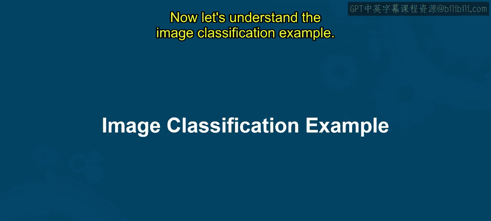
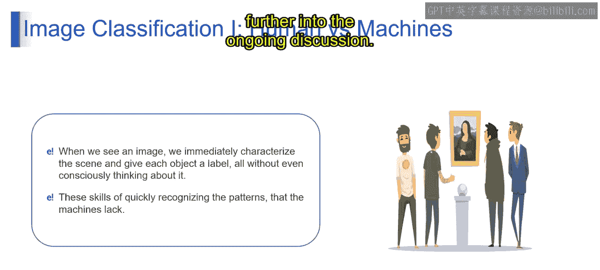

# Edureka《通过LLMs学习生成式人工智能（机器学习和NLP基础，第1课／共4课）｜Learn Generative AI with LLMs》中英字幕 - P62：61_图像分类示例.zh_en - GPT中英字幕课程资源 - BV1q4421Q7qh

Hello everyone， let's dive into the captivating world of machine learning and the foundational concepts of NLP together。

 So now let's understand the image classification example in this we are going to cover the image classification one and image classification too by the end of the session you are able to learn how to classify and identify the images based on the features and patterns and also able to explore the differences between the human and machine image recognitionation capabilities so let's get started before understanding image classification one and two。

 let's understand what exactly the image classification is all about imagine you have a collection of animal images and you want to develop a system that can automatically identify whether each image contains a cat or a dog to train the system you start by showing it a several images of。

😊。

Cats and dogs labeling each image accordingly as the system learns from these examples begins to recognize common features and patterns that distinguish cat from the dogs Eventually when you show it a new image the system can accurately predict whether it's a cat or a dog based on the learn features means technically image classification is a computer vision task that involves categorizing images into predefined classes or categories it utilizes machine learning algorithms typically deep learning models like convolutional neural networks automatically learn and extract features from the image and may predictions about their contents the goal is to train a model to accurately assign a label or class to each image based on its visual characteristics image classification signs。

Applications in various domain such as object recognition， medical imaging。

 autonomous vehicles and content filtering。 So now let's understand based on this example what exactly the image classification one is all about。

😊，Image classification is a task of taking an input image and predicting the probability of a class that best describes the image here in the example。

 we are having some pictures So which of the shadows resemble the image correctly so for humans this recognition is one of the first skill they acquired from the moment they are born and comes naturally and effortlessly as adults right but now let's understand how it happens technically in image classification the objective is to analyze input image and predict the likelihood or probability of various defined classes or categories that best describe the content of the image its fundamental task in computer vision where algorithms often powered by deep learning techniques like convolutional neural networks learn to recognize the patterns and the features。

😊，Within the images to make accurate predictions about the contents， for instance。

 in the scenario provided the task is to identify which shadow closely resembles the image depicted humans are naturally depict at this task from the young age effortlessly recognizing the objects and patterns in these surroundings similarly image classification algorithms aimed to emulate this cognitive process enabling missions to recognize and categorize the image accurately a crucial capability with applications ranging from object recognition to medical image and autonomous vehicles now let's understand image classification human versus missions so in the context of image classification human process and innate ability to swiftly interpret visual information and assign labels to objects within an image。

😊，Often without conscious effort， this skill allows us to effortlessly recognize patterns and distinguish between the different objects scenes or entities depicted in an image。

 however missions particularly artificial intelligence systems tasked with image classification。

 lag the inherent cognitive abilities of humans， while missions excel at processing vast amount of the data and performing complex computations the struggle to emulate the intuitive and holistic understanding of visual scenes that human possess unlike humans missions require explicit training and algorithms to recognize the patterns and classify images accurately。

 so techniques such as deep learning specially convolutional neural networks are employed to teach the missions to analyze the image features and make predictions。

😊，Don the learned patterns in the essence， while humans excel at quickly recognizing and labeling the objects in images without conscious thought machines rely on computational algorithms and training data to perform similar tasks highlighting the distinct difference between the humans and machine capabilities。

 image recognition or image classification， so the upcoming video will delve further into the ongoing discussion。

😊。

