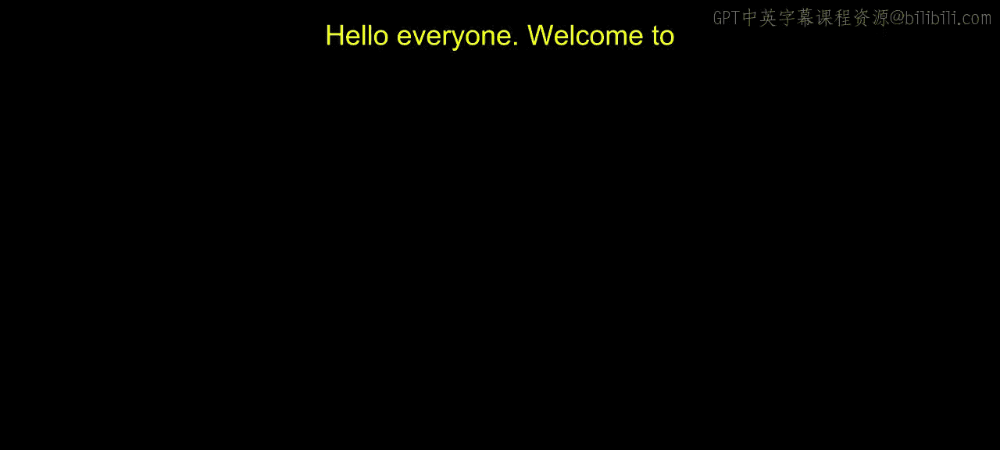
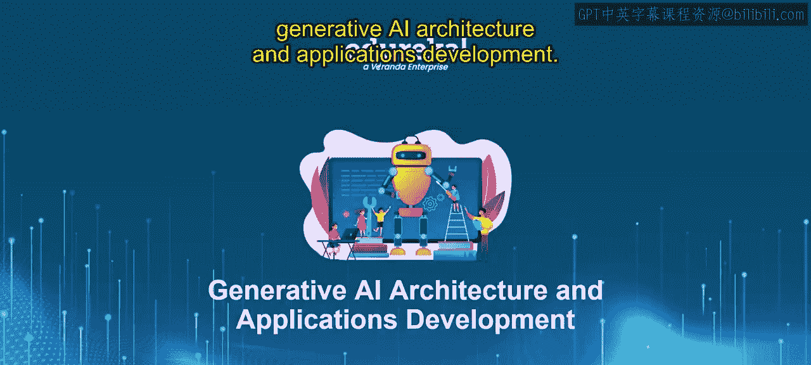
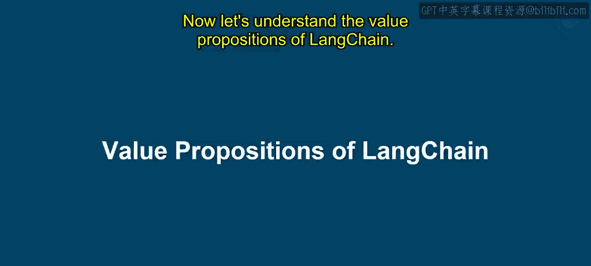
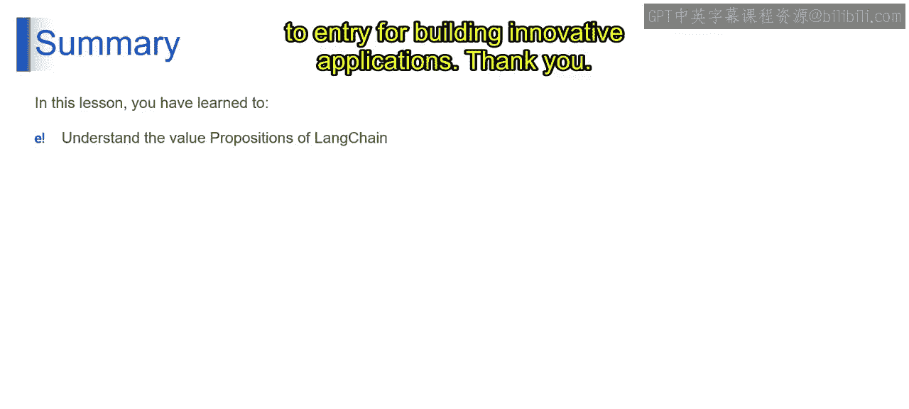

# Edureka《通过LLMs学习生成式AI（基础、应用开发、流行工具，第2、3、4课／共4课）｜Learn Generative AI with LLMs》中英 - P63：26_LangChain的价值主张.zh_en - GPT中英字幕课程资源 - BV1ym421V7gx

Hello everyone welcomee to generative AI architecture and applications development So now let's understand the value propositions of Lcha so in this we are going to cover what exactly the value propositions of the L by the end of the session you are able to understand what these will do for the La and what all these for the value propositions of the L so in the previous module we understood what exactly thecha like we took the example of like you know we were working with this super smart friend who knows the tons of the information and in case if you want to get the information from that supersmar friend we were telling Lacha is a special tool that helps you talk to your super smart friend and in a way that they understand and it makes it easier to ask clear questions and get helpful responses that is what we understood as a L。

😊。

So now here is how the la chain value propositions translate these into benefitsfi so the first one is of the simplified LM interaction。

😊，Here we are having two things the simplified LLM interaction and the next one is of powerful chain capabilities so in the simplified LLM interaction Lacha provides a user friendly interfaces like a chat window with a clear instructions that however you guys are utilizing the chat Jupyy so this will allow you to give a specific instructions nothing but prompts to the large language model just like asking your friend a well-defined question then coming to the Power chain capabilities imagine having a conversations with your friend allowing followup questions based on their previous answers so La change chain capabilities allows you to spend or send multiple prompts to the LLM in a sequence so creating a more natural flow of interaction technically L change value propositions can be summarized like reduce the complexity。

😊，Means Langcha simplifies the interaction with the complex LLMs by providing the easy to use tools for prompt crafting and response handling and they utilized in the advanced conversation flow。

 So the chain capabilities enables the sophisticated multistep interactions with the LM fostering a more natural and dynamic user experience。

 Then it will perform the data integration。 So Langcha bridges the gap between the Lms and external data sources allowing your application to access and process the real world information。

 and it also the opens and the open source nature fosters the community development and allows for customization through custom component tailored to the specific application needs。

 So now let's understand what exactly the value propositions of the L。

 The first one is of modular component。 in simple terms value proposition。😊。

Refer to the key benefits and advantages it offers to developers who want to build applications powered by the LLMs。

 So in simple terms， it's what makes the L a great tool for the specific tasks。

 So here is a breakdown。 The first one is of modular component。 So imagine building the same one。

 The Lego Ca。 Lego provides various building blocks like components like bricks， windows and toes。

 So line chain function similarly。 It offers a set of modular components that can combine to build different functionalities within the LLM application means La chain provides a collection of reusable code blocks。

😊，That is nothing but components with the specific functionalities。

 these components can be combined in various ways to create complex workflows within your application。

 These modular approach promotes code reusability and simplifies development then the next one is of of the shelf chain so think of premade Lego sets with the instructions for building specific structures So la chains offer of the shelf chain which are pre-defined workflows built using its components so these chains can be used as starting points for your application or inspiration for building your own custom workflows so of the shelf chains are pre-built workflows within la chain that address common LLM interaction patterns they provide a foundation upon which you can build more complex functionalities or use them directly for。

😊，Sempler tasks， then the next one is of flexibility and customization。

 So while Lego sets have instructions， you can also use your creativity to build something entirely different。

 So La chain offers similar flexibility。 you can use its components and chains as building blocks。

 but you are not limited to them。 you can customize and extend L to fit your specific applications and needs means La chain open source nature allows for high customization。

 developers can modify existing components， create entirely new ones and integrate them seamlessly into their application。

 This flexibility empowers the developers to address unique challenges and build truly innovative Lm applications。

 Then the next one is of enhanced Lm capability So imagine giving your super smart friend to additional resources like books。

😊，Encyclopedias， this expands their knowledge and improves their responses。

 Langcha operates similarly exactly in the same way。

 Langcha allows you to integrate your Lm application with the external data sources like databases and As。

 This grants the LLm access to the broader knowledge base leading to more comprehensive and informative responses within your application。

 So that's about enhanced LLm capabilities。 Now the next one is of lowering barriers to entry。

 So learning to code can be a challenging task， but Lcha helps by providing an easier way to interact with the complex LLms。

 it simplifies the process of building Lm applications making this technology more accessible to developers for all the levels。

 So now the summary， in this lesson you have become ated with the compelling value。😊。

Propositions of the L chain we explore how it simplifies interaction with the LLMS through its modular components and pre bill workflows that is nothing but off the shelf chain L chain empowers the developers with the flexibility and customization options unlocking the full potential of LLNs while lowering the barrier to entry for building innovative applications。

😊。

Thank you。