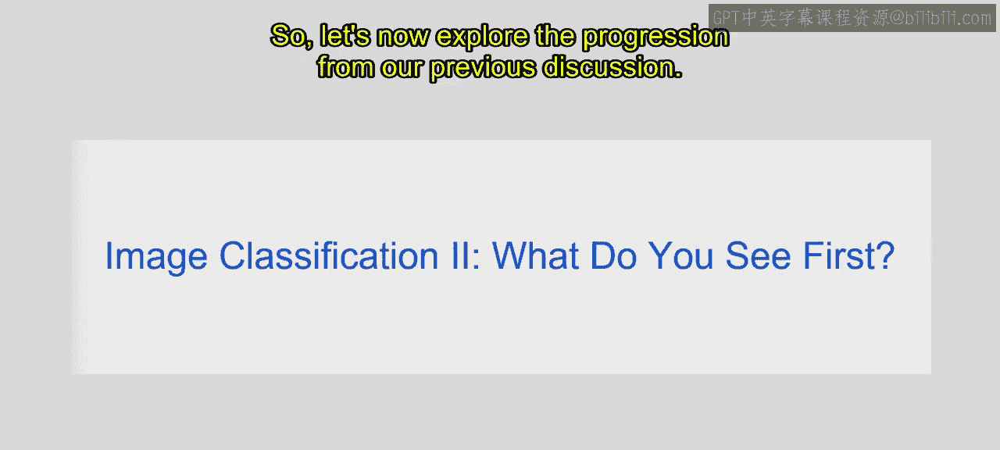
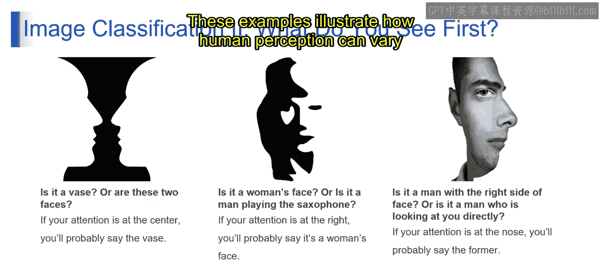
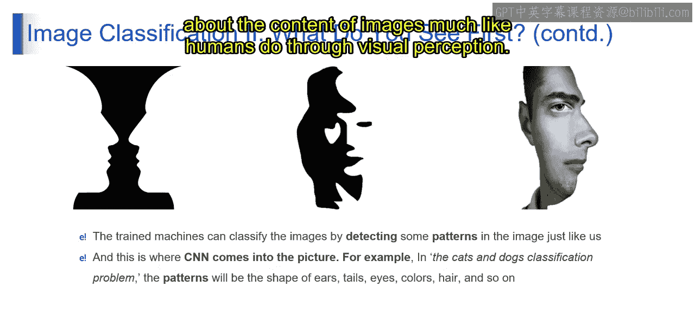
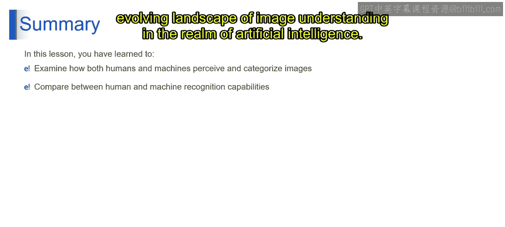

# Edureka《通过LLMs学习生成式人工智能（机器学习和NLP基础，第1课／共4课）｜Learn Generative AI with LLMs》中英字幕 - P63：62_图像分类II.zh_en - GPT中英字幕课程资源 - BV1q4421Q7qh

So let's now explore the progression from our previous discussion so now let's understand image classification2 what do you see first so here in image classification what a person perceives first can vary based on where their attention is directed within the image for instance。

 here if we can see in the first image whether if it is of ways or phases in in an image depicting both a base and the two phases if a person's attention is focused on the center they are likely to perceive the base。

😊。

Due to its prominent position， however， if the shifted focus to the surrounding areas。

 they may notice the presence of the faces and in the next image。Woman's face or man playing sophone。

 similarly in an image featuring a woman's face and the man playing saxophone。

 if attention is down to the right side， one might perceive the woman's face more prominently however upon considering inspection or a shift in focus to the sophone playing man。

 the perception could change that is about the second image then coming to the third one。

 man's face or his gaze in an image showing a man's face with one side clearly visible and the other partially obscure the perception may differ based on bare attention is directed if one faces on the nose。

 they may perceive the man's face with the right side visible， however。

 if attention shifts to the direction of his gaze。Interpretation may learn towards the perception of the man looking directly at the viewer means these examples illustrate how human perception can vary depending on where attention is directed within the image highlighting the subjective nature of visual information similarly in image classification tasks algorithms must be trained to recognize and interpret visual features accurately considering potential variations in the human perception。

 the trained machine learning models， particularly those employing CNN are capable of classifying images by identifying and analyzing the patterns within the image data。

 similar to human perception CNNs are designed to mimic the visual processing capabilities of the human brain enabling them。

😊。

To effectively detect and extract meaningful features from the images， for instance。

 the cats and dogs classification problem， CNNs can learn to recognize the distinctive patterns such as the shapes of the ears。

 tails， eyes， colorss， fur textures and other visual attributes。

 characteristics of the cats and dogs by analyzing these learned patterns across different regions of the image。

 CNNs can make accurate predictions about the content or the category of the image through the training process。

 CNNs are just their internal parameters like weights and biases to optimize the detection and interpretation of these patterns ultimately improving their ability to classify images with high accuracy means CNNs plays a very important role in image classification tasks by effective。

😊，cappt and leveraging visual patterns to make informed decisions about the content of images。

 much like humans do through visual perception Now， the summary in this lesson。

 we have delved into the intricacies of image perception and classification exploring both human and machine capabilities in recognizing and categorizing images by comparing the shades and differences between the human intuition and machine learning algorithms we have gained insights into the distinct approaches each employs to interpret visual information。

 shedding light on evolving landscape of image understanding in the realm of artificial intelligence Thank you。

😊。

