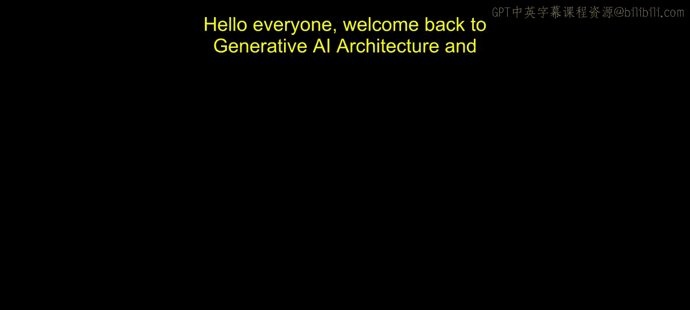
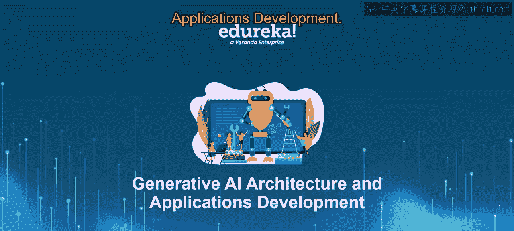
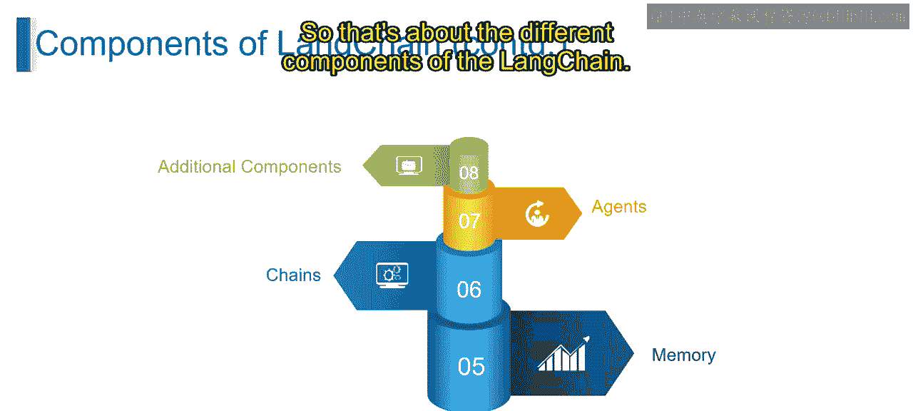
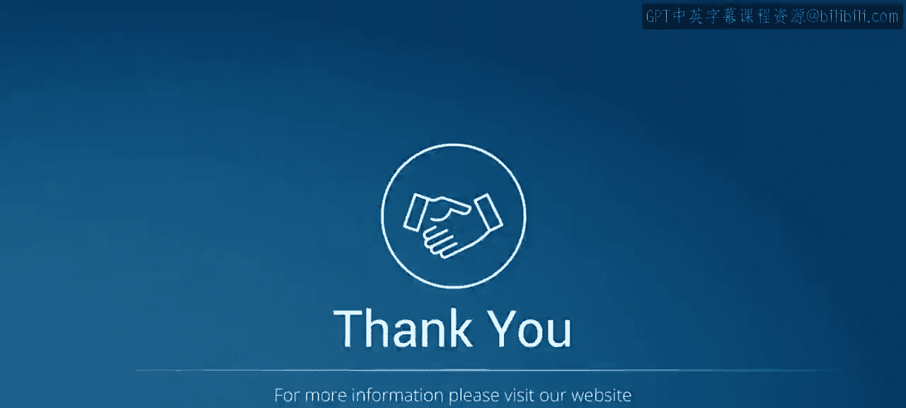

# Edureka《通过LLMs学习生成式AI（基础、应用开发、流行工具，第2、3、4课／共4课）｜Learn Generative AI with LLMs》中英 - P64：27_LangChain的组件.zh_en - GPT中英字幕课程资源 - BV1ym421V7gx

Hello everyone， welcome back to Generative AI Architecture and Appplication development Month。😊。

In this we are going to understand the different components of the La by the end of the session you are able to understand and learn the components of the La what is the row of them and how do they work so let's get started the components of the La。

😊，The first one is of LLM wrappers， so imagine having a different adapter for your varied electronic devices。

 so these adapters allow you to connect to your devices to your powerful sources LLM wrapper in your language functions exactly in the same way so LLM wrappers provide a unified interface for interacting with the various LLM providers。

 example the open AI hugging phase and many more so despite their differences they encapsulate the communication details allowing you to focus on crafting prompts and handling responses without worrying about the provider specific queries。

😊，Then the next one is of prom template。 So think of the prewritten recipe template in a cookbook。

 for example。 So these templates provide a basic structure for creating delicious dishes L chain prom template serves exactly in a similar way。

 So pro templates offer predefined structures for crafting effective prompts。

 which is nothing but instruction for the LLm。 they act as a starting point serving you time and ensuring consistency when formulating the prompts for the LLm。

 So you can customize these templates to fit your specific needss within your application。

 that's about prom template。 Then the next one is of response passes。

 So imagine getting a complex instructions manual， but needing only specific information like how to assemble a particular part response passes in la chain functions exactly in a similar way so。

😊，The response passes analyze the LLm's response and extract the relevant information。

 your application needs。 They can filter out the unnecessary details and transform the response into a format usable within your application logic。

 So that's about response for passes。 Then the next one is of indexes。

 Think of an index in a book that helps you quickly find specific information。

 So indexes in La serve a similar purpose for the large data sets。

 So indexes are data structures that allow for efficient retrieval of information from large data sets。

 Lacha can integrate with external indexes to empower the LLm to access and process the information beyond its core training data。

 So that's about indexes。 So now the next one is of memory。

 while building a Lego creation across the multiple session。😊。

You would likely remember the progress you made Lang chains memory component functions exactly in a similar way for your LLM application。

 The memory component allows your application to store the information from past interactions within the LLM。

 This is very crucial task the required context such as building a chat board that remembers user' preferences across the conversation。

 imagine it as a logbook that tracks the conversation history but in your application and the LLM。

 So that's about memory。 Then the next one is of the chain。

 So think of building a Lego creation that involvesvo multiple step， rather having a single step。

 you can consider as multiple steps。 chains in the line chain allows you to connect these steps into a more complex workflow means chains are the core workflow components of a la chain。

😊，Enable you to link together the different components like LLM prompts。

 response passes and the data manipulation tools。 This allows you to create multistep interactions with the LLM and build more sophisticated functionalities within your application。

 That's about the chains。 then the next one is of the agents。

 So imagine having a personal assistant who manages various tasks for you agents in La functions exactly in a similar way within your LLM application。

 So agents acts as managers within your application。

 the handle tasks like connecting to the LLM provider sending prompts receiving the responses and coordinating the overall workflow defined by your chain。

 the act as intermediates between your application logic and the powerful LLM。

 So that's about the agent。 Then the next to one is of additional components。 So La chain。😊。

Offers a rich ecosystem of additional components beyond the core ones， whatever be discussed now。

 these might include the components for data integration。

 error handling and logging and monitoring also when we say data integration it will enable the seamless connection with the external data sources like databases as well as APIs and when we are coming to the error handling it gracefully handles the potential issues during the communication with the LLM or processing its responses then logging and monitoring it will track the behavior of your application and the LLMs responses for debugging and optimization process means by understanding and effectively utilizing these components you can unlock the full potential of the language and create innovative LLM application that interact with the world in unique and powerful ways so that's about the different components of the language。

So stay tuned for the next video where we will elaborate on this topic， Thank you。😊。

