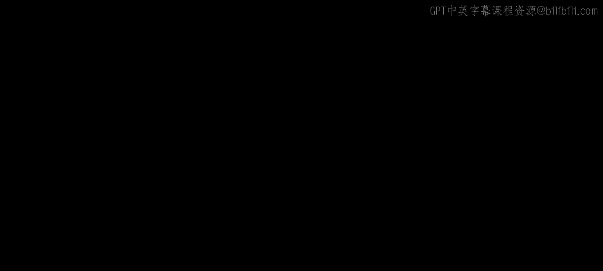
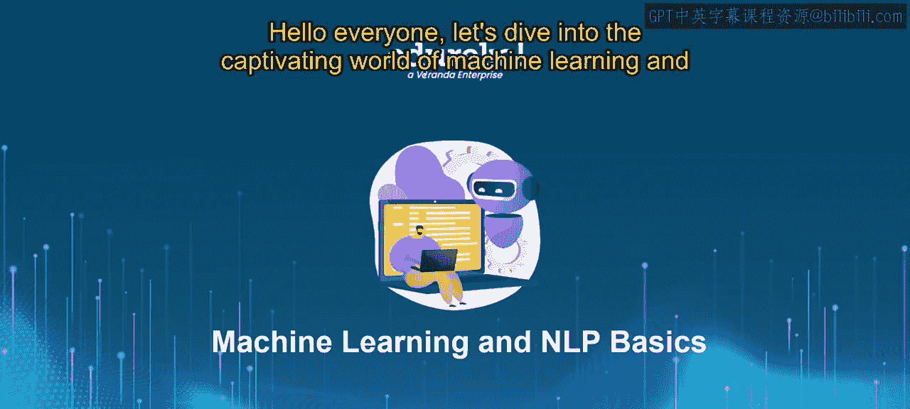
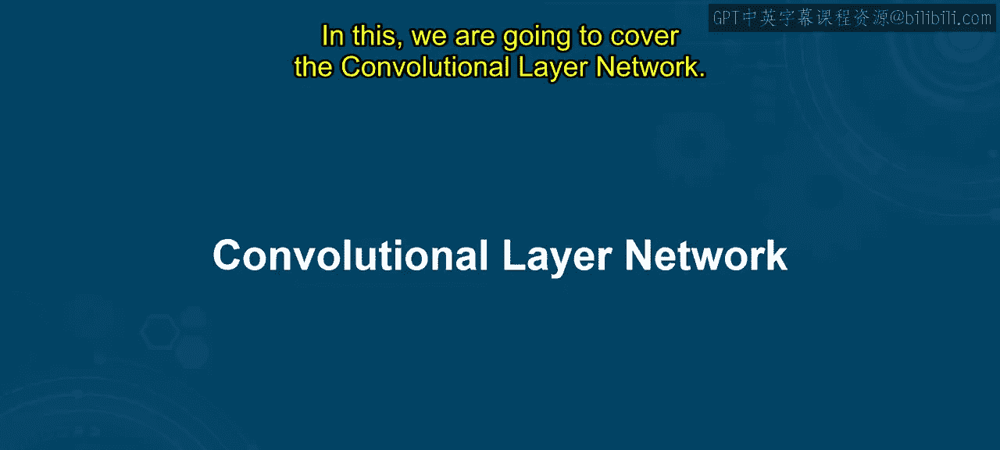
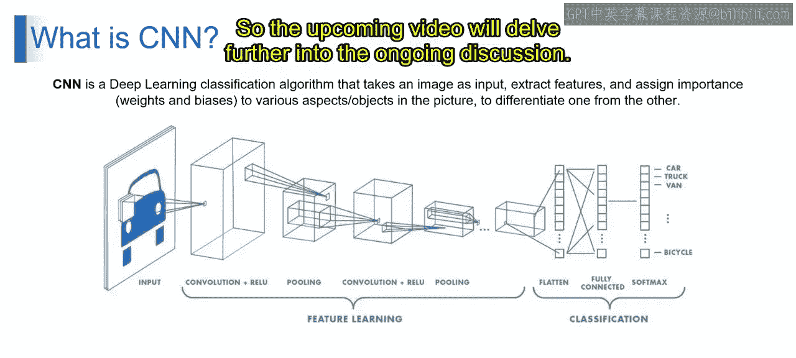

# Edureka《通过LLMs学习生成式人工智能（机器学习和NLP基础，第1课／共4课）｜Learn Generative AI with LLMs》中英字幕 - P64：63_卷积神经网络.zh_en - GPT中英字幕课程资源 - BV1q4421Q7qh

Hello everyone， let's dive into the captivating world of machine learning and the foundational concepts of NLP together In this。

 we are going to cover the convolutional layer network In this we are going to understand introduction to CNN and why E CNN preferred over the MLLP by the end of the session you are able to understand and explore the fundamental concepts or the CNNs and learn why CNNns are preferred over the multilayer perceptrons So let's get started In to CNN Imagine you are reading a book and trying to find specific words within the text instead of reading the entire page word by word you focus on small selection of text at a time scanning for patterns or keywords that match your search once you have identified the relevant sections you piece together。

😊。

the information to comprehend the overall meaning of the text。

 this localized and hierarchical approach allows you to effectively process the large amount of the text and extract meaningful information means CNNs are class of deep learning models designed for processing and analyzing the visual data such as images inspired by organization of the animal visual cortex。

 CNN consists of multiple layers including convolutional layers。

 pooling layers and fully connected layers in CNNs convolutional layers。

 apply filters or kernels to input the images extracting local features and patterns through convolution operations these filters slide over the input image capturing spatial relationships and detecting relevant visual patterns such as adjust。

😊，Textures or shapes by strikinging multiple convolutional layers and incorporating pooling layers to reduce the spatial dimensions。

 CNNNs can learn hierarchical representation of visual features enabling them to perform tasks like image classification object detection and image segmentation with remarkable accuracy means in the process of scanning sections of text for specified words in our example。

 so in our example the process of scanning sections of the text for specific words mirrors the operation of convolutional layer in CNNns which extract local features from input images through convolution operations by breaking down the visual data into smaller manageable segments and progressively analyzing them to extract hierarchical features CNNNs emulate the localized and hierarchical。

😊，Processing observed in human vision， making them powerful tool for understanding and interpreting visual information。

 So now let's understand it with an example。 first of all， the input image。

 we start with an input image， which is the case is a picture of car。

 The goal is to classify this image into one of the several predefined categories。

 car truck van or bicycle。 So the next is that feature learning in this。

 the first one is going to be the convolutional layer。

 The input image is passed through a series of convolutional layers。

 Each convolutional layer applies filters also called kernels to the input image extracting important features such as adjusts textures and shape。

 then it will perform relu activation after each convolutional operation the rect。😊，linear unit。

 which is nothing but reello activation function is applied element wise to introduce nonlineity into the network。

 allowing it to learn complex relationships but in the features then the next one is of pooling here following the relu activation pooling layers example maximum pooling reduces the spatial dimensions of the feature maps preserving the most important features while discarding the redundant information This helps in reducing computational complexity and preventing overfitting then the next one is of classification here we are having the flatten layer fully connected and softs so understanding the flatten layer the output from the last pulling layer because we are having the multiple convolution plus re pulling layers after this the output from the。

😊，Last pullinging layer is flattened into the one dimensional vector preparing for input into fully connected layers then means what this fully connected layer will do The flattened feature vector is passed through one or more fully connected layers which are densely connected neural network layers。

 These layers learn to combine the extracted features from the earlier layers and map them to the desired output classes。

 then the softmax activation。 the final fully connected layer is followed by a softm activation function which converts the raw output values into probability scores each score represents the likelihood of the input image belonging to a specific class whether if it is like car truck van or bicycle then it can be sent to the output means based on the probability scores obtained from the softm layer。

Orel classifies the input image into one of the predefined categories that car truck。

 van or bicycle or whatever it is means CNN or image classification process the input image through a series of convolutional and pullinging layers to extract the relevant features。

 these features are then flattened and passed through fully connected layers for classification ultimately producing a probability distribution over the possible output classes。

😊，Through training on label dataset， the CNN learns to assign importance to different aspects of the input image。

 enabling accurate classification into the appropriate categories。

 so the upcoming video will delve further into the ongoing discussion。😊。

