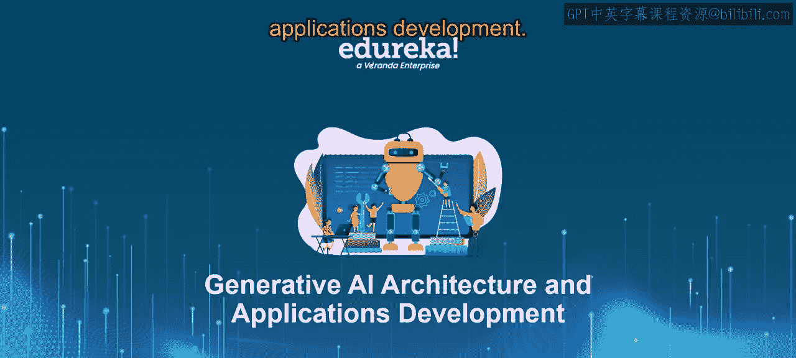
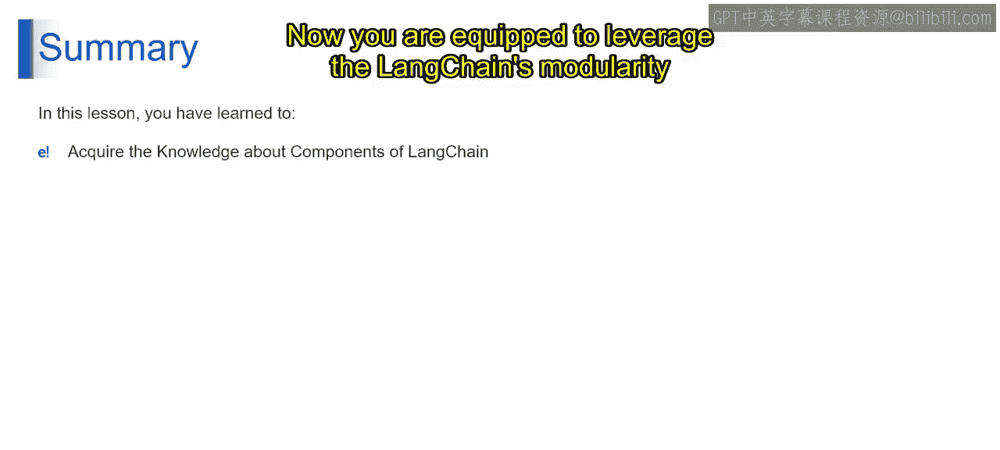
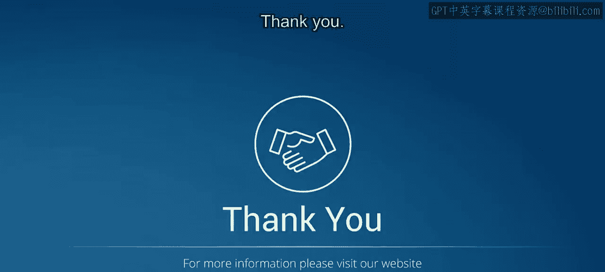

# Edureka《通过LLMs学习生成式AI（基础、应用开发、流行工具，第2、3、4课／共4课）｜Learn Generative AI with LLMs》中英 - P65：28_基于组件方法的优势.zh_en - GPT中英字幕课程资源 - BV1ym421V7gx

Hello everyone， welcome back to Generative AI architectureitecture and Appplication Travel Month。😊。

So now let's understand the benefits of the component based approach The first one is of lower entry barrier so imagine building your Lego for the first time if you are doing it for the first time the premade bricks and clear instructions make it easier to get started even for the bigness also it will be more friendly Similarlyly the line change components lower the entry barrier for working with the LLM means understanding it technically the component based approach simplifies LLM interaction developers don't need to be experts in the LLM technology all specific providers line change components handle the complexities allowing developers of all the levels to focus on building the core functionalities of their applications then the next one is of reusability So imagine using the same Lego bricks to build different creations change。

😊，Promote reusability in this exact similar way。 So components encapsulate specific functionalities。

 making them reusable across the different applications。

 So this saves development time and reduces the code duplication。

 developers can leverage existing components and combine them in new ways to build diverse LLM applications。

 Then the next one is of flexibility。 So while Lego sets have instructions。

 you can also use your creativity to build something entirely different Lacha offers similar flexibility。

 So technically the componentbased approach allows for high flexibility developers can use prebu components。

 modify existing ones or even create entirely new components to address specific needs of their applications。

 This empowers developers to build unique and innovative LLM functional。😊。

So that's about flexibility。 Then the last one is of customization。

 Imagine customizing your logo creation with different colored bricks or additional pieces。

 Langcha allows for similar customization means the open source nature of laang and its components allows for extensive customization。

Develop can tailor components to these specific use cases integrate with custom functionalities and extend L chains capabilities to fit their unique application requirements means the L componentbased approach offers a compelling combination of benefits。

 It lowers the barrier to entry for working with elementsLMS promotes reusability of the code empowers developers with flexibility and allows for extensive customization These advantages made La chain a powerful and versatile framework。

😊，For building innovative LLM applications across the diverse's domains。😊，Now。

 the summary in this lesson， we explore la chains building blocks from the LM wrappers for easy provided interactions to memory components for maintaining context in conversations。

 These components like Lego bricks can be combined to create powerful and versatile LM applications。

 Now， you are equipped to leverage the line chains modularity to bring your LM powered ideal to life。

 Thank you。😊。

