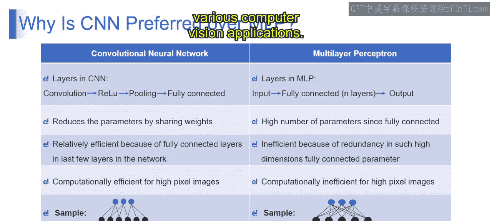
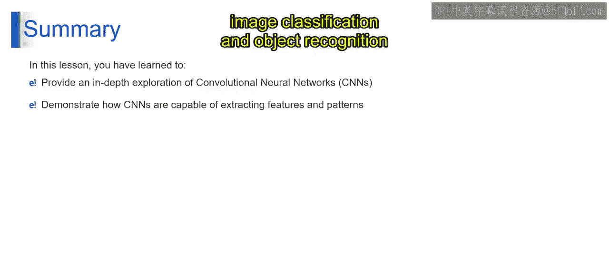

# Edureka《通过LLMs学习生成式人工智能（机器学习和NLP基础，第1课／共4课）｜Learn Generative AI with LLMs》中英字幕 - P65：64_为什么CNN优于MLP.zh_en - GPT中英字幕课程资源 - BV1q4421Q7qh

So let's now explore the progression from our previous discussion so why CNN is preferred over the MLP so especially in the context of image classification tasks like MNs data why CNNs are preferred what exactly a MLP so a multi layerer perceptron MLP is nothing but a multilayer perceptron。

 it is a type of neural network architecture consisting of multiple layers of interconnected neurons used for various machine learning tasks including classification and regression but now let's understand why CNN is preferred over the MLP the first reason is that considering the Ms data set the complexity of the image data means image data such as the MNs data set is inherently complex due to its high dimensionality and spatial relationships among the pixels means MLP street each pixel。

😊。

An independent feature disregarding the spatial structure of the image In contrast。

 CNNs preserve spatial information by employing convolutional layers which capture local patterns and relationships among the neighboring pixels this makes CNNNs better suited for tasks involving image data where spatial features play a very important role then feature learning so MLPs re solely on fully connected layers which require a large number of parameters to learn complex features from the raw input data This makes MLPs prone to overfitting especially in high dimensional data like images so CNNs on the other hand use the convolutional layers to automatically learn and extract the hierarchical features from the input images by sharing the weights and leveraging local connectivity。

😊，effectivelyffectively capture the relevant patterns while reducing the number of parameters。

 thus mitigating， overfitting and improving the generalization performance。

 then when more advantage of CNN is that translation in variance。

 So generally MLP lack translation in variance， meaning they cannot recognize the patterns in different spatial locations within an image。

 in contrast， CNNs leverage shared weights and pooling operations enabling them to detect and recognize the patterns regardless of their spatial location in the image。

 this translation in variance properly makes CNNs robust to variations in object position and orientation crucial for task like object recognition and detection。

 that is the other importance and coming to the real world obligation。

 while MLPs may perform adequately。😊，simpler datas like MN。

 they often struggle to generalize to real world image data with more complex structures。

 backgrounds and variations in lighting conditions。

 CNNs Excel in real world applications of computer vision such as object detection image segmentation and facial recognition where spatial relationships and local features are essential for accurate classification and analysis。

 So these all are the important features when compared to the MLP for CNN。

 So here is the representation of y E CNN preferred over the MP。

 So let's break down the comparison between the CNNs and MP based on their architecture and efficiency So layers in CNN versus layers in MP。

 So CNN consists of convolutional layers followed by activation function for example relu pullinging layers and fully。

😊。

Conected layers， convolutional layers extract local patterns from the input images while pooling layers reduce the spatial dimensions。

 fully connected layers combine extracted features for classification。

 coming to the MP MPs primary comprise fully connected layers where each neuron in one layer is connected to every neuron in the next layer。

 The typically consist of an input layer， one or more hidden layers and an output layer。

 Then the next one is of parameter reduction and efficiency。

 CNs reduce the number of parameters by sharing weights across the different regions of the input image leveraging the local connectivity and translation variance properties。

 this parameter sharing， significantly reduces redancy and improves computational efficiency。

 specially for high dimensional image data coming to the。😊。

MLP require a high number of parameters due to their fully connected architecture where each neuron is connected to every neuron in the adjacent layers these redundancy in parameters can lead to computational efficiency particularly for high dimensional input data like images Then the next one is of computational efficiency So CNs are computationally efficient。

 particularly surpassing high resolution images due to their parameters sharing and local connectivity properties。

 they can effectively capture the spatial relationships and hierarchical features with relatively fewer parameters making them well suited tasks like image classification object detection and image segmentation then coming to the MLP MLP may become computationally inefficient when dealing with the high dimensional image。

😊，Stta as the fully connected layers require crossing a large number of parameters。

 this inefficiency can lead to increased computational complexity and slower training and inference limits。

😊，Means CNNNs are preferred over the MLPs for tasks involving image data due to their efficiency in capturing the spatial features。

 reducing parameter redundancy and achieving computational efficiency。

 making them indispensable for various computer vision applications Now the summary in this lesson。

 we have delved into CNNns uncovering their architecture and convolutionality in feature extraction from the images through detailed examination we have showcased how CNNns efficiently capture spatial patterns and hierarchical features making them indispensable tools for tasks like image classification and object recognition in the realm of computer vision Thank you。

😊。

