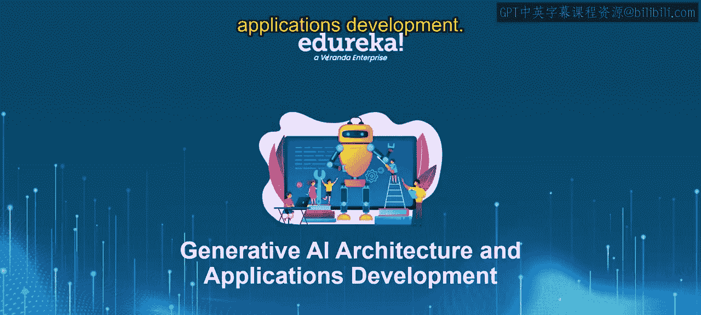
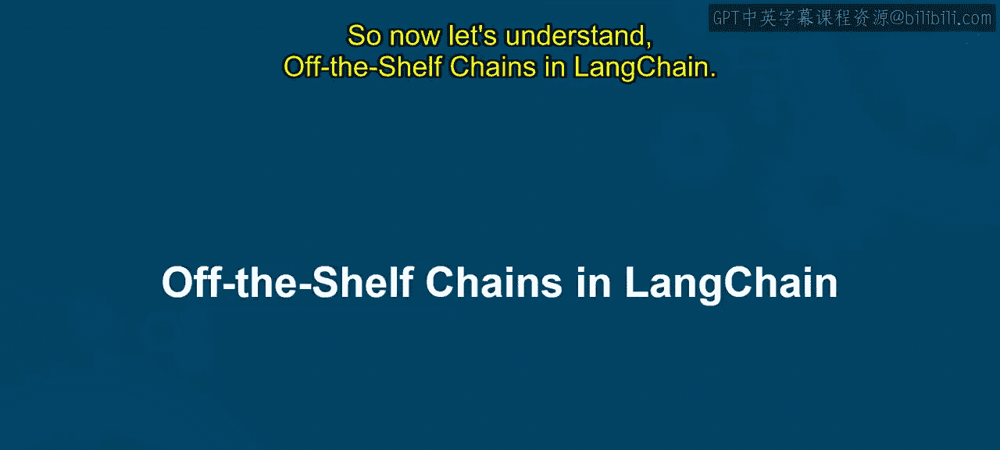
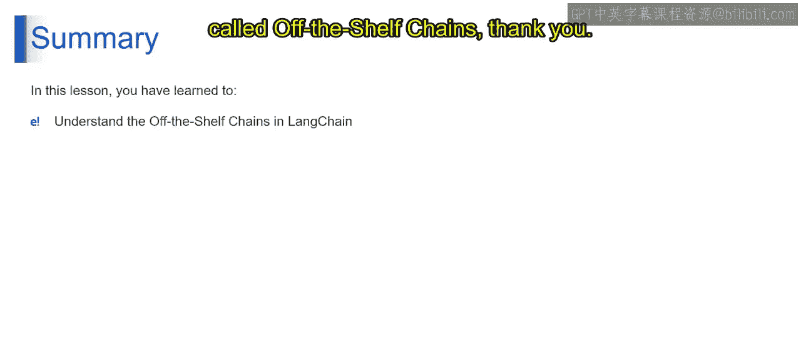

# Edureka《通过LLMs学习生成式AI（基础、应用开发、流行工具，第2、3、4课／共4课）｜Learn Generative AI with LLMs》中英 - P66：29_LangChain中现成的链.zh_en - GPT中英字幕课程资源 - BV1ym421V7gx

Hello everyone， welcome back to Generative AI Architecture and Appplication development Month。😊。

So now let's understand of the shelf chains in Lchain so in this we are going to cover the detailed understanding of the of the shell chains in the Lcha by the end of the session you are able to understand what exactly they are and how do they work and what are the benefits so let's get started off the shelf chain in La。

😊。

So in L chain of the shelf chain refers to a pre-built workflows that simplify interacting with the large language models。

 so imagine them as pre-made logo sets with clear instructions they provide a foundation for building LM functionalities within your application without starting from the scratch means of the shelf chains are predefined sequences of the la chain components。

😊，Liinking together to perform specific tasks， these chains encapsulate common LLM interaction patterns such as text sumization。

 question answering or even creative text generation。

 so now let's understand what exactly the of the shell chains in L。😊。

So it consists of modular components used to build the various applications。😊，Mas。

 this emphasizes the reusability and flexibility inherent in La's approach。

 and they designed for specific tasks they simplify the application development。😊。

Means highlighting they design for specific tasks reinforces the benefit of faster development and reduced complexity。

😊，Then ready made solutions means these chains provide ready made solutions for the common use cases in the L and they will allow for customization and enhancement by modifying the components and settings let's understand all these in brief so what are the different types of the shelf chains the first of all conversational AI chain imagine having a pre-programmed chatbo conversational flow this conversational AI chains functions similarly so these chains are designed specifically for building chatbos or virtual assistant they handle。

😊，The back and forth nature of the conversation， allowing the LLM to understand the user queries respond appropriately and maintain context across the multiple interactions。

 then the next one is of content generation and processing chains。😊。

Think of a pre-made recipe template that helps you generate the different dishes so content generation chain functions exactly in a similar way in the LLMs So these chains focus on tasks like text summarization creative text generation like poems and scripts or different types of writing formats like emails letters and many more so they provide a structured approach to guide the LLM in generating the specific content formats then the next one is of data exploration and analysis chains so imagine having a predefined search query for a specific topic so the data exploration chain functions exactly in a similar way for LMs so these chains assist in tasks like question answering or data analysis they allow you to structure your prompts and access information from the LLM in a way that facilitates data exploration and analysis based on your specific。

😊，So these are just few examples and the specific functionalities offered by of the shelf chains may vary。

 depending on the La version that you are going to use。

 So here are some additional points like you know customization evolving ecosystem and many more。

 So now let's understand the benefits of using the off the shelf chain the first one is of first development Imagine building a house from the scratch it would require a lot of planning。

 acquiring material and executing each step of the construction process So of the shelf chain functions like a prefabricated building module they provide predefined workflows that can be really integrated into your application saving you significant time and efforts compared to building everything from the ground up like from the scratch so you can focus on the core functionalities of your application leveraging the pre-built structure。

😊，Provided by the chains。 Then the next one is of lower barrier to entry。

 So think of starting a new recipe but lacking extensive culinary experienceed。

 a pre-written recipe with clear instructions lowers the barrier to entry and increases your chances of success。

 Similarlyly of the shelf chains lower the barrier to entry for working with the Lms。

 they offer a structured approach making LLm interaction more accessible even for the developers who are new to this technology。

 you don't need to be an LLm expert to leverage their capabilities effectively within your application。

 Then the next one is of proven functionality。 Imagine collaborating with the team of experienced shs knowing for their successful recipes。

 So pre-bi chain offers similar piece of mind。 These chains represent well。😊。

Tested approaches for the common L task。 they have been developed and refined by the L chain community。

 increasing your confidence that they will function efficiently within your approach。

 you can benefit from the collective knowledge and experience embedded in these predefined workflows Then the customization option。

 Think perfect clothing stored that allows you to tailor pre-made garments to your specific needs of the shelf chain offers a similar level of customization while they provide a solid foundation you are not limited using them as is you can modify existing components within the chains adjust settings or even combine multiple chains to create more complex workflows that perfectly aligned with your applications Uni requirements。

 This flexibility ems you to harness the power of the prebuilt solutions while。😊。

Apting them to your specific use cases。So these all are the benefitsfi。

 Now the summary in this lesson， we explored line chains prebuil workflows called off the shelf chains。

 Thank you。😊。

