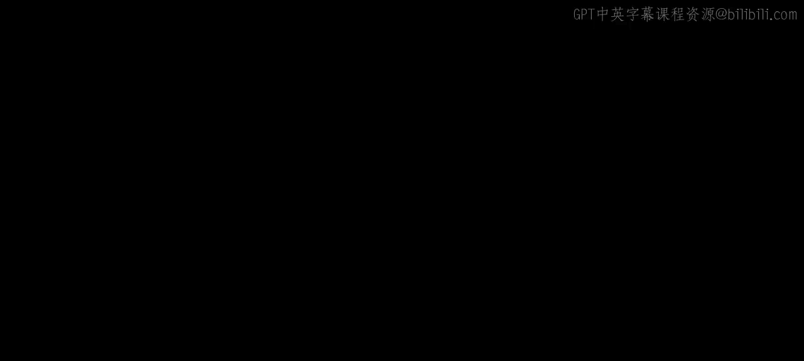
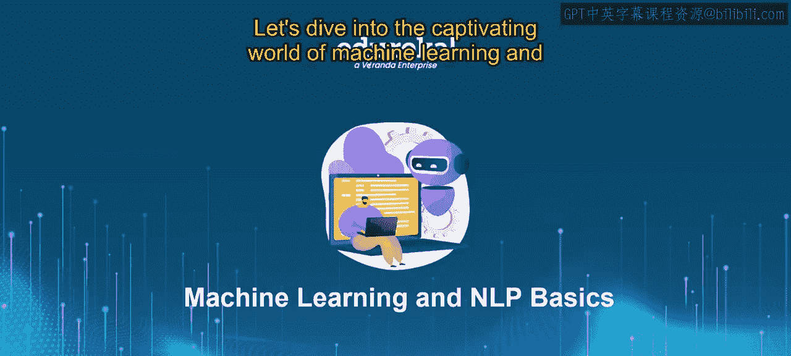
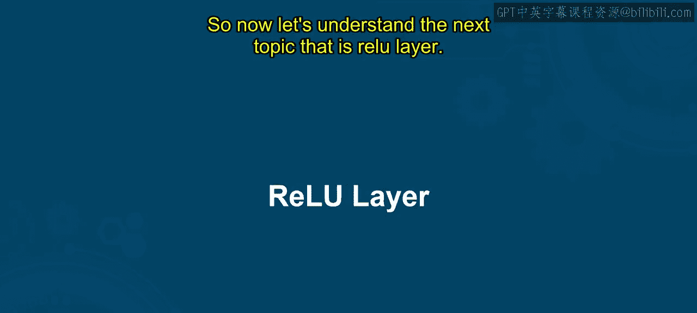
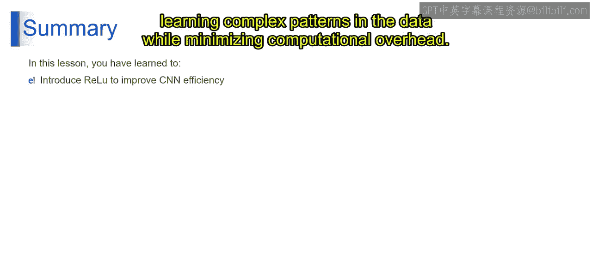

# Edureka《通过LLMs学习生成式人工智能（机器学习和NLP基础，第1课／共4课）｜Learn Generative AI with LLMs》中英字幕 - P66：65_ReLU层.zh_en - GPT中英字幕课程资源 - BV1q4421Q7qh

Hello everyone， let's dive into the captivating world of machine learning and the foundational concepts of NLP together。

 So now let's understand the next topic that is relu layer。

 So in this we are going to cover what exactly a relu layer by the end of the session you are able to understand the functionality and implementation of relu layers and able to comprehend the integration of raillu layers within the CNN。

 So let's get started understanding the raillu layer。 first of all。

 let's understand what exactly a relu is by understanding within easy the example。

 imagine you have a dimmer switch in your room slide when the switch is off that is considered as a negative input the light remains off means the output is0。

 So when you turn the switch on even slightly that is nothing but the positive input the light instantly。

😊。

smean the output is the same as the input means the simple analogy reflects how relu operates in neural network means in neural network Relu is an activation function that introduces non nonlinearity by outputting the input directly if its positive and0 otherwise mathematically it can be defined as f of x is equal to maximum of0 comma x here x represents the input to the relu function and f of x represents the output just like the dimmer switch controls the brightness of the light Relu helps control the flow of information in a neural network by introducing nonlinearity Relu enables neural networks to learn complex patterns and relationships in the data it widely used in hidden layers。

😊，To add flexibility and improve the networkss capacity to model intricate functions so now let's understand it in brief so the re rectified linear unit it is a layer in fundamental component in neural networks used for introducing non nonlinearity in the context of image processing after applying filter operations such as convolution。

 the resulting image may contain both positive and negative values when we talk about removing the negative values replacing them with zeros in the filtered image it refers to a specific activation function used within the relu layer the relu activation function sets all negative values in the input data to zero while leaving positive values unchanged。

So now let's understand how it is going to work so removing the negative values so any negative value in the filtered image are replaced with the zeros。

 this operation effectively eliminates negative activations ensuring that only positive or0 values remain means avoiding summarization to0 by setting negative values to0 we prevent them from contributing to the sum。

 this is important for maintaining the integrity of the data flow through the neural network ensuring that information is not lost or distort as it propagates through subsequent layers means re layer with its zero out behavior of negative values serves to introduce nonlineity into the neural network while also ensuring that only relevant information is passed forward in the。

😊，Works computation means in this grid， for example， if we consider this grid in this。

 we are having a values represented with 0。33 minus 0。110。

55 and followed by one more negative value in this entire row we are having two negative numbers so as per our condition whenever we encounter negative values we have to replace them with the zeros but in case if we encounter the positive values。

 we retain them as they are right so let's understand the step by step here you can see 0。

33 is represented as it is and minus 0。11 is converted it into the0 likewise wherever we are having the negative value representations they can be represented as zeros so now you can see we do not have any negative values in our grid now means how exactly it is。

😊，Happening so let's break down the stepized step process of how relu works when providing the input。

 So first of all， input data， we are providing the entire data。

 we start with the grid representation containing both positive and negative numbers here。

 however we are having where each cell in the grid represents a value then activation function application when we apply the relu activation function to this grid。

 it operates element wise， this means it processes each individual value in the grid independently then zeroing the negative value means for each value in the grid if the value is positive or0 it remains unchanged。

 However， if the value is negative relu replace it with zero then the output data after applying the relu to every value in the grid we get a modified。

😊，gridrid where all negative values have been replaced with zeros while positive values remain unchanged and then the non nonlinearity introduction by zeroing out negative values Relo introduces nonlineity into the data This is crucial for enabling neural networks to learn complex patterns and relationships in the data as it allows them to model more intricate functions That's the reason it is important then passing forward。

 the modified grid with nonneg values is then passed forward to subsequent layers in the neural network for further processinging such as pulling convolution or fully connected layers means relo plays a vital role in neural network architecture by promoting sparsity enhancing computational efficiency and。

😊，Aabling the learning of complex nonlinear relationships in the data。

 So now the summary in this lesson， you have learned how Relu enhances convolutional neural network efficiency by introducing nonlinearity and sparsity crucial for learning complex patterns in the data while minimizing computational overhead。

 Thank you。😊。

