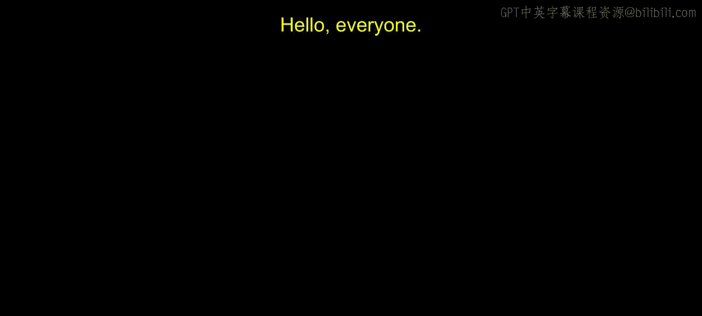
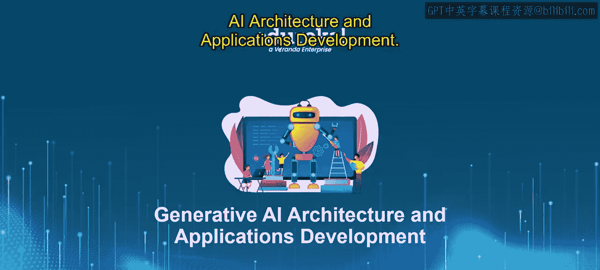
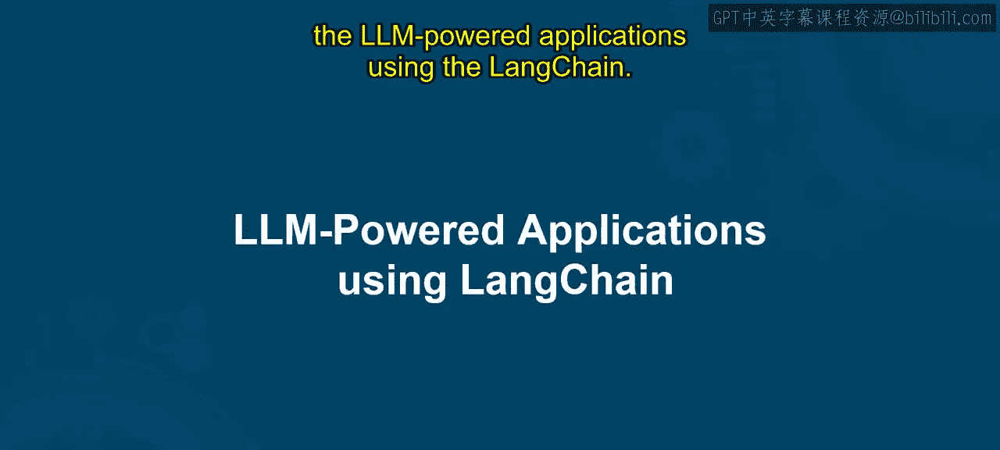
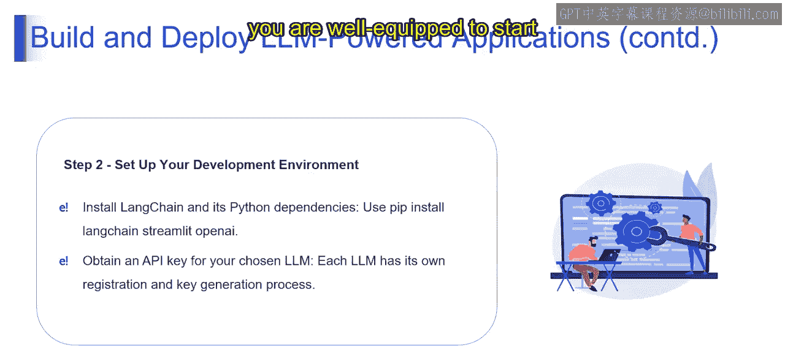
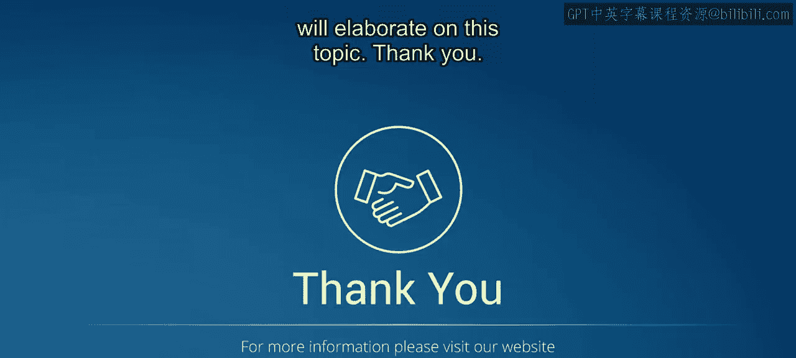

# Edureka《通过LLMs学习生成式AI（基础、应用开发、流行工具，第2、3、4课／共4课）｜Learn Generative AI with LLMs》中英 - P67：30_使用LangChain构建和部署LLM驱动的应用.zh_en - GPT中英字幕课程资源 - BV1ym421V7gx

Hello everyone， welcome back to Generative AI Architecture and Appplication development Month。😊。

So now let's understand the LLM powered applications using the La in this we are going to cover the built and deploy LLM powered applications using the La chain means what are the steps involved within it and we are going to understand all the step by step procedure in order to deploy the application by the end of the session you are able to understand how to build and deploy the LLM powered application using the La chain so let's get started。

😊。

The very first step is define your application so before we diving into the code like you know before we are getting into the buildinging of the application。

 take a moment to plan your lain application like you know here is a simplified breakdown I can tell So first of all you need to understand what problem you are going to solve Imagine your app as a tool So what specific task or need will it address do you want a chat board for customer service。

 a content summarizer for research articles or something else entirely new So you need to decide what kind of problem you want to solve and then next you have to choose your LLM friend means think of the large language model as a specialist with different talents。

😊，For creative tasks like writing poems， GP3 or 3。5 or even 4 might be a good choice here。

 So Lcha allows you to pick the LLm that best suits your app need。

 then you need to go for the pre-built shortcuts in case if it is possible as discussed La chain offers the pre-built workflows for common tasks think of them as recipe templates。

 If one fits your app's goal， you can use it to save time and get started quickly by clearly defining your app cor and selecting the right tools like LLm and potentially a prebu chain。

 you will lay a solid foundation for building your L chain application as a first step。

 Now let's understand the second step set up your development environment。

 Now that you have a clear vision for your application。

 Now it's time to set up your development environment。 first of all， you need。

Perform installing the essential requirements for your application。

 so imagine building a house first you need the tools in this case we use pipeip in our la in case。

So in our case， we are going to use the PP as a command。

 It is a common tool for installing the Python packages we all know for this we need to run the command Pip install streamlit open AI streamlit here is the UI and here I am providing you the example as open AI for your reference。

 So this installs the chain， the core framework along with the streamlit。

 which is a helpful tool for building the web application and the open AI if you plan to use open AI LLm。

 you can use open AI or if you want to use hugging phase you can even use the hugging phase Lm also So now you are done with the installing the essential by performing this then getting your LLm secret key So think of the LLM API key as a special key card Each Lm provider has its own registration process to obtain the key in the other video we have seen how to create the open。

😊，AI API so in order to get the API key， you need to log in into their website and you need to get the API key from their dashboard page and you need to follow the specific instructions to unlock access to their LM capabilities so with these two steps you are well equipped to start building your LM application using the La。

So stay tuned for the next video where we will elaborate on this topic， Thank you。😊。

