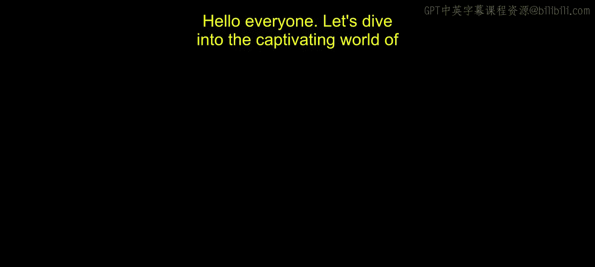
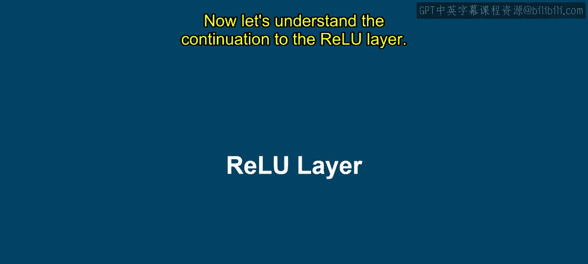
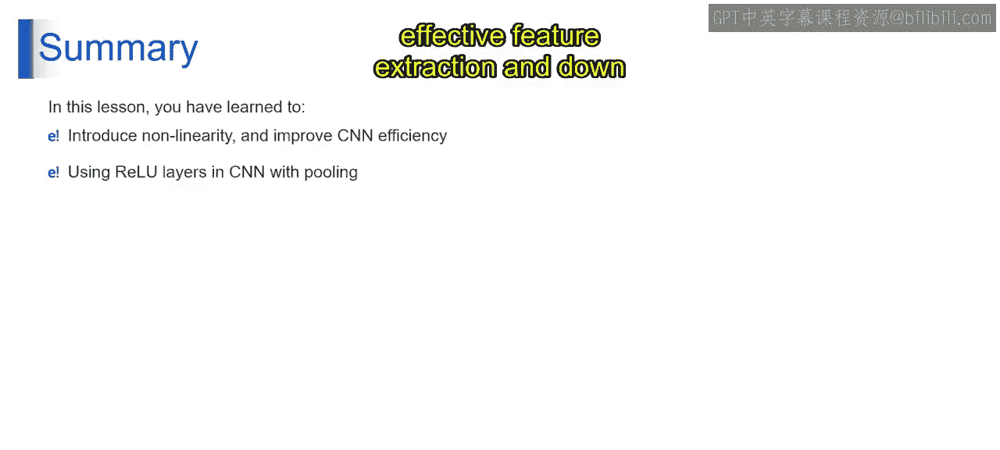

# Edureka《通过LLMs学习生成式人工智能（机器学习和NLP基础，第1课／共4课）｜Learn Generative AI with LLMs》中英字幕 - P67：66_池化.zh_en - GPT中英字幕课程资源 - BV1q4421Q7qh

Hello everyone， let's dive into the captivating world of machine learning and the foundational concepts of NLP together。

 So now let's understand the continuation to the relu layer。

 What exactly going to happen with the pulling in this we are going to cover using the relu layers in CNN with pulling by the end of this session you are able to understand and comprehend the integration of relu layers within the CNNns So let's understand relu layers in CNN with pullinging。

 Imagine you have a picture。 Let's say it's a photo of cat。

 Now this picture is quite big with lots of details。

 the maximum pulling is like zooming out and summarizing the important features。

 So how exactly will work first of all， it will divide the picture。

 Imagine dividing the picture into small squares kind of like a grid now for。😊。

Square you are going to pick the biggest number you see。

 This number represents the most important feature in that small area。

 then after you have looked at all the squares， you are going to shrink the picture by keeping those biggest numbers So instead of having a big detailed picture now you have a smaller one with just the most important features likewise。

 technically if we can understand what exactly it will do is that in CNN the maximum pullinging is downs operation applied after convolutional layers its primary purpose is to reduce the spatial dimensions of the input volume thus reducing the computational complexity while preserving the most important features So how exactly it will work first of all let's start with our first filtered convoluted plus reed image。

 the first window the maximum。highest value is one。 so drag it and move next two strides。 Okay。

 let's understand this。 first of all we will take the entire input image and then we will divide into windows here a window consists of four squares it is called a grid in this we are separating the four grids this maximum pooling divides the input image or feature map into non overlapping rectangular regions or the squared regions or windows or the pools then out of these four we will choose the maximum value means for each window after this we will go for this means for each window maximum pooling retains only the maximum pixel value within that particular region this value represents the most significant feature detected in the particular region so out of these four0。

33 is the maximum number so。😊，We will keep this then in the next step the window is moved to the next grid Now let's understand what is the maximum number out of all these four it is going to be a 0。

55 again it will take the maximum number Similarlyly the process is repeated until all areas of images are covered then in the next step it will go and cover next window of grid 4 here out of all these four one is the maximum number so that it will get placed here then you might wonder what exactly going to happen because there is no extra window for it right so let's see in this case we are adding an additional extra layer the process is repeated until all the areas of the images are covered means now it will select the maximum number of feature from this as 0。

77 like this but the remaining all。😊，The process is going to continue and this is going to be the output for this means a4 by four pixel image is generated without affecting the higher pixel values this process is very helpful when working with the images of the bigger pixels or like thousand by thousand pixels and many more this entire process of choosing the maximum value from the window till the process completes is nothing but the maximum pooling。

😊，Means this is repeating the pooling process means as described earlier。

 we continue the process of match pullinging across the entire image until all areas are covered this in moving the pullinging window across the image with the specified strip identifying the maximum values within the each window and creating a down sample representation of the image based on this maximum values and generating the4 by four pixel image with each pullinging operation the spatial dimensions of the image are reduced if we repeatedly apply pooling with appropriate settings for example window size and strip。

 we eventually shrink the image to a smaller size in this case the image size is reduced to4 by four pixel grid and it will preserve the high pixel values means despite the reduction in image size。

😊，s ensures that the higher pixel values representing the most significant features in the original image are retained。

 This is because the maximum pixel values within each window effectively preserves the most important information while discarding less relevant details but what is the benefit out of it when dealing with the large images such as with the dimension thousand by0 pixels or many more this is going to work very well by progressively downs the image while preserving the essential features max pooling helps manage computational complexity and memory requirement associated with processinging the large images in convolutional neural networks it enables the network to focus on most relevant aspects of the input while reducing the risk of overfitting and improving computational efficiency。

😊，Now the summary means the repeated application of maximum pooling across an image results in downsampled representation with preserved high pixel values making it advantages for handling large scale images in deep learning tasks Now the summary in this lesson you have learned how to introduce non nonlinearity and enhanced CNN efficiency by introducing the maximum pooling operators facilitating effective feature extraction and down sampling in convolutional neural network Thank you。

