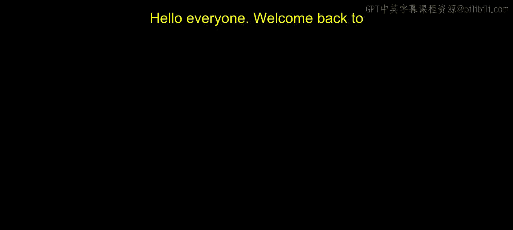
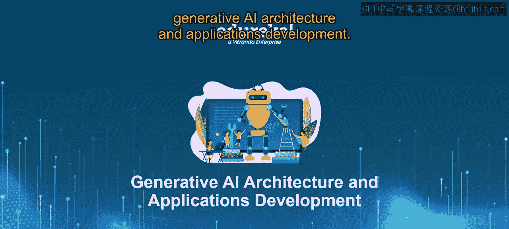
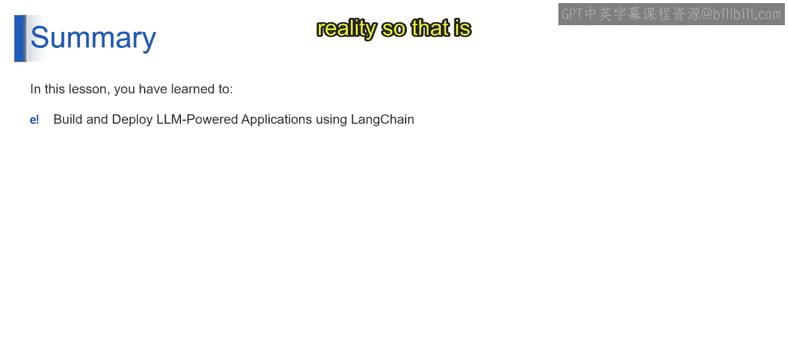
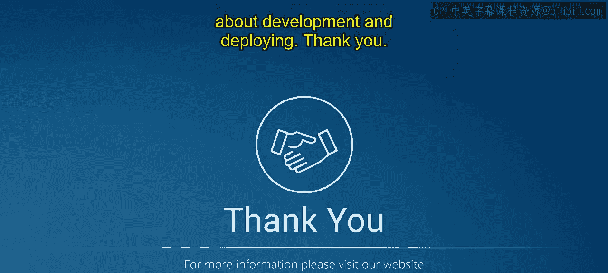

# Edureka《通过LLMs学习生成式AI（基础、应用开发、流行工具，第2、3、4课／共4课）｜Learn Generative AI with LLMs》中英 - P68：31_设计LLM工作流程和其他步骤.zh_en - GPT中英字幕课程资源 - BV1ym421V7gx

Hello everyone， welcome back to Generative AI architectureitecture and Appplication Travel Month。😊。

So now let's understand the step3 that is design your LLM workflow here we are having the two things customized chain as well as build custom chain so let's understand the customized chain first so imagine using a recipe template that wanting to adjust the spices or ingredients with the existing requirement means La chain offers rebuilt chains for common tasks you can modify the prompts memory settings and response passes within these chains to fine tune them for your specific names so that's about customized chain。

 then coming to the build custom chain think of constructing the house as whatever we discussed La chain allows you to build custom workflows from the scratch you can combine the individual la chain components like LLM wrappers and prompt templates and even the passes to create a unique conversation flow。

😊，For your application means by customizing the existing chains for building your own。

 you define the specific steps your application will take to interact with the Lm and achieve its desired outcome。

 So that's about this third step。 So now let's understand the step forward that is develop your application logic。

 So what exactly we are doing。 So first of all， we are connecting to the LLM body。

 So imagine having a special adapto。😊，The first one is of connecting to LLM here you use the Lacha wrapper to interface with your chosen LLMs API that previously whatever we discussed as an adapter for your phone charger Laangcha provides wrapper that act as an adapter allowing your application to seamlessly connect with your chosen LLM API then the next one is of crafting instructions for LLM so think of prompt as a clear Bi instructions for your LLM front here you will use the Lacha to develop specific prompts that will elicit the desired outputs from the LLM Additionally you will set up the data pipelines to manage any data flow within your application Then the next one is of making sense of the LLM response once the LLM response to your query Langcha passes come into the play think of them as data filters。

😊，Ting the most relevant information from the LLMs。

 sometimes lengthy responses and making it usable within your application。

 Then the last one is of develop user interfaces。 If you are creating a web application you can leverage frameworks like streamlit for a quick and easy interface Al。

 you can build custom interface that seamlessly integrates with your La application logic by tackling these steps。

 you will transform your LLm interaction design into a functional application that integrates with the LLm and present its insights in a user friendly manner。

 So that's about the step4。 Now the last one is testing and refinement where you are polishing your LLm by testing and refinement So before unleashing the LLM application to the world it's very important to ensure it functions smoothly means。

😊，First step here you are doing is putting your app through the paces。

 Think of test driving a car before hitting the road。

 run simulations in L to mimic the real world usage and check your application behavior。

 This allows you to refine the prompts at just components and identify any potential issues before the deployment then you need to perform the real world feedback is an optional one。

 So imagine getting feedback on a dish cooked Consider deploying your application to a limited audience which is nothing but a beta users here or be testers to gather a valuable use of feedback。

 so this can help you improve the user experience。 identify areas for improvement in functionality and ensure your LLm application truly shines by thoroughly testing and refining your LLm application。

 you will guarantee it delivers a smooth and user friendly experience。

Everyone so that is about the last step testing and refinement Now the summary so in this lesson we explore L chain's power for building LLM applications from defining your app' goal to crafting interactions with the LLM and polishing the final product Lng chain empowers you to turn your LLM ideas into reality so that is about development and deploying Thank you。

😊。

