# Edureka《通过LLMs学习生成式人工智能（机器学习和NLP基础，第1课／共4课）｜Learn Generative AI with LLMs》中英字幕 - P68：67_ReLU层的实现.zh_en - GPT中英字幕课程资源 - BV1q4421Q7qh

Hello， everyone。 welcome back。 Now， let's understand the practical implementation of Relu layer implementation using the demo。

😊。

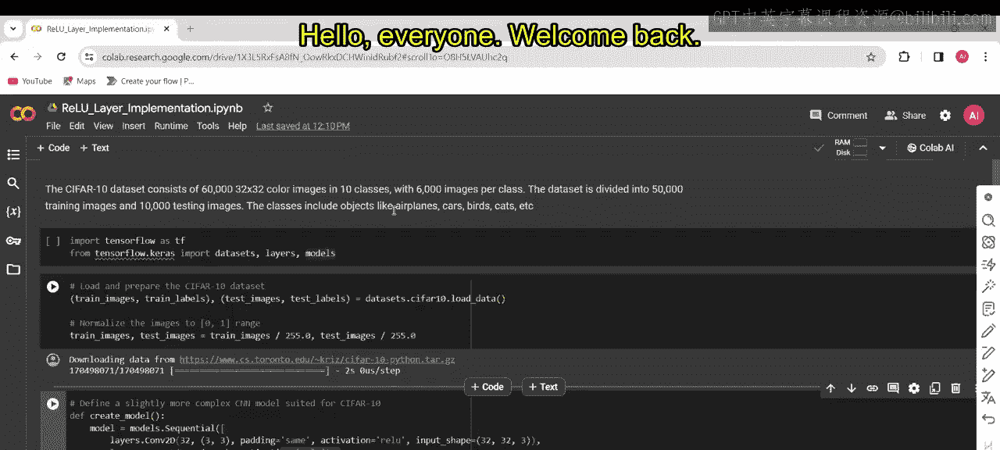

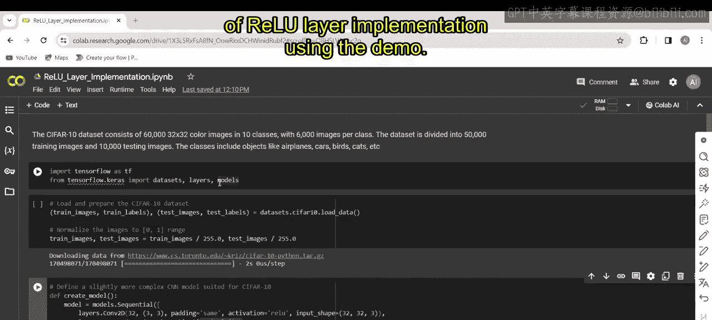

So here now we are going to analyze CF 10 CF stands for Canadian Institute of Advanced Research。

 It is a research inst that focuses on interdisciplinary research in various areas including artificial intelligence and machine learning so now we are going to work on CFR 10 data。

 It is a collection of 60000 32 by 32 color images of 10 data sets used for object recognition in computer vision research So now we are going to make use of it。

 This data contains 60000 small images categorized into 10 different classes with each class having 60000 images it serves as a benchmark for image classification tasks covering various objects like airplanes cars。

😊。

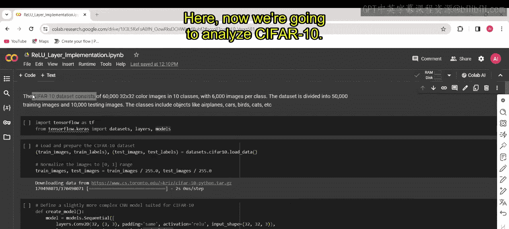

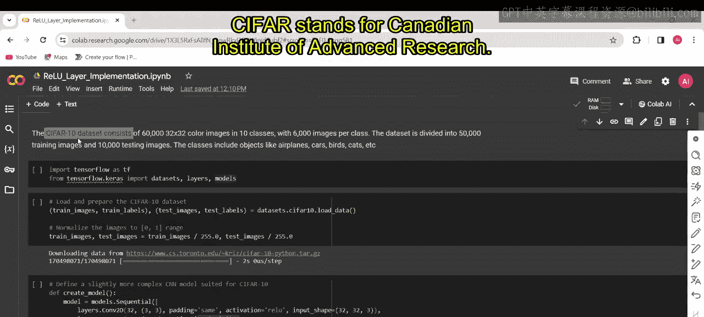

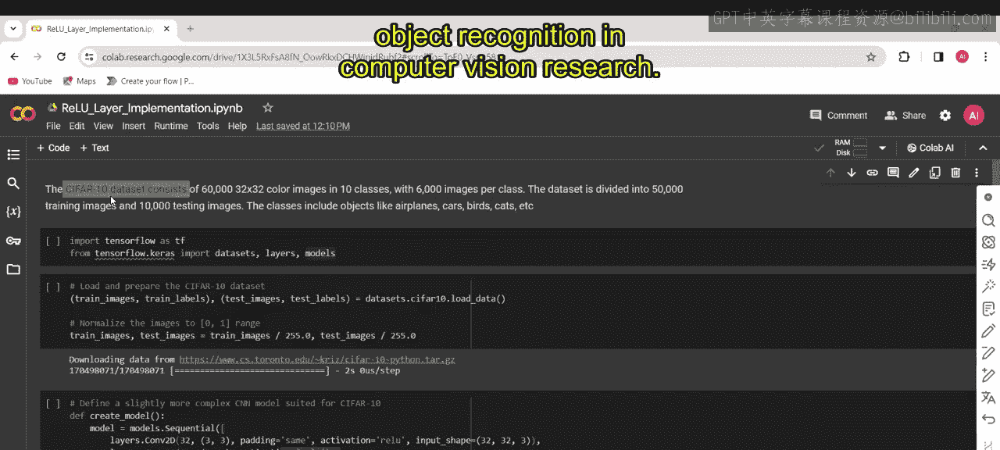

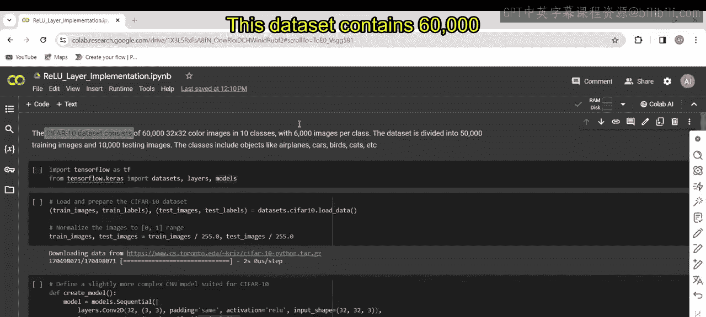

Birds and cats， among others。

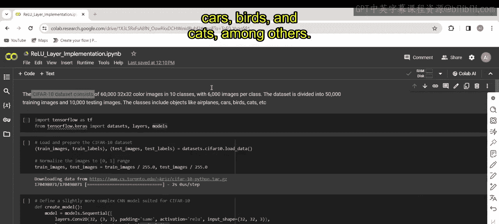

This dataset is typically used for training and evaluating machine learning or deep learning models primarily for image classification tasks this data helps researchers and partitions develop and assess algorithms that can accurately classify images into one of the10 predefined classes now the first step is import Tensorflow asf and dot ks as import data so this block of code imports Tensorflow and its k API for building neural networks it also imports datas layers and modules。

😊。

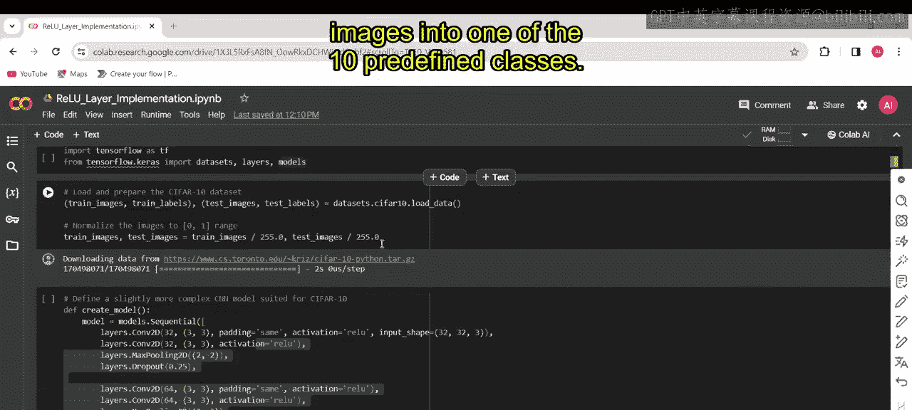

To facilitate the creation of convolutional neural network， that is nothing but CNN architectures。

 fors， tasks like image classification。 Now， the second block of code。😊。

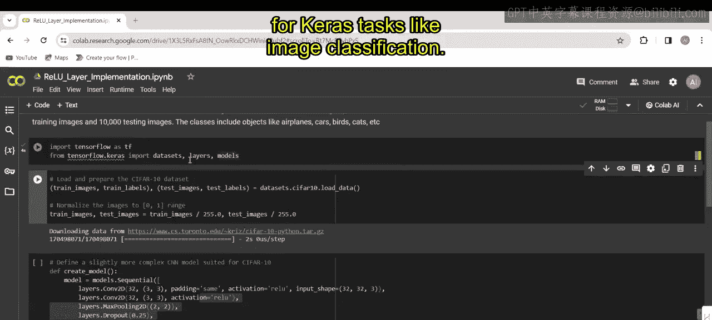

This code segment loads CFAR 10 dataset set dividing it into training and testing sets along with their respective labels。

 it then normalizes the pixel values of the image to the range of zero comma1。

 a common preprocesing step to facilitate the model training Now the next block of code。

 this code consists of more complex CNN architecture suitable for CFAR 10 classification it consists of multiple convolutional and re activation comm a max pullinging layers and dropout regularizations the model ends with fully connected layers including final dense layer with 10 neurons。

😊。

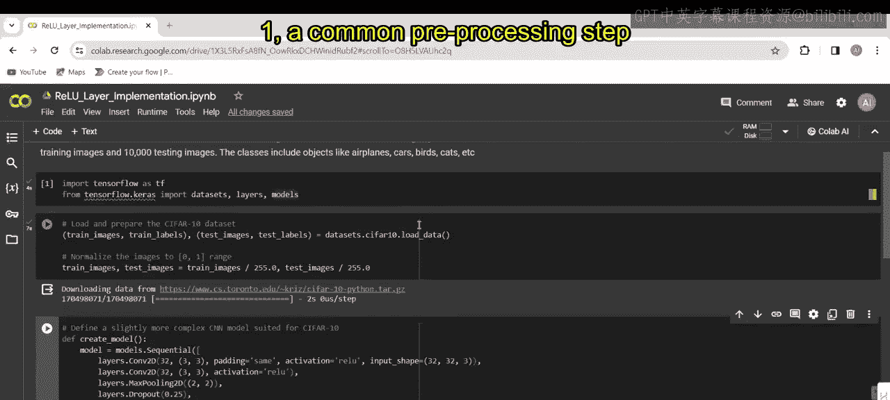

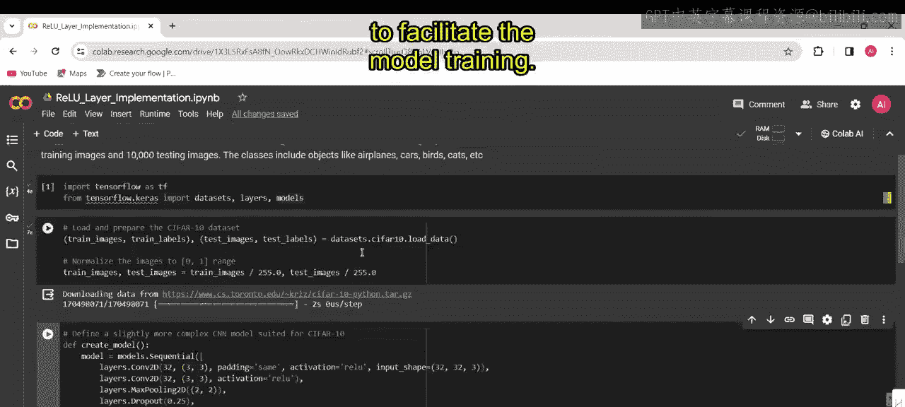

For class prediction corresponding to 10 classes in the CFAR data set。😊。

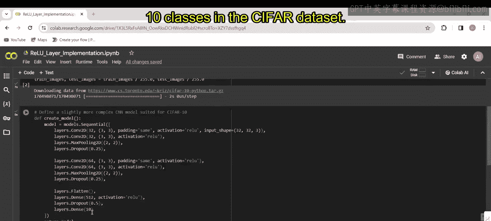

Now compile the model this code compiles the CNN model using the aom optimizer。

 sparse categorical cross entropy loss function and accuracy as the evaluation metric。

 then it trains the model on the training data。😊，With the train images。😊。

And train labels for five apoch。Validating on the test images and test labels after training it evaluates the models performance on the test data set printing the test accuracy it is actually still working on once if it is done I will show you the output。

😊。

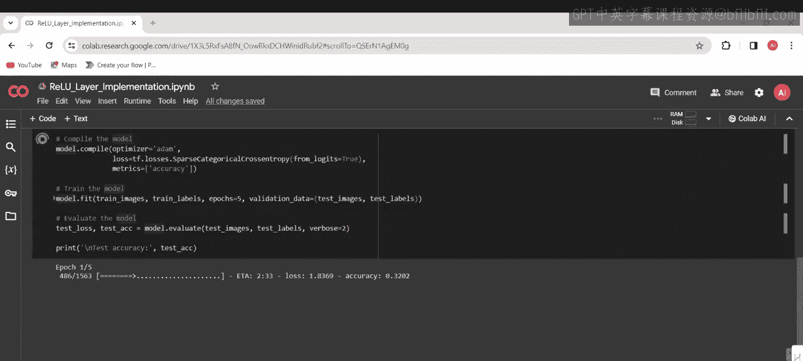

This code block is likely taking time due to the computational load of training a neural network model。

 it involves optimizing model parameters across the multiple epochs which can be resourced especially for large dataset for complex architectures。

 additionally evaluating the model on the test dataset add further computational overhead。😊，Firstly。

 comp the model involves setting up the computation graph。

 which includes configuring the optimizer and the loss function。 Secondly。

 training the model requires iterative forward and backward passes through the network for multiple epochs adjusting model parameters to minimize the loss Lastly evaluating the model on the test data set it involves。

 as I mentioned， making predictions on each test sample and comparing them with the ground truth labels to compute accuracy which can also be computationally demanding。

 So that's the reason it is taking so much of time。 Once if it is done。

 I will show you the output with the accuracy point of view Now you can see the output here that the test accuracy of 0。

74 for the re layer implementation。 Thank you。😊。

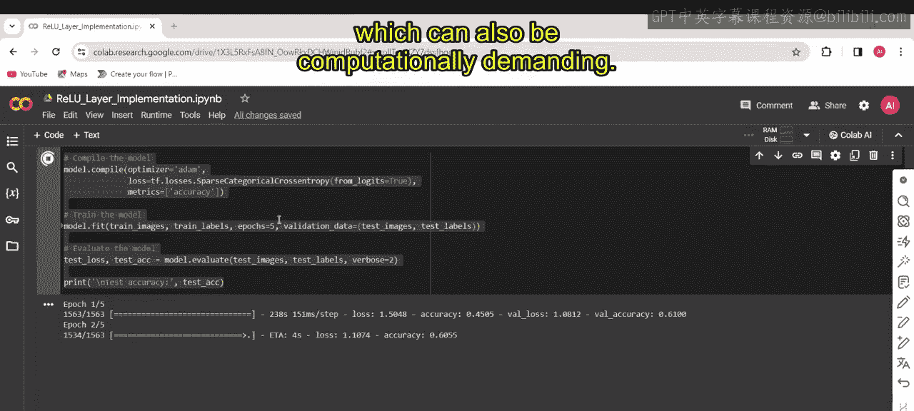

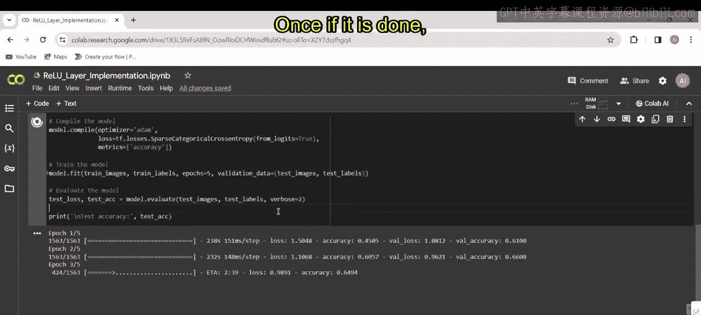

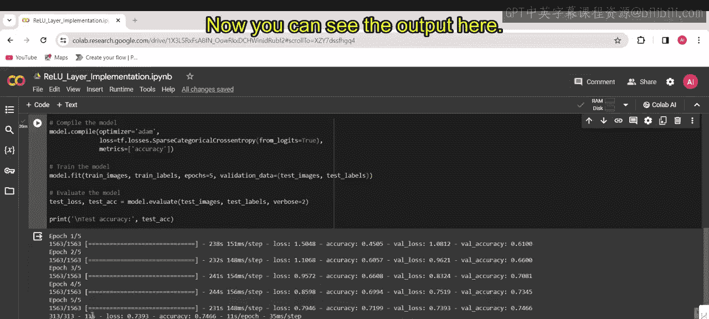

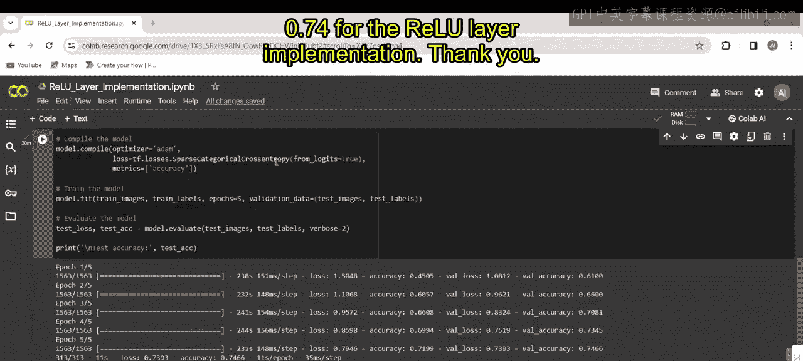