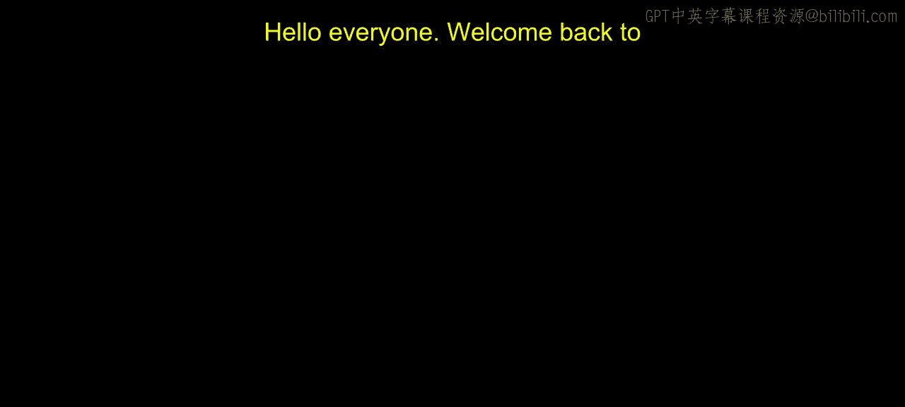
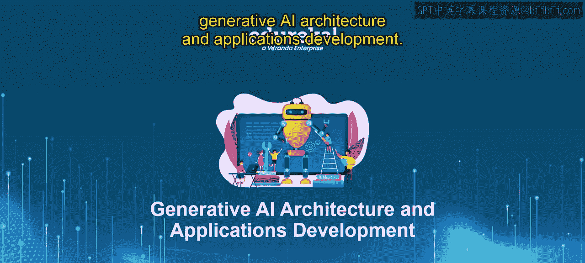
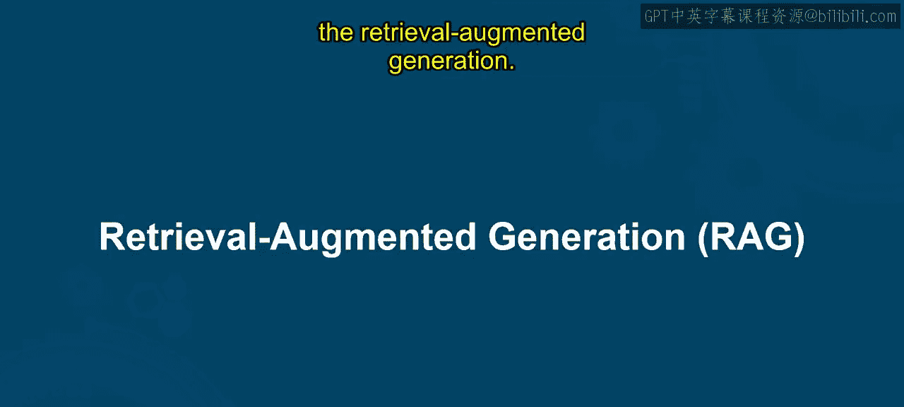
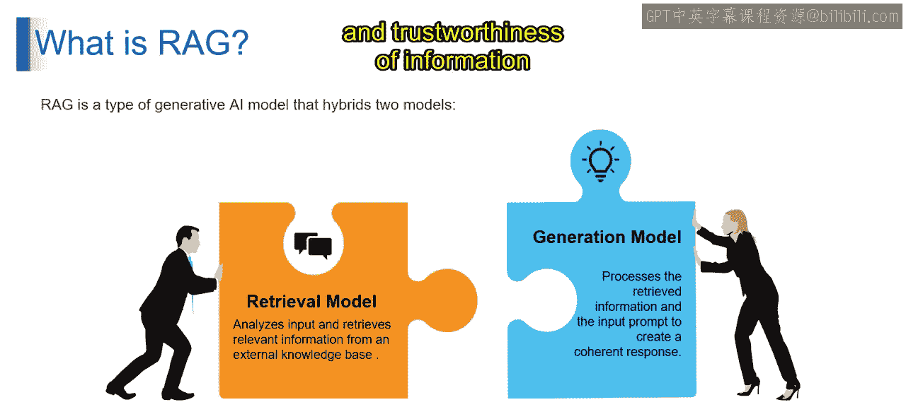
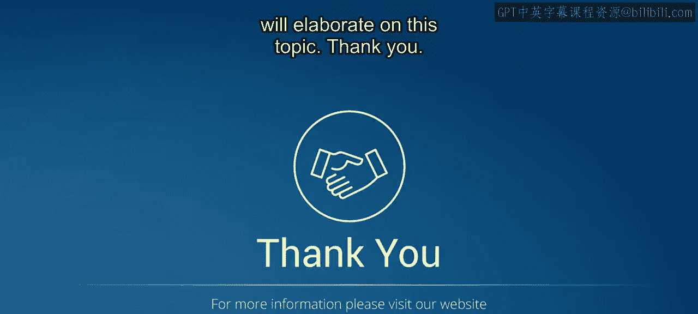

# Edureka《通过LLMs学习生成式AI（基础、应用开发、流行工具，第2、3、4课／共4课）｜Learn Generative AI with LLMs》中英 - P69：32_理解检索增强生成（RAG）.zh_en - GPT中英字幕课程资源 - BV1ym421V7gx

Hello everyone， welcome back to Generative AI Architecture and Appplication development Month。😊。

So now let's understand the retrieval augmented generation in this we are going to gogle what exactly the reG that is retrieval augmented generation。

 how it is going to work by the end of the session you are able to understand the significance of RG in the LLB tasks so let's get started the retrieval augmented generation So retrieval augmented generation often aggreavated as RG is a fascinating technique that elevates the capabilities of the large language models by grounding them in factual accuracy so think of it like this imagine a judge in a courtroom they rely on their legal knowledge but can also consult external sources like precedes and case studies for complex rulings Similarlyly reG equis。

😊。

LLms with the access to external knowledge bases to enhance the quality and reliability of the responses。

 Let's take one more example。 Imagine you have a super creative friend。

 that is nothing but LLm in our cases who can write amazing stories but sometimes these stories might have fantastical details that are now imagine you have a super creative friend that is nothing but LLm in ourrks who can write amazing stories。

 but sometimes these stories or might not be quite true all the time。

 So in the situation ragg act like a helpful librarian forya friend when you ask your friend a question like。

 for example， who build the E trouble the rag goes to external sources like Encyclopedias think Wikipedia to find the real answers out of it。

 So rag。😊，And whisperpers the correct information to your friend who can use that knowledge to tell you a story that's both creative and accurate。

😊，In this way， Ra ensures your friend's answer。😊，Are reliable and based on real facts。

 just like how RaG helps LLMs generate responses that are both creative and factual grounded in technical terms。

 RaG is the NLP technique designed to improve the factual accuracy of the generated AI models。

 It is an intermediary between the LLM and the external knowledge sources。

 It retrieves and generates or integrates the real world knowledge from the external sources to ensure AI responses are factual grounded and reliable。

 So now let's understand what exactly the RG is。😊，Remember your super creative friend who could write amazing stories。

 but sometimes included fantastical details。 Rag is like a helpful librarian who ensures the stories are factual accurate。

 So think of your friend as a large language model in our case， they are create a generating text。

 but their knowledge might not always be perfect。 The ragg model is like the library catalog。

 It analysess your question like in our previous case。

 the question was who build the E and searches a massive external knowledge base， for example。

 like Wikipedia， to find the relevant information out of it。

 Then the generation model is like your friend， who is using librarian' health。

 They consider the retrieve information along with your question to create a well structured answer。

 This is similar to how。😊，Genrative AI model processes retrieved information and the input prompt to create a coherrenent responses in this。

 the rack convinced two models retrieval model and the geneative model so the retrieval model this analyzes your input and acts like a super search engine sifting through a vast external knowledge base to find the most relevant information then the generation model This is your friend who is nothing but a LLM in our case to take the retrieved information and your question to create a response that's both creative and factual accurate means Ra acts as a intermediary bed the LM and the external knowledge sources ensuring the LLM responses are grounded in real facts This makes Ra a powerful tool for improving the re and trustworthiness of information。

😊。

By the AI models。So stay tuned for the next video where we will elaborate on this topic， Thank you。😊。

