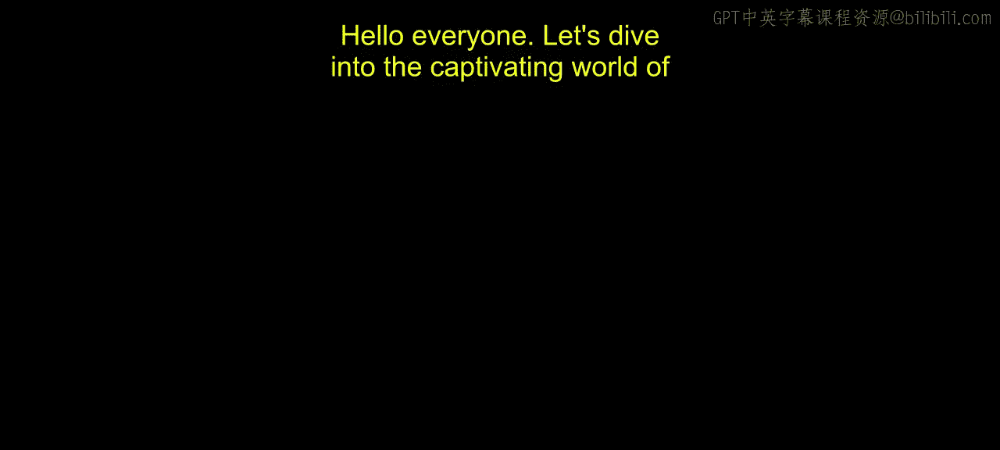
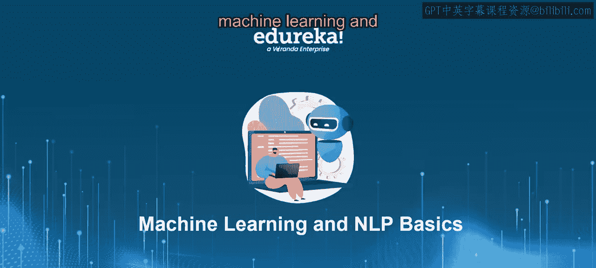
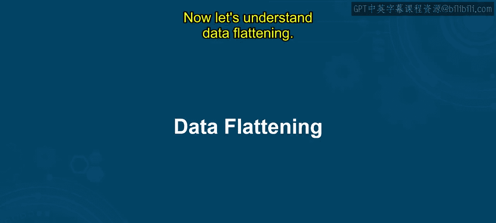
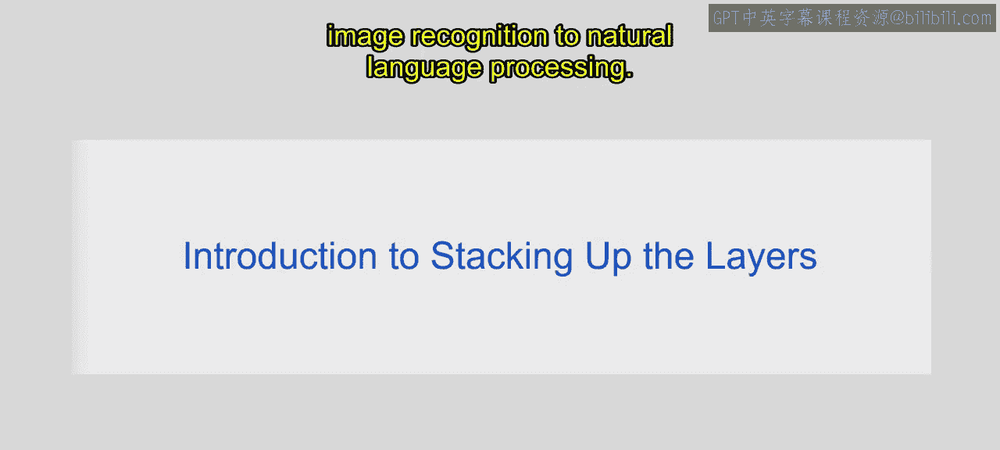
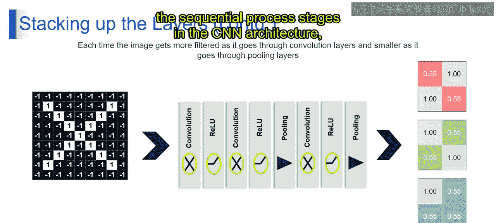

# Edureka《通过LLMs学习生成式人工智能（机器学习和NLP基础，第1课／共4课）｜Learn Generative AI with LLMs》中英字幕 - P69：68_数据展平.zh_en - GPT中英字幕课程资源 - BV1q4421Q7qh

Hello everyone， let's dive into the captivating world of machine learning and the foundational concepts of NLP together。

 Now let's understand data flattering in this we are going to cover stacking of the layers and flattening by the end of the session you are able to understand and learn how to convert multi-dimensional data into one dimensionsal array and able to grasp the significance of flattening of the layers so let's get started introduction to stacking of the layers first of all。

 let's understand what exactly the stacking of the layers Okay imagine you are building a cover using the building blocks each block represents a layer in your neural network you start with base layer and add more blocks on top of it to build a total or taller。

😊。

Similarly， in a neural network， you start with input data first to form。

And or add layers on top of each other to create a deeper network means what exactly happening here。

 so here you start with the base layer means in our case it is nothing but the input data and we are adding the layers on top of each other to create the deeper network so now let's delve into the technical understanding stackging up the layers in your neural network tagging up the layers refers to the process of adding multiple layers on top of each other to form a deep architecture these layers can include various types such as convolutional pooling and fully connected。

😊，Means these layers can include various types such as convolutional layer。

 pullinging layer and fully connected layer and even activation layers each serving a specific purpose in extracting features and learning representations from the provided input data in this example consider a feed forward neural network for image classification you start with the input layer representing the pixel values of an image then you add one or more hidden layers。

😊，Means like this consider a feed for neural network for image classification you start with the input layer here you start with the input layer representing the pixel values of an image and then you add one or more hidden layers where each layer applies transformation to the input data gradually extracting highle features finally you have an output layer that produces the predicted class probabilities means technically stacking up the layers involves arranging the neurons of each layer into sequence where the output of one layer serves as an input to the next layer this sequential arrangement allows the network to learn hierarchical representation of the input provided data with each layer capturing different levels of abstraction just like building a tower blocks。

😊，Stacking up the layers in neural networks or neural networks involves adding layers one on top of each other to create a deeper architecture。

 Each layer contributes to the overall complexity and capacity of the network enabling it to learn intricate patterns and relationships in the data means stacking a layer is a fundamental concept of neural network design where layers are added sequentially to create a deep architecture capable of learning complex representations from the input data。

 This process enables neural networks to solve a wide range of tasks from image recognition to natural language processing。

😊。

So here we have provided the representation how exactly it is going to be so let's dive deeper into each stage of processing in a convolutional neural network using the image so first of all we are providing the input data then it is going to be the first layer is going to be the convolution convolution is the first stage processing in CNN it involves applying small filters or kernels to the input image to extract the various features in the provided image the black and white grid represents the input image where black squares represents minus1 and the plus squares represent plus one the filters represented by numbers in the grid slide across the input image computing dot products at each position the resulting output grid depict the feature maps generated by convolving the filters with the input。

😊，Image these feature maps capture different aspects of the input data。

 such as adjusts texture or shapes。 Then the next layer is going to be the relu。

 It is nothing but rectified linear unit Relu is an activation function applied after the convolutional layer it introduces non nonlinearity into the network by replacing negative values with the zero and leading positive values unchanged which we discussed in the last module in the provided image the output grid from the convolution stage are passed through the relu layer resulting in modified feature maps where the negative values are set to0 by the positive values remains unchanged Relu activation helps the network learn more complex patterns and improve its ability to capture nonlinear relation。

😊，In the data then it will be sent to the pooling layer。

 So we discussed in the last session that pooling is a downs down samplingampling operation that reduces dimensionality of the feature maps produced by the convolutional layer in the provided image the output grid from the re layer undergo pooling which involves dividing each feature map into nonoverping regions and summarizing them using a pulling operation such as mass pullinging average or some pooling the resulting output grids represent the pool feature maps which have reduced the spatial dimensions compared to the original feature maps This helps in controlling overfitting and improving computational efficiency means overall the image illustrates the sequential process stages。

In the CNN architecture， starting from the convolution to re activation and polling。

 so the upcoming video will delve further into the ongoing discussion。😊。

