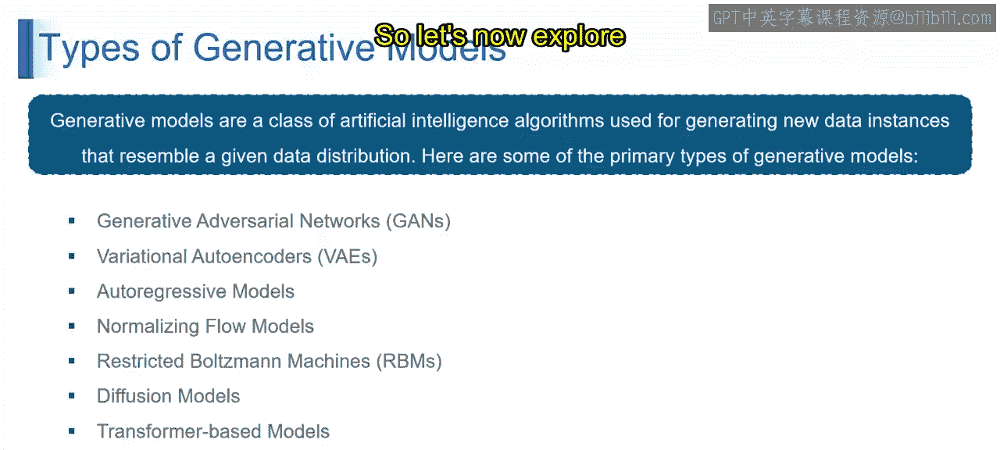
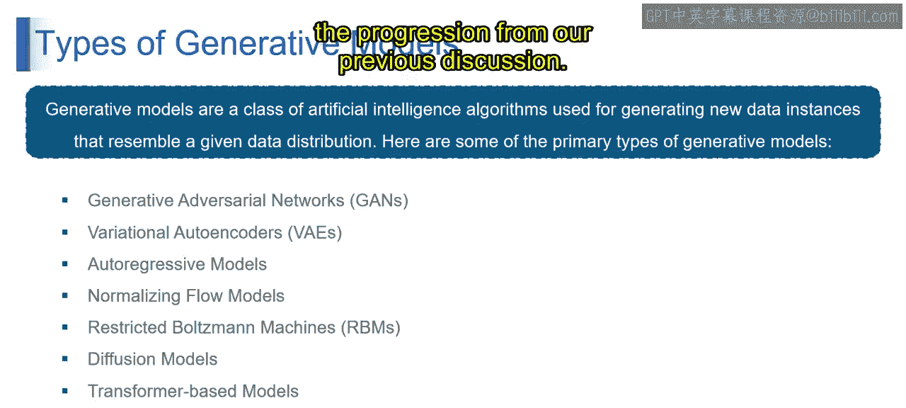
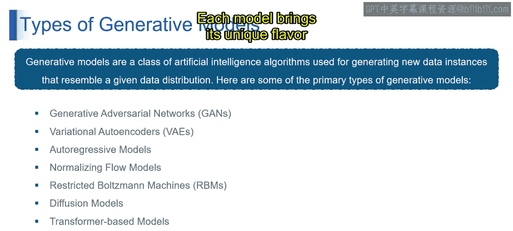
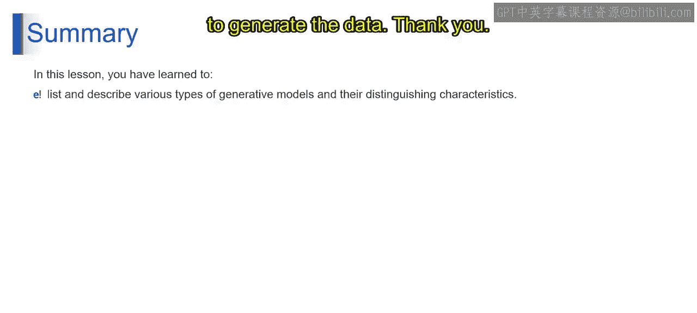

# Edureka《通过LLMs学习生成式AI（基础、应用开发、流行工具，第2、3、4课／共4课）｜Learn Generative AI with LLMs》中英 - P6：5_基于Transformer的能量条件生成模型.zh_en - GPT中英字幕课程资源 - BV1ym421V7gx

So let's now explore the progression from our previous discussion they start with a simple distribution and iteratively transform it to capture the intricate patterns in the data that's about diffusion models then the next one is of transformer based models so think of a multilingual translator effortlessly switching between the languages so transformer based models like the famous GP3 work similarly part with the data。

 the process and generate data by attending to different parts of the input capturing intricate relationships and producing contextually rich output means technically transformer based models are generative models that utilize attention mechanism to process and generate the data the exc in capturing dependencies within the data by attending to different elements at various positions making。

😊。

them versatile and powerful So that's about transformer based models。

 Then the next one is of energybased models which is also known as EBm so just imagine a landscape where objects naturally settle into the lower points or the lowest points like a ball rolling into a v EBm operates similarly assigning lower energy values to more probable data points the model aims to find the lowest energy state representing the most likely data distribution in technical terms this EBm are generative models that assign an energy value to each possible configuration of the data the lower the energy。

 the more likely the configuration guiding the model to generate data that fits the desired distribution that's about EBm then the last one is of conditional generative models so consider。

😊，A chef who can create various dishes based on specific customer preferences。

 So conditional generative models work similarly， generating data with specific characteristics of features based on the given conditions。

 It's like a chef preparing a dish tailored to a customer's unique state， technically。

al generative models are type of generative model that take additional information called conditions into account during the data generation process。

 These models guide the model to produce the data with specific attributes or the features means these generative models from the to the conditional generative models offer diverse and creative ways to generate the data。

 whether through advisory battles， control randomness。

 sequential dependencies or complex transformations。 Each model brings its unique。😊。

For to the world of generative AI Now the summary in this lesson。

 we explore diverse generative AI models from G Ns to conditional generative AI models。

 each with unique characteristics whether through aable dynamic control randomness。

 sequential dependencies or complex transformers。 These models offer creative ways to generate the data Thank you。

😊。

