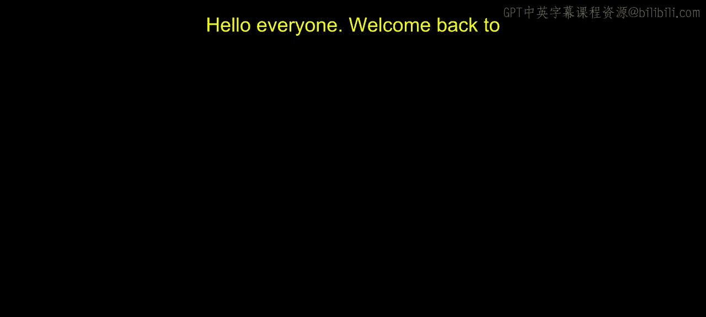
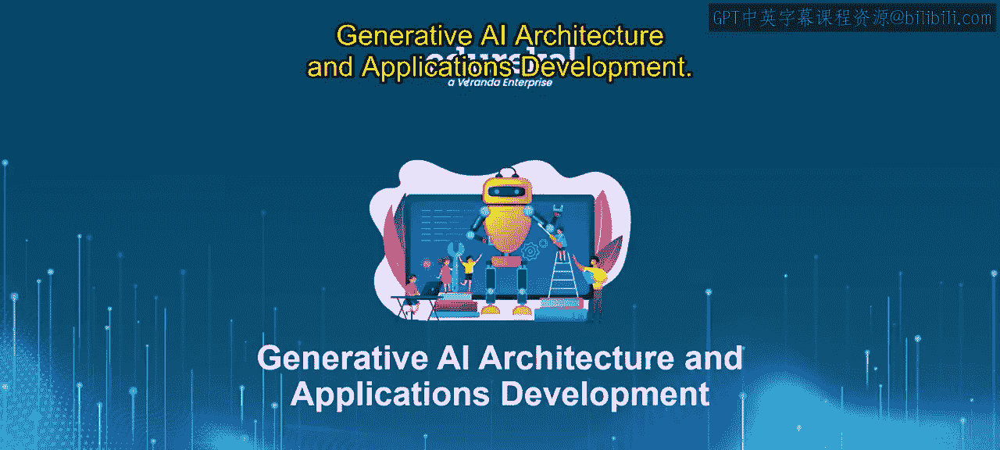
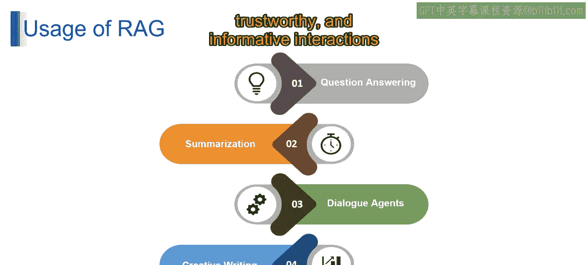

# Edureka《通过LLMs学习生成式AI（基础、应用开发、流行工具，第2、3、4课／共4课）｜Learn Generative AI with LLMs》中英 - P70：33_检索增强生成（RAG）的使用.zh_en - GPT中英字幕课程资源 - BV1ym421V7gx

Hello everyone， welcome back to Generative AI architectureitecture and Appplication Travel Month。😊。

Now let's understand the usages of Ra。 The first one is of question answering。

 Imagine asking your super creative friend a factual answer like the same one。 For example。

 now let's take what is the capital of France with the Ra they can console the library external knowledge base to find the answer and provide you with a reliable answer or response This makes Rag ideal for building question answering system that are both informative and trustworthy。

 Then the next one is of summarization。 So think of summarizing a complex research paper。

 Rag can empower your Lm to not only condense your information but also verify the facts and statistics by referring the library This ensures the summaries are accurate and capture the essence of the source material。

 Then the next one is of dialogue agents imagine have。😊。

a conversation with the chat board Ra can elevate the quality of these interactions by grounding the chatbo's response in factual information。

 This is practically important for domains like healthcare or customer services where accuracy is very。

 very important Then the next one is of creative writing。

 So while Ra excs at ensuring the factual accuracy。

 It does not have to stifle creativity entirely think of your friend using the library for inspiration Ra can help LLm generate the creative text formats like poems or the scripts that are still rooted in factual details adding new dimensions to creative writing possibilities means Rag offers a valuable tool for enhancing the capabilities of elementss across the various applications by providing a bridge to factual information Rag pas。

😊，The way from more reliable， trustworthy and informative interactions with the AI models。😊。

So stay tuned for the next video where we will elaborate on this topic， thank you。😊。

