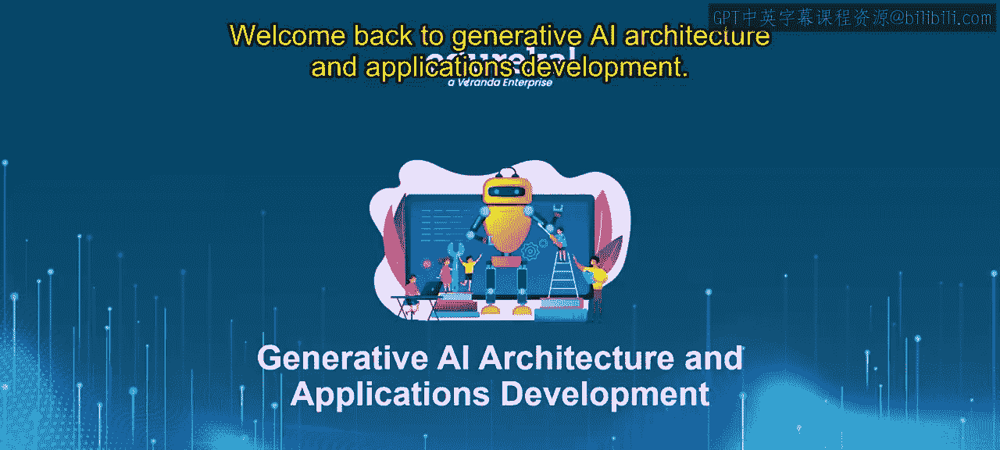
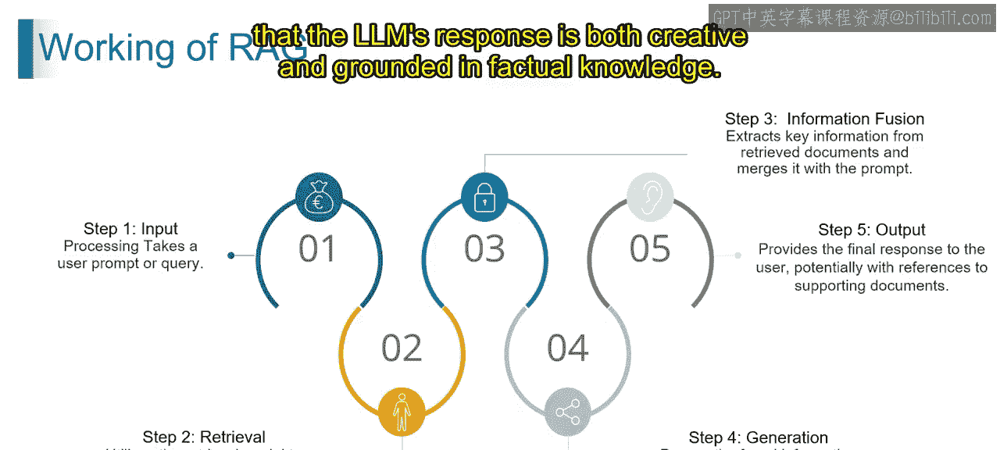
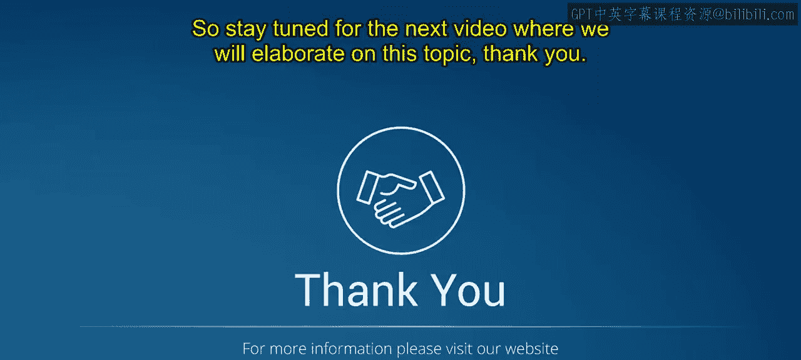

# Edureka《通过LLMs学习生成式AI（基础、应用开发、流行工具，第2、3、4课／共4课）｜Learn Generative AI with LLMs》中英 - P71：34_检索增强生成（RAG）的工作原理.zh_en - GPT中英字幕课程资源 - BV1ym421V7gx

Hello everyone， welcome back to Generative AI architectureitecture and Appplication Travel Month。😊。

Now let's understand how the rag works in the step by step processor remember our super creative friend who writes stories。

 the rag， the helpful librarian ensuring factual accuracy so let's see how rag works behind the scenes using the example so imagine you ask your friend write a story about talking cat who travels to the moon so here is the breakdown of rag st weaving the technical details into the easy to understand scenario the step one is that input processingsing so you give your friend the prompt like a story idea rag retrieves the user's query that write a story about talking cat who travels to the moon in the step to the retrieval your friend the retrieval model asks the librarian the external knowledge base for the information related to talking cats。

😊，And the moon travel， since these are key elements of your prompt means Rag utilizes the retrieval model to search the knowledge base for documents relevant to the prompt。

 These might include information about space travel cats。

 perhaps even famous fictional talking cats or even lunar exploration that is about the step 2。

 in the step 3， it will perform information fusion means the librarian gathers the relevant books like space encyclopidians or the stories about the cats and whisperpers the key points to your friend。

 That is nothing but like a fact that humans have not taken pets to the moon E。

 Your friend combines this information with your original prompt。

 This step involves extracting the key information from the retrieved document like the scientific limitation of the space travel and merging。

😊，With the original prompt， this creates a fused representation that considers both creative idea and factual constraints。

 Then in the step4， it is about the generation So now informed by the librarian。

 your friend uses their creativity to craft a story maybe the cat uses a super invention to reach the moon。

 or perhaps the story becomes more fantastical focusing on cat's dream of lunar adventure means what happens here in technically the fused information is passed to the generation model。

 that is nothing but the LLm。 they use their language skills and provide context to create a response。

 that is nothing but a story in our case。 This response can be factual means highlighting the challenges of space travel to create focusing on the cat's imaginary journey then。

😊，The last step is of output。 Your friend shares the story with you now。

 It might be a funny tale of the cat's attempt to build a rocket or more imaginative story about the wonders the cat encounters meanss Ra provides the final response that is nothing but our story to the user depending on the specific implementation the output could include references to the document used in the retrieval step like links to relevant articles about the space travel by working together with all the steps。

 the retrieval model and the generation model with the little help from the librarian rack ensures that the Lms response is both creative and grounded in factual knowledge。

 This is one example whatever we discussed。😊。

So stay tuned for the next video where we will elaborate on this topic， thank you。😊。

