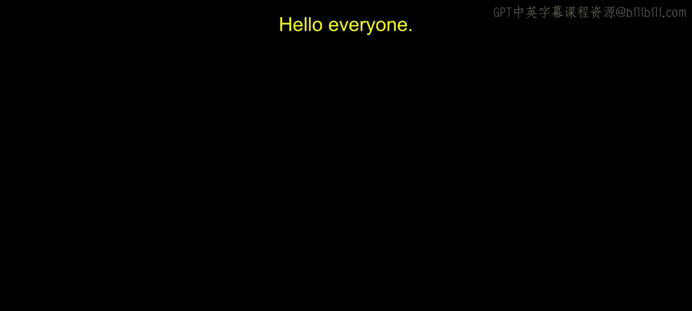
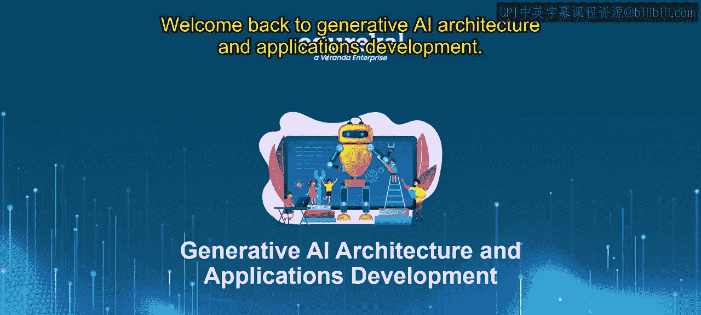
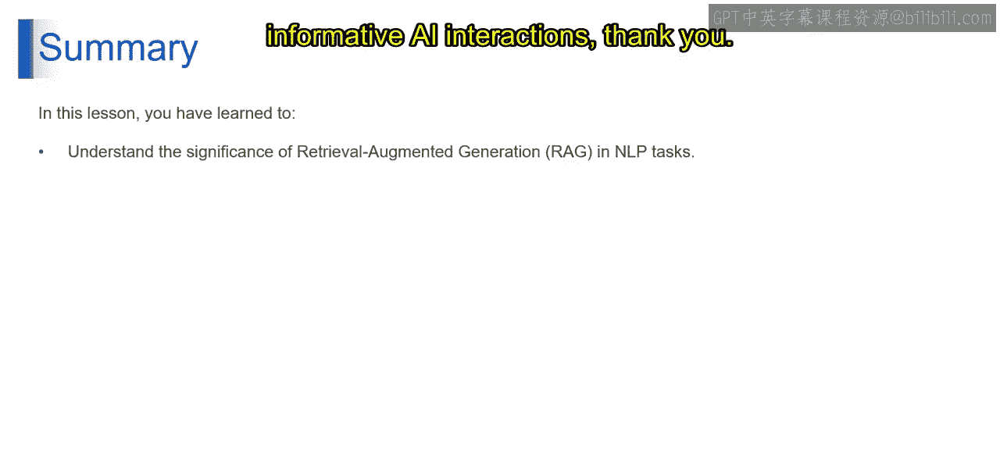

# Edureka《通过LLMs学习生成式AI（基础、应用开发、流行工具，第2、3、4课／共4课）｜Learn Generative AI with LLMs》中英 - P72：35_检索增强生成（RAG）的优势.zh_en - GPT中英字幕课程资源 - BV1ym421V7gx

Hello everyone， welcome back to Generative AI architectureitecture and Appplication Travel Month。😊。

Now let's understand the benefitsphts of the rag so we have explored how Ra acts like a helpful librarian for our LLMs so now let's understand the benefitsphitts。

 the first one is of improved factuality and accuracy means imagine a world various super creative friend that is nothing but LLM can write stories that are not only fantastical but also scientifically accurate and true with the ra this becomes a reality by accessing external knowledge basiss Ra ensures that the LLM's response are based on the real world information minimizing the risk of factual errors or misleading statements this is crucial for applications like questionansing or summarizing the factual topics then the next one is enhanced contextual understanding think of having a conversation with someone who not only listens to your words but also understands。

😊，The broader context Rag empowers LLms to achieve a similar level of understanding by retrieving relevant information from the external sources Rag provides LLms with the additional context beyond the user's immediate query this allows them to generate responses that are more relevant shade it and tailored to the specific situation then the next one is of increased versatity so imagine your friend being able to write not just stories but also poems scripts or even factual summaries Rag unlocks this kind of veratity for LLms by providing access to a wider range of information and by understanding different writing styles Rag allows LLms to adapt their responses to various stars and creative formats this opens a door for more diverse applications for the LLM capabilities then the transparency and trustworthiness。

😊，Imagine knowing exactly where your friend got their information of a story。

 RaG promotes similar transparency in the LLM interaction。

 Some implementations of Rag allow user to see references to the document used in the retrieval step。

 This transparency best trust in the information provided by the LLM and allows the users to verify the factual basis the responses means RaG offers compelling set of benefits that elevate the capabilities of the LLMs。

😊，Now let's understand the limitations of the rag。 The first one is of external source dependencies。

 Imagine your super creative LLM relying solely on the libraryr and the external knowledge base for information if the library has limited or outdated information about the topic like the distance of planets from the sun。

 for example， your friends story might be inaccurate Similarlyly。

 rag depends on the quality and comprehensiveness of the external knowledge base if the information retrieved is inaccurate or incomplete it can negatively impact the LLM response in our example。

 if the knowledge base incorrectly states venues as the closest planet to the sun the rag might incorporate this error into the LLM's response So that is one drawback and the second one is of potential for bio So think of biased library。

😊，Who only recommends books that align with their own perspective。

 external knowledge bases can also contain biases and the rack can inherit these biases if not carefully addressed it's crucial to be mindful of potential biases in the training data used for retrieval model and the knowledge base itself means biases can lead to skew it or unfair representations within the LLM responses then the last one is of computational cost imagine having a massive library with billions of books searching through all of them fine relevant information can be a time consuminguming process。

 Similarlyly retrieval and information fusion processes in rack can be computationally expansive requiring significant resources this can be a limitation for applications where realtime responses are important。

These all are the limitations of the rack now the summary。😊。

In this lesson we explore retrieval augmented generation that is nothing but R AG an NLP technique that empowers LLMs by providing access to the real world information RaG acts like a librarian for LLMs ensuring that responses are factual accurate and reliable this paves the way for more trustworthy and informative AI interactions Thank you。

😊。

